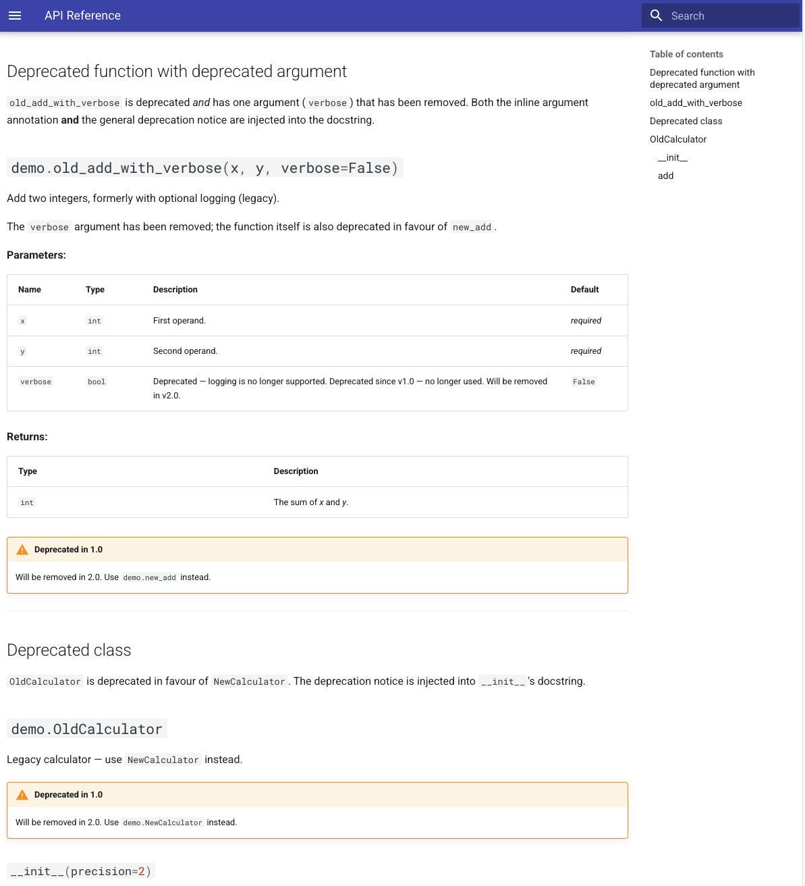
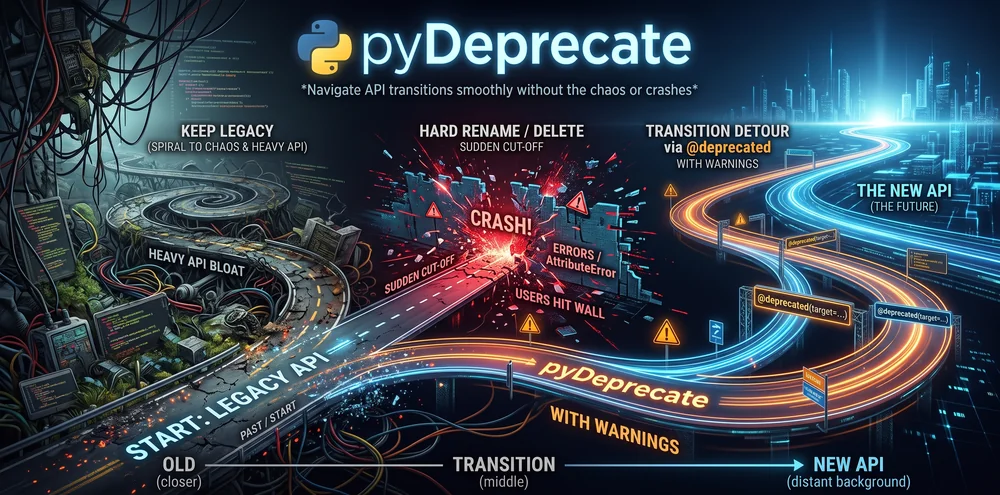

<picture>
  <source media="(prefers-color-scheme: dark)" srcset="docs/assets/brand/banner-dark.svg">
  
</picture>

# pyDeprecate

**Deprecate Python APIs without breaking existing callers.**

Use pyDeprecate when you rename a function, move a class, or retire an argument while existing user code must keep working. A single decorator warns callers, forwards calls, and remaps arguments during the migration window. CI audit tools expose deprecations that have reached their removal deadline.

**Author:** [Jiri Borovec](https://github.com/Borda) · **License:** Apache 2.0 · **Python:** 3.9+ · **Import:** `from deprecate import deprecated, deprecated_class`.

The [documentation site](https://borda.github.io/pyDeprecate/stable/) owns the full guides and API reference. This README covers installation, a quick start, the everyday patterns, audits and testing; each section links to the guide with the details.

[](https://pypi.org/project/pyDeprecate/) [](https://github.com/Borda/pyDeprecate/blob/main/LICENSE) [](https://app.fossa.com/projects/git%2Bgithub.com%2FBorda%2FpyDeprecate?ref=badge_shield&issueType=license)

[](https://badge.fury.io/py/pyDeprecate) [](https://pepy.tech/project/pyDeprecate) [](https://anaconda.org/conda-forge/pyDeprecate)  [](https://www.codefactor.io/repository/github/borda/pydeprecate) [](https://borda.github.io/pyDeprecate/)

[](https://github.com/Borda/pyDeprecate/actions/workflows/ci_testing.yml) [](https://github.com/Borda/pyDeprecate/actions/workflows/ci_install-pkg.yml) [](https://codecov.io/gh/Borda/pyDeprecate) [](https://results.pre-commit.ci/latest/github/Borda/pyDeprecate/main)

## 📖 Overview

Keep the old entry point temporarily, tell users what changed, and forward calls to its replacement. Remove the deprecated entry point after callers have migrated.


The usual migration has four steps:

1. Publish the replacement API.
2. Deprecate the old entry point with introduction and removal versions.
3. Audit deprecated wrappers in tests, pre-commit, or CI.
4. Remove the old entry point when its migration window closes.

Read the [getting-started guide](https://borda.github.io/pyDeprecate/stable/getting-started.html) for the full walkthrough.

Read [Mastering API Deprecation in Python](https://medium.com/codex/mastering-api-deprecation-in-python-the-pain-points-and-how-pydeprecate-can-help-1dbfd90e2b62) for the motivation and migration pain points.

## ✨ Features

### 🔁 Runtime compatibility

- Forward function and method calls while preserving signatures, annotations, and metadata.
- Rename, drop, or inject arguments during forwarding.
- Keep old class, Enum, dataclass, and object names available through proxies.
- Deprecate an entire module or selected attributes.

See the [use-case decision table](https://borda.github.io/pyDeprecate/stable/guide/use-cases.html#quick-decision-table) to choose a pattern.

### 🧩 Callable support

- Support functions, methods, constructors, generators, and async functions.
- Warn on generator iteration and coroutine awaiting.
- Deprecate property getters, setters, and deleters, plus `cached_property` getters.
- Keep the base library free of runtime dependencies.

See [async functions](https://borda.github.io/pyDeprecate/stable/guide/async.html) and [properties](https://borda.github.io/pyDeprecate/stable/guide/properties.html) for timing and accessor rules.

### 🎛 Migration controls

- Warn once per callable by default, with configurable warning budgets.
- Send notices through Python warnings, logging, or a custom callable.
- Configure message templates and conditional `skip_if` behavior.
- Raise `DeprecatedError` when a deprecation must become fatal.

See [customization](https://borda.github.io/pyDeprecate/stable/guide/customization.html) and [fatal deprecations](https://borda.github.io/pyDeprecate/stable/guide/functions.html#fatal-deprecations) for controls and limits.

### 🛠 Maintenance tools

- Update docstrings in RST/Sphinx or MkDocs/Markdown format.
- Validate wrapper configuration, removal deadlines, governance policies, and deprecation chains.
- Generate deprecation status tables for release planning.
- Test warning behavior with `assert_no_warnings`.

See the [audit guide](https://borda.github.io/pyDeprecate/stable/guide/audit.html) for Python and CI workflows.

## 💾 Installation

Requires **Python 3.9 or later**.

```bash
pip install pyDeprecate
```

Choose the installation for your workflow:

| Workflow                            | Command                                                             | Includes                                                                 |
| ----------------------------------- | ------------------------------------------------------------------- | ------------------------------------------------------------------------ |
| Runtime wrappers                    | `pip install pyDeprecate`                                           | Decorators, proxies, docstring helpers, and most audit metadata helpers. |
| Runtime wrappers with conda         | `conda install -c conda-forge pydeprecate`                          | The same runtime package from conda-forge.                               |
| Removal deadlines and policy checks | `pip install 'pyDeprecate[audit]'`                                  | PEP 440 version comparison through `packaging`.                          |
| Command-line audits                 | `pip install 'pyDeprecate[audit,cli]'`                              | Version-aware audit commands and the CLI.                                |
| Latest development version          | `pip install https://github.com/Borda/pyDeprecate/archive/main.zip` | Unreleased changes from the default branch.                              |

The CLI itself uses only the standard library. The `[cli]` extra is empty and retained for compatibility. See [installation details](https://borda.github.io/pyDeprecate/stable/getting-started.html#installation) for the full package and extras reference.

## 🚀 Quick Start

Forward an existing function to its replacement with `@deprecated(target=...)`:

```python
from deprecate import deprecated, void


# NEW API — the replacement computes the sum
def compute_sum(a: int, b: int) -> int:
    return a + b


# DEPRECATED API — `addition` now forwards to `compute_sum`; its own body never runs
@deprecated(target=compute_sum, deprecated_in="1.0", remove_in="2.0")
def addition(a: int, b: int) -> int:
    return void(a, b)


print(addition(1, 2))  # warns: FutureWarning
```

<details>
  <summary>Output: <code>addition(1, 2)</code></summary>

```
3
```

</details>

The result comes from `compute_sum`, because the deprecated body only returns `None`. Existing callers see this warning once, and new callers should call `compute_sum` directly:

```text
FutureWarning: The `addition` was deprecated since v1.0 in favor of `__main__.compute_sum`. It will be removed in v2.0.
```

> **Warning — forwarding skips the old body.** With a callable `target`, the deprecated function body does not run. If `skip_if` evaluates to `True`, the source body runs instead, so keep a working fallback when combining these options.

See [simple function forwarding](https://borda.github.io/pyDeprecate/stable/guide/functions.html#simple-function-forwarding) for argument handling and callable-target limits.

## 📊 Comparison with Other Tools

A hand-written `warnings.warn` shim covers the first row only. pyDeprecate covers the rest of the migration from the same decorator:

| Migration need                              | Hand-written `warnings.warn`               | pyDeprecate                          |
| ------------------------------------------- | ------------------------------------------ | ------------------------------------ |
| Warn old callers                            | Write the message and `stacklevel` by hand | Generated message with both versions |
| Forward calls to the replacement            | Write a shim per function                  | `target=new_function`                |
| Rename or drop arguments                    | Translate keyword arguments by hand        | `args_mapping`                       |
| Keep old class, constant, and module names  | Subclass or write a module `__getattr__`   | Transparent proxies                  |
| Warn once instead of on every call          | Track call state yourself                  | `num_warns` budget per wrapper       |
| Fail CI once the removal version is reached | Not available                              | `pydeprecate expiry`                 |

Use `warnings.deprecated` (PEP 702, Python 3.13+) or `typing_extensions.deprecated` when you only need a type-checker signal; stack it above `@deprecated` to get both. See the [Python deprecation tools comparison](https://borda.github.io/pyDeprecate/stable/guide/compare-python-deprecation-tools.html) for `deprecation`, `Deprecated` and other libraries.

## 📚 Use-cases and Applications

Each example below is a complete basic setup you can paste and run. The [use-case guide](https://borda.github.io/pyDeprecate/stable/guide/use-cases.html#quick-decision-table) helps you choose a pattern for other cases.

### 🔄 Rename an argument

Use `TargetMode.ARGS_REMAP` when the function stays in place but one of its arguments has a new name:

```python
from deprecate import TargetMode, deprecated


# NEW API — `factor` is the current argument name
# DEPRECATED API — callers passing `scale` are remapped to `factor`
@deprecated(target=TargetMode.ARGS_REMAP, args_mapping={"scale": "factor"}, deprecated_in="0.2", remove_in="0.4")
def resize_width(width: int, scale: float = 1.0, factor: float = 1.0) -> int:
    return int(width * factor)


print(resize_width(100, scale=2))  # warns: FutureWarning
```

<details>
  <summary>Output: <code>resize_width(100, scale=2)</code></summary>

```
200
```

</details>

```text
FutureWarning: The `resize_width` uses deprecated arguments: `scale` -> `factor`. They were deprecated since v0.2 and will be removed in v0.4.
```

### ⚠ Warn without changing behavior

Use `TargetMode.NOTIFY` when the function keeps its body and only needs a removal notice:

```python
from deprecate import TargetMode, deprecated


# DEPRECATED API — `order_total` still runs its own body until v0.5
@deprecated(target=TargetMode.NOTIFY, deprecated_in="0.1", remove_in="0.5")
def order_total(prices: list[float]) -> float:
    return sum(prices)


print(order_total([1.5, 2.5]))  # warns: FutureWarning
```

<details>
  <summary>Output: <code>order_total([1.5, 2.5])</code></summary>

```
4.0
```

</details>

```text
FutureWarning: The `order_total` was deprecated since v0.1. It will be removed in v0.5.
```

### 🏗 Rename a class

Use `deprecated_class` to keep an old class name working while construction goes to the new class:

```python
from deprecate import deprecated_class


# NEW API — the renamed writer
class ReportWriter:
    def __init__(self, path: str = "") -> None:
        self.path = path


# DEPRECATED API — `CsvReportWriter` forwards to `ReportWriter`
@deprecated_class(target=ReportWriter, deprecated_in="1.2", remove_in="2.0")
class CsvReportWriter:
    def __init__(self, path: str = "") -> None:
        self.path = path


writer = CsvReportWriter("out.csv")  # warns: FutureWarning
print(type(writer).__name__, writer.path)
```

<details>
  <summary>Output: <code>type(writer).__name__, writer.path</code></summary>

```
ReportWriter out.csv
```

</details>

```text
FutureWarning: The `CsvReportWriter` was deprecated since v1.2 in favor of `__main__.ReportWriter`. It will be removed in v2.0.
```

### 📦 Rename a constant

Use `deprecated_instance` to keep an old module-level name for a dict, list, constant, or object:

```python
from deprecate import deprecated_instance

# NEW API — renamed to say what it configures
TRAINING_CONFIG = {"lr": 0.001, "batch_size": 32}

# DEPRECATED API — `DEFAULTS` was the original name; read-only so callers cannot mutate shared state through it
DEFAULTS = deprecated_instance(TRAINING_CONFIG, name="DEFAULTS", deprecated_in="1.2", remove_in="2.0", read_only=True)

print(DEFAULTS["lr"])  # warns: FutureWarning
```

<details>
  <summary>Output: <code>DEFAULTS["lr"]</code></summary>

```
0.001
```

</details>

```text
FutureWarning: The `DEFAULTS` was deprecated since v1.2. It will be removed in v2.0.
```

### ➕ More patterns

- **Stacked decorators** — rename arguments across several releases ([guide](https://borda.github.io/pyDeprecate/stable/guide/functions.html#stacked-deprecation-decorators)).
- **Conditional skip** — control when a deprecation applies with `skip_if` ([guide](https://borda.github.io/pyDeprecate/stable/guide/functions.html#conditional-skip)).
- **Fatal deprecations** — refuse a call with `DeprecatedError`, or make one block strict with `with deprecate.as_exceptions():` ([guide](https://borda.github.io/pyDeprecate/stable/guide/functions.html#fatal-deprecations)).
- **Strict callable-only deprecation** — reject class sources with `deprecated_callable` ([guide](https://borda.github.io/pyDeprecate/stable/guide/functions.html#strict-callable-only-deprecation)).
- **Enums and dataclasses** — forward class access and construction ([guide](https://borda.github.io/pyDeprecate/stable/guide/classes.html#enums-and-dataclasses)).
- **Selective attributes** — rename attributes with `attrs_mapping` ([guide](https://borda.github.io/pyDeprecate/stable/guide/attributes.html#selective-attribute-deprecation)).
- **Entire modules** — deprecate or redirect a module ([guide](https://borda.github.io/pyDeprecate/stable/guide/modules.html)).
- **Async functions and properties** — forward coroutines and accessors ([async](https://borda.github.io/pyDeprecate/stable/guide/async.html#async-functions), [properties](https://borda.github.io/pyDeprecate/stable/guide/properties.html)).
- **New required arguments** — inject fixed forwarded kwargs ([guide](https://borda.github.io/pyDeprecate/stable/guide/advanced.html#injecting-new-required-arguments)).
- **The `void()` helper** — write deprecated stubs ([guide](https://borda.github.io/pyDeprecate/stable/guide/void-helper.html#basic-usage)).

For existing installations, read the [migration guide](https://borda.github.io/pyDeprecate/stable/guide/migration.html) before upgrading.

## 🗺 API at a Glance

Choose an entry point for the object you are deprecating:

| Entry point           | Purpose                                       | Reference                                                                                               |
| --------------------- | --------------------------------------------- | ------------------------------------------------------------------------------------------------------- |
| `deprecated`          | Deprecate functions, methods, and properties. | [Decorator API](https://borda.github.io/pyDeprecate/stable/api-reference.html#decorator)                |
| `deprecated_callable` | Deprecate callables and reject class sources. | [Decorator API](https://borda.github.io/pyDeprecate/stable/api-reference.html#decorator)                |
| `deprecated_class`    | Deprecate classes, Enums, and dataclasses.    | [Class guide](https://borda.github.io/pyDeprecate/stable/guide/classes.html)                            |
| `deprecated_instance` | Deprecate objects and constants.              | [Instance guide](https://borda.github.io/pyDeprecate/stable/guide/classes.html#constants-and-instances) |
| `deprecated_module`   | Deprecate a module in place or redirect it.   | [Module guide](https://borda.github.io/pyDeprecate/stable/guide/modules.html)                           |


Use `deprecated_in` and `remove_in` to define the migration window. A callable `target` identifies the replacement in the default warning message. See the [parameter matrix](https://borda.github.io/pyDeprecate/stable/getting-started.html#parameter-matrix-across-the-api) and the [complete API reference](https://borda.github.io/pyDeprecate/stable/api-reference.html) for every option.

### 🎯 Target modes

Choose the behavior explicitly when configuring a wrapper:

| Target                   | Behavior                                                      |
| ------------------------ | ------------------------------------------------------------- |
| A replacement callable   | Warn and forward calls to the replacement.                    |
| `TargetMode.NOTIFY`      | Warn and keep running the source body.                        |
| `TargetMode.ARGS_REMAP`  | Rename arguments within the same function.                    |
| `TargetMode.ATTRS_REMAP` | Warn on selected attribute aliases (`deprecated_class` only). |

The default `TargetMode.AUTO` infers the mode at decoration time. See [mode differences](https://borda.github.io/pyDeprecate/stable/guide/functions.html#behaviour-comparison) for warning triggers and mapping rules.

## 🔍 Audit

Audit wrappers before release to catch invalid configuration and wrappers that outlived their removal version.

### ⏰ Check from the command line

```bash
pip install 'pyDeprecate[audit,cli]'
pydeprecate check path/to/your/package                    # invalid wrapper configuration
pydeprecate expiry path/to/your/package --version 2.0.0   # wrappers past their remove_in version
pydeprecate status path/to/your/package                   # deprecation status table
```

`check` and `expiry` exit `1` on findings, while `status` only reports. See [CLI exit codes](https://borda.github.io/pyDeprecate/stable/guide/cli.html#exit-codes) before making one a required CI gate.

### 🪝 Run on every commit

Add the hook to `.pre-commit-config.yaml`:

```yaml
repos:
  - repo: https://github.com/Borda/pyDeprecate
    rev: v0.15.0
    hooks:
      - id: pydeprecate-check
```

The hook imports the scanned package, so its imports must resolve without your project's runtime dependencies. The `pydeprecate-expiry`, `pydeprecate-policy`, `pydeprecate-chains` and `pydeprecate-all` hooks run the other checks. See [pre-commit integration](https://borda.github.io/pyDeprecate/stable/guide/ci-integration.html#pre-commit-integration) for options.

### ⚙ Run in GitHub Actions

Add a step after checking out the repository and installing your package:

```yaml
- uses: Borda/pyDeprecate@v0.15.0
  with:
    subcommand: expiry
    path: src/mypackage
```

The step returns the CLI exit code. See the [GitHub Action recipe](https://borda.github.io/pyDeprecate/stable/guide/ci-integration.html#github-action) for every input.

The [audit guide](https://borda.github.io/pyDeprecate/stable/guide/audit.html) covers the Python API, deprecation tables, [policy checks](https://borda.github.io/pyDeprecate/stable/guide/audit-policy.html#enforcing-a-deprecation-policy) and [chain detection](https://borda.github.io/pyDeprecate/stable/guide/audit.html#detecting-deprecation-chains).

## 🧪 Testing

Pair `pytest.warns` with `assert_no_warnings` to check both that old callers warn and that new callers stay silent:

```python
import pytest

from deprecate import assert_no_warnings, deprecated, void


# NEW API — doubles the input value
def score_predictions(x: int) -> int:
    return x * 2


# DEPRECATED API — `score` replaced by `score_predictions`
@deprecated(target=score_predictions, deprecated_in="1.0", remove_in="2.0")
def score(x: int) -> int:
    return void(x)


def test_deprecated_function_shows_warning():
    with pytest.warns(FutureWarning, match="score.*deprecated"):
        assert score(42) == 84


def test_new_function_no_warning():
    with assert_no_warnings(FutureWarning):
        assert score_predictions(42) == 84


# README demo only: pytest collects the test_* functions itself, so leave these two calls out of a test module
test_deprecated_function_shows_warning()
test_new_function_no_warning()
```

A wrapper warns once by default (`num_warns=1`). A `pytest.warns` check must therefore be the first call of that deprecated function in the test process, or the wrapper needs `num_warns=-1`. See [testing deprecated code](https://borda.github.io/pyDeprecate/stable/guide/testing.html) for more patterns.

## 📝 Documentation tools

Enable automatic docstring updates to publish migration guidance alongside API documentation.

The library supports RST/Sphinx and MkDocs/Markdown notices, with automatic format detection. Bundled Griffe and Sphinx extensions integrate those notices with documentation builds.

See [automatic docstring updates](https://borda.github.io/pyDeprecate/stable/guide/advanced.html#automatic-docstring-updates) for configuration and extension setup.

### 📘 MkDocs preview



View the [MkDocs demo](https://borda.github.io/pyDeprecate/stable/demo-mkdocs/api.html) for rendered notices.

### 📗 Sphinx preview


View the [Sphinx demo](https://borda.github.io/pyDeprecate/stable/demo-sphinx/api.html) for rendered notices.

## 🔧 Troubleshooting

The [troubleshooting guide](https://borda.github.io/pyDeprecate/stable/troubleshooting.html) explains common errors and integration limits.

| Symptom                               | Guide                                                                                                                                        |
| ------------------------------------- | -------------------------------------------------------------------------------------------------------------------------------------------- |
| `UserWarning` when decorating a class | [Choose the class entry point](https://borda.github.io/pyDeprecate/stable/troubleshooting.html#userwarning-when-decorating-a-class).         |
| `TypeError: Failed mapping`           | [Check argument names](https://borda.github.io/pyDeprecate/stable/troubleshooting.html#typeerror-failed-mapping).                            |
| `skip_if` does not return `bool`      | [Fix the callback result](https://borda.github.io/pyDeprecate/stable/troubleshooting.html#typeerror-skip_if-function-must-return-bool).      |
| Warning not showing                   | [Check warning budgets and filters](https://borda.github.io/pyDeprecate/stable/troubleshooting.html#deprecation-notice-not-appearing).       |
| Unexpected target path across modules | [Check the target import](https://borda.github.io/pyDeprecate/stable/troubleshooting.html#deprecation-target-path-incorrect-across-modules). |

See [limitations](https://borda.github.io/pyDeprecate/stable/limitations.html) for supported boundaries before adopting a proxy or integration pattern.



## 🏷️ Show that you use pyDeprecate

Add this badge to show that your project provides an API migration path:

[](https://github.com/Borda/pyDeprecate)

```markdown
[](https://github.com/Borda/pyDeprecate)
```

<!-- following section will be skipped from PyPI description -->

## 🤖 Coding-agent plugin

This repository includes a `pydeprecate` plugin for Codex and Claude Code, available from the repository's default branch (early, pre-1.0). It is a separate artifact from the `pyDeprecate` library and is not installed by `pip`.

Install it from GitHub:

```bash
# Codex
codex plugin marketplace add Borda/pyDeprecate
codex plugin add pydeprecate@pydeprecate

# Claude Code
claude plugin marketplace add Borda/pyDeprecate
claude plugin install pydeprecate@pydeprecate
```

For local development or unpublished changes, run these commands from the repository root with `.` instead of `Borda/pyDeprecate` in the marketplace-add command. The plugin-install command stays the same.

Use `$pydeprecate:sunset` / `$pydeprecate:prune` in Codex, or `/pydeprecate:sunset` / `/pydeprecate:prune` in Claude Code, to implement or retire a deprecation — see the [coding-agent recipes](https://borda.github.io/pyDeprecate/stable/guide/agent-recipes.html) for invocation examples, host commands, and workflow boundaries.

<!-- end skipping PyPI description -->

## 🤝 Contributing

Contributions, bug reports, and migration stories are welcome.

Read the [Contributing Guide](.github/CONTRIBUTING.md) for development and testing instructions.

Follow the [Code of Conduct](.github/CODE_OF_CONDUCT.md) when participating in the community.
