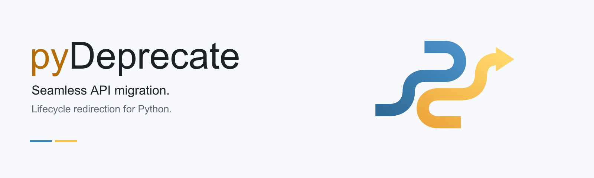
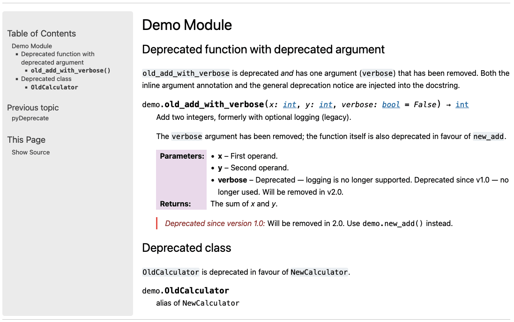

<picture>
  <source media="(prefers-color-scheme: dark)" srcset="docs/assets/brand/banner-dark.svg">
  
</picture>

# pyDeprecate

**Deprecate Python APIs without breaking existing callers.**

Use pyDeprecate when you rename a function, move a class, or retire an argument while existing user code must keep working. A single decorator warns callers, forwards calls, and remaps arguments during the migration window. CI audit tools expose deprecations that have reached their removal deadline.

**Core capabilities:**

- **Warn and forward** deprecated functions or methods to replacements.
- **Rename or drop arguments** while preserving compatibility for old call sites.
- **Wrap classes, Enums, dataclasses, constants, and objects** with transparent deprecation proxies.
- **Audit deprecations in CI** so expired wrappers and deprecation chains do not quietly linger.

**Author:** [Jiri Borovec](https://github.com/Borda) · **License:** Apache 2.0 · **Python:** 3.9+ · **Import:** `from deprecate import deprecated, deprecated_class`.

The [documentation site](https://borda.github.io/pyDeprecate/stable/) owns the full guides and API reference. This README covers installation, a quick start, and links to each topic.

[](https://pypi.org/project/pyDeprecate/) [](https://github.com/Borda/pyDeprecate/blob/main/LICENSE) [](https://app.fossa.com/projects/git%2Bgithub.com%2FBorda%2FpyDeprecate?ref=badge_shield&issueType=license)

[](https://badge.fury.io/py/pyDeprecate) [](https://pepy.tech/project/pyDeprecate) [](https://anaconda.org/conda-forge/pyDeprecate)  [](https://www.codefactor.io/repository/github/borda/pydeprecate) [](https://borda.github.io/pyDeprecate/)

[](https://github.com/Borda/pyDeprecate/actions/workflows/ci_testing.yml) [](https://github.com/Borda/pyDeprecate/actions/workflows/ci_install-pkg.yml) [](https://codecov.io/gh/Borda/pyDeprecate) [](https://results.pre-commit.ci/latest/github/Borda/pyDeprecate/main)

## Contents

- [Overview](#overview).
- [Features](#features).
- [Installation](#installation).

<!-- following section will be skipped from PyPI description -->

- [🤖 Coding-agent plugin](#coding-agent-plugin)

<!-- end skipping PyPI description -->

- [Quick Start](#quick-start).
- [API at a Glance](#api-at-a-glance).
- [Comparison with Other Tools](#comparison-with-other-tools).
- [Use-cases and Applications](#use-cases-and-applications).
- [Audit](#audit).
- [Documentation tools](#documentation-tools).
- [Troubleshooting](#troubleshooting).
- [Show that you use pyDeprecate](#show-that-you-use-pydeprecate).
- [Contributing](#contributing).

## Overview

Keep the old entry point temporarily, tell users what changed, and forward calls to its replacement. Remove the deprecated entry point after callers have migrated.



The usual migration has four steps:

1. Publish the replacement API.
2. Deprecate the old entry point with introduction and removal versions.
3. Audit deprecated wrappers in tests, pre-commit, or CI.
4. Remove the old entry point when its migration window closes.

Read the [getting-started guide](https://borda.github.io/pyDeprecate/stable/getting-started.html) for the full walkthrough.

Read [Mastering API Deprecation in Python](https://medium.com/codex/mastering-api-deprecation-in-python-the-pain-points-and-how-pydeprecate-can-help-1dbfd90e2b62) for the motivation and migration pain points.

## Features

### Runtime compatibility

- Forward function and method calls while preserving signatures, annotations, and metadata.
- Rename, drop, or inject arguments during forwarding.
- Keep old class, Enum, dataclass, and object names available through proxies.
- Deprecate an entire module or selected attributes.

See the [use-case decision table](https://borda.github.io/pyDeprecate/stable/guide/use-cases.html#quick-decision-table) to choose a pattern.

### Callable support

- Support functions, methods, constructors, generators, and async functions.
- Warn on generator iteration and coroutine awaiting.
- Deprecate property getters, setters, and deleters, plus `cached_property` getters.
- Keep the base library free of runtime dependencies.

See [async functions](https://borda.github.io/pyDeprecate/stable/guide/async.html) and [properties](https://borda.github.io/pyDeprecate/stable/guide/properties.html) for timing and accessor rules.

### Migration controls

- Warn once per callable by default, with configurable warning budgets.
- Send notices through Python warnings, logging, or a custom callable.
- Configure message templates and conditional `skip_if` behavior.
- Raise `DeprecatedError` when a deprecation must become fatal.

See [customization](https://borda.github.io/pyDeprecate/stable/guide/customization.html) and [fatal deprecations](https://borda.github.io/pyDeprecate/stable/guide/functions.html#fatal-deprecations) for controls and limits.

### Maintenance tools

- Update docstrings in RST/Sphinx or MkDocs/Markdown format.
- Validate wrapper configuration, removal deadlines, governance policies, and deprecation chains.
- Generate deprecation status tables for release planning.
- Test warning behavior with `assert_no_warnings`.

See the [audit guide](https://borda.github.io/pyDeprecate/stable/guide/audit.html) for Python and CI workflows.

## Installation

Requires **Python 3.9 or later**.

Choose the installation for your workflow:

| Workflow                            | Command                                | Includes                                                                 |
| ----------------------------------- | -------------------------------------- | ------------------------------------------------------------------------ |
| Runtime wrappers                    | `pip install pyDeprecate`              | Decorators, proxies, docstring helpers, and most audit metadata helpers. |
| Removal deadlines and policy checks | `pip install 'pyDeprecate[audit]'`     | PEP 440 version comparison through `packaging`.                          |
| Command-line audits                 | `pip install 'pyDeprecate[audit,cli]'` | Version-aware audit commands and the CLI.                                |

The CLI itself uses only the standard library. The `[cli]` extra is empty and retained for compatibility.

### Install from PyPI

```bash
pip install pyDeprecate
```

### Install audit support

```bash
pip install 'pyDeprecate[audit]'
pip install 'pyDeprecate[audit,cli]'
```

### Install from source

```bash
pip install https://github.com/Borda/pyDeprecate/archive/main.zip
```

See [installation details](https://borda.github.io/pyDeprecate/stable/getting-started.html#installation) for the full package and extras reference.

<!-- following section will be skipped from PyPI description -->

## 🤖 Coding-agent plugin

This repository includes a `pydeprecate` plugin for Codex and Claude Code, available from the repository's default branch (early, pre-1.0). It is a separate artifact from the `pyDeprecate` library and is not installed by `pip`.

Install it from GitHub:

```bash
# Codex
codex plugin marketplace add Borda/pyDeprecate
codex plugin add pydeprecate@pydeprecate

# Claude Code
claude plugin marketplace add Borda/pyDeprecate
claude plugin install pydeprecate@pydeprecate
```

For local development or unpublished changes, run these commands from the repository root with `.` instead of `Borda/pyDeprecate` in the marketplace-add command. The plugin-install command stays the same.

Use `$pydeprecate:sunset` / `$pydeprecate:prune` in Codex, or `/pydeprecate:sunset` / `/pydeprecate:prune` in Claude Code, to implement or retire a deprecation — see the [coding-agent recipes](https://borda.github.io/pyDeprecate/stable/guide/agent-recipes.html) for invocation examples, host commands, and workflow boundaries.

<!-- end skipping PyPI description -->

## Quick Start

Forward an existing function to its replacement with `deprecated(target=...)`.

This runnable example imports existing callables from the repository's test collections. In your package, import your existing callable and its replacement instead.

```python
from deprecate import deprecated

# NEW API — the replacement computes the sum
from tests.collections.api_current.core import base_sum_kwargs as compute_sum

# DEPRECATED API — `addition` now forwards to `compute_sum`
from tests.collections.api_deprecated.core import original_sum as addition

addition = deprecated(
    target=compute_sum,
    deprecated_in="1.0",
    remove_in="2.0",
)(addition)

print(addition(1, 2))  # warns: FutureWarning
```

<details>
  <summary>Output: <code>addition(1, 2)</code></summary>

```
3
```

</details>

Existing callers receive the replacement's result and a migration warning. New callers should call `compute_sum` directly.

The decorator form, `@deprecated(target=compute_sum, deprecated_in="1.0", remove_in="2.0")`, provides the same forwarding behavior on a function definition.

> [!WARNING]
>
> **Forwarding skips the old body.** With a callable `target`, the deprecated function body does not run. If `skip_if` evaluates to `True`, the source body runs instead, so keep a working fallback when combining these options.

See [simple function forwarding](https://borda.github.io/pyDeprecate/stable/guide/functions.html#simple-function-forwarding) for decorator syntax, argument handling, and callable-target limits.

## API at a Glance

Choose an entry point for the object you are deprecating:

| Entry point           | Purpose                                               | Reference                                                                                               |
| --------------------- | ----------------------------------------------------- | ------------------------------------------------------------------------------------------------------- |
| `deprecated`          | Deprecate functions, methods, properties, or classes. | [Decorator API](https://borda.github.io/pyDeprecate/stable/api-reference.html#decorator)                |
| `deprecated_callable` | Deprecate callables and reject class sources.         | [Decorator API](https://borda.github.io/pyDeprecate/stable/api-reference.html#decorator)                |
| `deprecated_class`    | Deprecate classes, Enums, and dataclasses.            | [Class guide](https://borda.github.io/pyDeprecate/stable/guide/classes.html)                            |
| `deprecated_instance` | Deprecate objects and constants.                      | [Instance guide](https://borda.github.io/pyDeprecate/stable/guide/classes.html#constants-and-instances) |
| `deprecated_module`   | Deprecate a module in place or redirect it.           | [Module guide](https://borda.github.io/pyDeprecate/stable/guide/modules.html)                           |



Use `deprecated_in` and `remove_in` to define the migration window. A callable `target` identifies the replacement in the default warning message.

See the [parameter matrix](https://borda.github.io/pyDeprecate/stable/getting-started.html#parameter-matrix-across-the-api) for defaults and differences between entry points.

See the [complete API reference](https://borda.github.io/pyDeprecate/stable/api-reference.html) for signatures and supported options.

### Target modes

Choose the behavior explicitly when configuring a wrapper:

| Target                  | Behavior                                   |
| ----------------------- | ------------------------------------------ |
| A replacement callable  | Warn and forward calls to the replacement. |
| `TargetMode.NOTIFY`     | Warn and keep running the source body.     |
| `TargetMode.ARGS_REMAP` | Rename arguments within the same function. |

The default `TargetMode.AUTO` infers the mode at decoration time. See [mode differences](https://borda.github.io/pyDeprecate/stable/guide/functions.html#behaviour-comparison) for warning triggers and mapping rules.

## Comparison with Other Tools

Python's `warnings.warn` and PEP 702 deprecation tools cover warning emission and static signals. pyDeprecate adds compatibility forwarding, argument remapping, class and object proxies, and removal-deadline audits. See the [Python deprecation tools comparison](https://borda.github.io/pyDeprecate/stable/guide/compare-python-deprecation-tools.html) for the canonical comparison table and selection guidance.

## Use-cases and Applications

The guides own the detailed examples, caveats, and migration recipes.

### Function migrations

| Migration                            | Guide                                                                                                                                |
| ------------------------------------ | ------------------------------------------------------------------------------------------------------------------------------------ |
| Simple function forwarding           | [Forward existing calls](https://borda.github.io/pyDeprecate/stable/guide/functions.html#simple-function-forwarding).                |
| Advanced target argument mapping     | [Rename and map arguments](https://borda.github.io/pyDeprecate/stable/guide/functions.html#argument-renaming-and-mapping).           |
| Deprecation warning only             | [Keep the existing body](https://borda.github.io/pyDeprecate/stable/guide/functions.html#notice-only-deprecation).                   |
| Rename arguments within one function | [Use `TargetMode.ARGS_REMAP`](https://borda.github.io/pyDeprecate/stable/guide/functions.html#rename-arguments-within-one-function). |
| Stacked deprecation decorators       | [Handle multiple migration stages](https://borda.github.io/pyDeprecate/stable/guide/functions.html#stacked-deprecation-decorators).  |
| Conditional skip                     | [Control when deprecation applies](https://borda.github.io/pyDeprecate/stable/guide/functions.html#conditional-skip).                |
| Fatal deprecations                   | [Turn warnings into errors](https://borda.github.io/pyDeprecate/stable/guide/functions.html#fatal-deprecations).                     |
| Strict callable-only deprecation     | [Use `deprecated_callable`](https://borda.github.io/pyDeprecate/stable/guide/functions.html#strict-callable-only-deprecation).       |

On the development line, `deprecate.as_exceptions()` makes deprecations fatal for one block and restores the previous setting afterward. See [fatal-deprecation scope limits](https://borda.github.io/pyDeprecate/dev/guide/functions.html#the-global-switch) before using it.

### Classes and objects

| Migration                 | Guide                                                                                                                                                    |
| ------------------------- | -------------------------------------------------------------------------------------------------------------------------------------------------------- |
| Class deprecation         | [Deprecate constructors or class aliases](https://borda.github.io/pyDeprecate/stable/guide/classes.html#class-deprecation).                              |
| Constants and instances   | [Wrap existing objects](https://borda.github.io/pyDeprecate/stable/guide/classes.html#constants-and-instances).                                          |
| Enums and dataclasses     | [Forward class access and construction](https://borda.github.io/pyDeprecate/stable/guide/classes.html#enums-and-dataclasses).                            |
| Typing deprecated proxies | [Annotate class aliases and instance proxies](https://borda.github.io/pyDeprecate/stable/guide/classes.html#type-annotations-and-static-analysis).       |
| Introspection             | [Preserve signatures and source breadcrumbs](https://borda.github.io/pyDeprecate/stable/guide/classes.html#breadcrumbs-for-documentation-and-ide-tools). |
| Selective attributes      | [Rename attributes with `attrs_mapping`](https://borda.github.io/pyDeprecate/stable/guide/classes.html#selective-attribute-deprecation).                 |

### Other patterns

| Migration              | Guide                                                                                                                             |
| ---------------------- | --------------------------------------------------------------------------------------------------------------------------------- |
| Entire modules         | [Deprecate or redirect a module](https://borda.github.io/pyDeprecate/stable/guide/modules.html).                                  |
| Async functions        | [Forward coroutines and remap arguments](https://borda.github.io/pyDeprecate/stable/guide/async.html#async-functions).            |
| Generator functions    | [Preserve generator behavior](https://borda.github.io/pyDeprecate/stable/guide/advanced.html#deprecating-generator-functions).    |
| Properties             | [Deprecate accessors and cached getters](https://borda.github.io/pyDeprecate/stable/guide/properties.html).                       |
| New required arguments | [Inject fixed forwarded kwargs](https://borda.github.io/pyDeprecate/stable/guide/advanced.html#injecting-new-required-arguments). |
| The `void()` helper    | [Write deprecated stubs](https://borda.github.io/pyDeprecate/stable/guide/void-helper.html#basic-usage).                          |

For existing installations, read the [migration guide](https://borda.github.io/pyDeprecate/stable/guide/migration.html) before upgrading.

## Audit

Audit wrappers before release to catch invalid configuration and expired migration windows.

| Check                                        | Guide                                                                                                                                     |
| -------------------------------------------- | ----------------------------------------------------------------------------------------------------------------------------------------- |
| Validate wrapper configuration               | [Validate one wrapper](https://borda.github.io/pyDeprecate/stable/guide/audit.html#validating-a-single-function).                         |
| Discover deprecated wrappers                 | [Scan a package](https://borda.github.io/pyDeprecate/stable/guide/audit.html#scanning-a-package-for-deprecated-wrappers).                 |
| Generate deprecation tables                  | [Build status reports](https://borda.github.io/pyDeprecate/stable/guide/audit.html#generating-deprecation-tables).                        |
| Enforce removal deadlines                    | [Find expired wrappers](https://borda.github.io/pyDeprecate/stable/guide/audit.html#enforcing-removal-deadlines).                         |
| Enforce a deprecation policy                 | [Check grace periods and migration guidance](https://borda.github.io/pyDeprecate/stable/guide/audit.html#enforcing-a-deprecation-policy). |
| Detect deprecation chains                    | [Find deprecated-to-deprecated forwarding](https://borda.github.io/pyDeprecate/stable/guide/audit.html#detecting-deprecation-chains).     |
| Detect positional-only incompatible mappings | [Validate mapping compatibility](https://borda.github.io/pyDeprecate/stable/guide/audit.html#detecting-mapping-incompatibilities).        |
| Test deprecated code                         | [Assert warning behavior](https://borda.github.io/pyDeprecate/stable/guide/audit.html#testing-deprecated-code).                           |

### Automation entry points

- **CLI:** Run `pydeprecate check path/to/your/package`; see the [CLI reference](https://borda.github.io/pyDeprecate/stable/guide/cli.html).
- **Pre-commit:** Use the `pydeprecate-check` hook; see [pre-commit integration](https://borda.github.io/pyDeprecate/stable/guide/audit.html#pre-commit-integration).
- **GitHub Action:** Use `Borda/pyDeprecate@v0.15.0`; see the [GitHub Action recipe](https://borda.github.io/pyDeprecate/stable/guide/audit.html#github-action).

See [CLI exit codes](https://borda.github.io/pyDeprecate/stable/guide/cli.html#exit-codes) before making an audit command a required CI gate.

## Documentation tools

Enable automatic docstring updates to publish migration guidance alongside API documentation.

The library supports RST/Sphinx and MkDocs/Markdown notices, with automatic format detection. Bundled Griffe and Sphinx extensions integrate those notices with documentation builds.

See [automatic docstring updates](https://borda.github.io/pyDeprecate/stable/guide/advanced.html#automatic-docstring-updates) for configuration and extension setup.

### MkDocs preview


View the [MkDocs demo](https://borda.github.io/pyDeprecate/stable/demo-mkdocs/api.html) for rendered notices.

### Sphinx preview



View the [Sphinx demo](https://borda.github.io/pyDeprecate/stable/demo-sphinx/api.html) for rendered notices.

## Troubleshooting

The [troubleshooting guide](https://borda.github.io/pyDeprecate/stable/troubleshooting.html) explains common errors and integration limits.

| Symptom                               | Guide                                                                                                                                        |
| ------------------------------------- | -------------------------------------------------------------------------------------------------------------------------------------------- |
| `UserWarning` when decorating a class | [Choose the class entry point](https://borda.github.io/pyDeprecate/stable/troubleshooting.html#userwarning-when-decorating-a-class).         |
| `TypeError: Failed mapping`           | [Check argument names](https://borda.github.io/pyDeprecate/stable/troubleshooting.html#typeerror-failed-mapping).                            |
| `skip_if` does not return `bool`      | [Fix the callback result](https://borda.github.io/pyDeprecate/stable/troubleshooting.html#typeerror-skip_if-function-must-return-bool).      |
| Warning not showing                   | [Check warning budgets and filters](https://borda.github.io/pyDeprecate/stable/troubleshooting.html#deprecation-notice-not-appearing).       |
| Unexpected target path across modules | [Check the target import](https://borda.github.io/pyDeprecate/stable/troubleshooting.html#deprecation-target-path-incorrect-across-modules). |

See [limitations](https://borda.github.io/pyDeprecate/stable/limitations.html) for supported boundaries before adopting a proxy or integration pattern.


## Show that you use pyDeprecate

Add this badge to show that your project provides an API migration path:

[](https://github.com/Borda/pyDeprecate)

```markdown
[](https://github.com/Borda/pyDeprecate)
```

## Contributing

Contributions, bug reports, and migration stories are welcome.

Read the [Contributing Guide](.github/CONTRIBUTING.md) for development and testing instructions.

Follow the [Code of Conduct](.github/CODE_OF_CONDUCT.md) when participating in the community.
