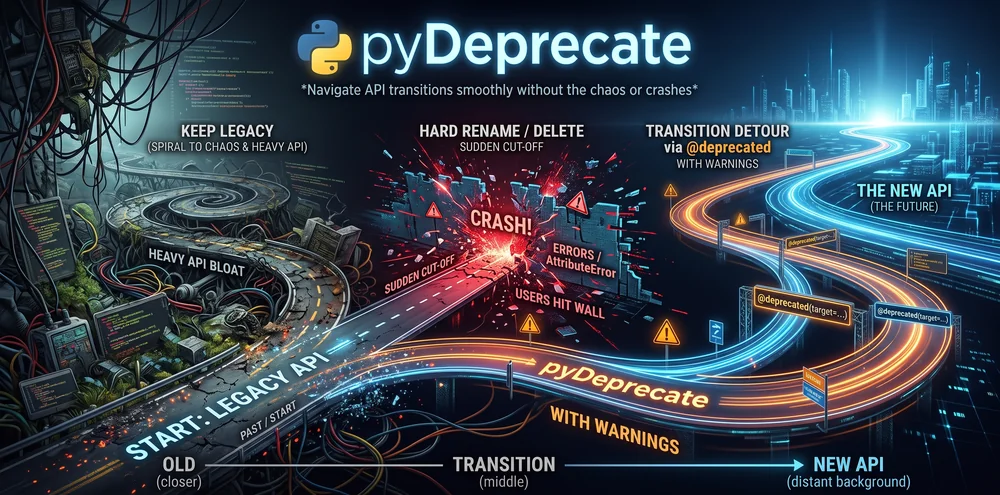

# Brand

The pyDeprecate mark is a blue route that turns into a gold arrow: the old API path redirecting to the new one.

## Logo

 

Use the light logo on light backgrounds and the dark logo on dark backgrounds: [`logo-light.svg`](assets/brand/logo-light.svg), [`logo-dark.svg`](assets/brand/logo-dark.svg).

## Mark


The icon-only mark works on both light and dark backgrounds: [`mark.svg`](assets/brand/mark.svg).

## Banner

 

[`banner-light.svg`](assets/brand/banner-light.svg) · [`banner-dark.svg`](assets/brand/banner-dark.svg)

## Icons and social card

| Asset            | File                                                                                                | Use                                   |
| ---------------- | --------------------------------------------------------------------------------------------------- | ------------------------------------- |
| Favicon          | [`favicon.svg`](assets/brand/favicon.svg)                                                           | Browser tab icon of this site         |
| Apple touch icon | [`apple-touch-icon.png`](assets/brand/apple-touch-icon.png)                                         | iOS home-screen icon                  |
| Avatar           | [`avatar.svg`](assets/brand/avatar.svg)                                                             | Profile picture                       |
| Social card      | [`social-preview.png`](assets/brand/social-preview.png) · [`.svg`](assets/brand/social-preview.svg) | Link previews (Open Graph, X/Twitter) |


## Colors

| Color         | Hex       | Use                               |
| ------------- | --------- | --------------------------------- |
| Route blue    | `#2E6893` | Mark, links, badge label          |
| Redirect gold | `#EAA238` | Mark arrow, accent, badge message |
| Ink           | `#1B2330` | Header, text on light backgrounds |
| Paper         | `#F7F9FC` | Light backgrounds                 |

## Illustration



## Badge

If your project uses pyDeprecate, let others know that it has a clear deprecation path:

[](https://github.com/Borda/pyDeprecate)

```markdown
[](https://github.com/Borda/pyDeprecate)
```
