# CI Integration

## pytest integration

Add a test that fails the suite when any deprecated wrapper has an invalid configuration. Wrong argument names are **hard errors**; identity mappings are worth a warning.

```python
import warnings

import pytest
from deprecate import find_deprecation_wrappers

# For testing purposes, we use the test module; normally you would import your own package
from tests.collections.api_deprecated import core as my_package


def test_deprecated_wrappers_are_valid():
    """Validate all deprecated wrappers have proper configuration."""
    results = find_deprecation_wrappers(my_package)

    # Collect hard configuration errors; identity mappings are worth a warning
    wrong_args = [r for r in results if r.invalid_args or r.misconfigured_target or r.inner_order_property]
    identity_mappings = [r for r in results if r.identity_args_mapping]

    # Raise errors for wrong arguments (critical issues)
    if wrong_args:
        for r in wrong_args:
            print(
                f"ERROR: {r.module}.{r.function}: invalid_args={r.invalid_args}, "
                f"misconfigured_target={r.misconfigured_target}, inner_order_property={r.inner_order_property}"
            )
        pytest.fail(f"Found {len(wrong_args)} deprecated wrappers with invalid configuration")

    # Warn for identity mappings (less severe)
    for r in identity_mappings:
        warnings.warn(f"{r.function} has identity mapping", UserWarning)
```

## Enforcing the policy in CI

Use your project's release convention rather than assuming the policy defaults fit.

1. Set the release numbers in [`[tool.pydeprecate.policy]`](policy.md#enforcing-a-deprecation-policy).
2. Install your project and `pyDeprecate[audit]` in CI.
3. Run the CLI as its own CI step (since v0.16):

The table is the **single source of truth**. The CLI step enforces it without test code to maintain.

```bash
# audit everything in one scan; reads [tool.pydeprecate.policy] and exits 1 on a violation too
pydeprecate all --gate=policy src/mypackage
```

!!! info "Policy gate defaults"

    Without `--gate=policy`, `pydeprecate all` prints policy violations as `[WARNING]` **without failing**. Set `gate = ["policy"]` in `[tool.pydeprecate]` to make policy enforcement the project default.

    Before v0.16, run `pydeprecate all` and a separate `pydeprecate policy src/mypackage` step.

    A one-off override needs no config edit. `pydeprecate policy src/mypackage --min-grace=0.3` overrides the table for that run only.

On GitHub Actions, use the ready-made [GitHub Action](#github-action) step for the same gate.

### Monorepo: several packages in one run

Pass every package to one command: `pydeprecate all --gate=policy packages/core/src/core packages/cli/src/cli` (since v0.16).

- Each package uses its own `[tool.pydeprecate]` settings.
- Each package uses the version from its nearest `pyproject.toml` that has a `[project]` table. When that version cannot be resolved, detection falls back to installed metadata or `__version__`, or records a `version not resolved` gap.
- Findings appear in one set of sections.
- Each package has a table under a `### <package>` heading.
- One exit code covers all packages.

**Paths are checked before imports.** A typo or broken `pyproject.toml` in any package fails the run with exit `2` *before* scanning. A missing submodule of an importable package, such as `pkg.nosuch`, is found only when its path is reached.

**Process and import isolation.** Packages sharing the same top-level import name need **separate runs**. Multiple paths remaining after deduplication use separate Python workers for import-mode scans. A shared import may initialize once in each worker.

One retained path runs in the calling process. `--static` reads source without importing packages or starting workers. See [Several paths in one run](cli.md#several-paths-in-one-run).

## Pre-commit Integration

A [pre-commit](https://pre-commit.com/) hook gives local feedback before you push, without running tests or waiting for CI.

!!! note "Choose an import environment"

    The scan imports your package to read wrappers. Your package and its runtime dependencies must be *importable* in the hook's environment. This determines which recipe fits.

### Local hook

Use a local hook in your development environment when your package has runtime dependencies.

Install `pip install 'pyDeprecate[audit]'` in the same environment as your tests. The hook uses that environment's `pydeprecate` CLI, so every submodule imports as it does at runtime:

```yaml
# .pre-commit-config.yaml
repos:
  - repo: local
    hooks:
      - id: pydeprecate
        name: pydeprecate
        entry: pydeprecate check # add the package path if it is not under src/
        language: system # spelled `unsupported` since pre-commit 4.4; `system` still works
        pass_filenames: false # the CLI scans packages, not individual files
        types: [python] # runs only when a Python file is staged
        require_serial: true

ci:
  skip: [pydeprecate] # pre-commit.ci has no project environment to import from
```

### Import-mode remote hook

For packages without third-party import dependencies, use the repository's hook manifest (since `v0.15.0`):

```yaml
# .pre-commit-config.yaml
repos:
  - repo: https://github.com/Borda/pyDeprecate
    rev: v0.15.0 # the first tag shipping the hook
    hooks:
      - id: pydeprecate-check # finds the package under src/; add `args: [mypkg]` for any other location
```

pre-commit installs the hook into an *isolated environment*. It contains pyDeprecate and CLI dependencies, but none of your package's runtime dependencies.

!!! note "Replacing hook dependencies"

    `additional_dependencies` *replaces* the hook's own dependency list. Start with `"pyDeprecate[audit]"`, then append your package's runtime dependencies. pip resolves that entry to the hook's own checkout, including its `audit` extra.

    Omitting that entry leaves `pydeprecate` without `packaging`, which `expiry` and any `policy` version comparison need. Python 3.9–3.10 also cannot read `[tool.pydeprecate]` from `pyproject.toml`.

```yaml
# .pre-commit-config.yaml
repos:
  - repo: https://github.com/Borda/pyDeprecate
    rev: v0.15.0
    hooks:
      - id: pydeprecate-check
        additional_dependencies: ["pyDeprecate[audit]", numpy, requests] # the hook's own entry first, then your package's runtime dependencies
```

!!! warning "A missing dependency can pass silently"

    A failed submodule import emits `UserWarning: audit: skipped <module>`. The scan skips that module and continues. See [Troubleshooting](../troubleshooting.md).

    pre-commit hides output from passing hooks. A missing dependency can therefore leave modules unaudited <u>without a visible failure</u>.

    Prefer the local hook when your package has runtime dependencies. Pin `rev` to the pyDeprecate release your project depends on.

### Import-free remote hooks

`pydeprecate-expiry-static` and `pydeprecate-policy-static` read source with `ast` without importing your package. They need none of its runtime dependencies.

```yaml
# .pre-commit-config.yaml
repos:
  - repo: https://github.com/Borda/pyDeprecate
    rev: v0.16.0 # the first tag shipping the static hooks
    hooks:
      - id: pydeprecate-expiry-static
      - id: pydeprecate-policy-static
```

The static hooks check removal deadlines and policy rules for recognized wrappers with resolvable relevant settings.

**Static coverage is incomplete.** Recognized unresolved forms emit a `not statically resolvable` gap. The hooks pass no flags, so a gap fails the hook only when the project sets `strict = true` in `[tool.pydeprecate]`. A removal deadline that cannot be checked because no usable package version was found is reported as a `version not resolved` gap, not per wrapper. Some forms remain invisible without a gap.

Read output with `pre-commit run --verbose` when first enabling a hook. Use an import-mode audit for fuller coverage. See [Static mode](cli.md#static-mode).

Configuration checks and chains require imported wrappers. Keep `pydeprecate check` in a local hook or CI.

!!! danger "Hook trust boundary"

    Both local hooks and import-mode remote hooks import your package. Import-time code runs with your user's permissions.

    Run untrusted checkouts, including fork pull requests in CI, **without secrets** or privileged credentials. An isolated dependency environment does not make that code trustworthy.

Run a configured hook on demand using its ID:

| Recipe                | Hook ID                     |
| --------------------- | --------------------------- |
| Local.                | `pydeprecate`               |
| Import-mode remote.   | `pydeprecate-check`         |
| Static remote expiry. | `pydeprecate-expiry-static` |
| Static remote policy. | `pydeprecate-policy-static` |

The following commands use the local ID:

```bash
# Get a clear signal before pushing (runs when a Python file is staged):
pre-commit run pydeprecate

# Or check regardless of what is staged:
pre-commit run pydeprecate --all-files
```

### Hook scope and configuration

The hook ignores staged filenames and scans the **whole package** each time. Import-mode discovery resolves wrappers through importable modules, never individual files.

| Repository layout                                         | Default discovery without a path in `args`                                                                    |
| --------------------------------------------------------- | ------------------------------------------------------------------------------------------------------------- |
| One package under `src/`.                                 | Audit that package. No `args` is needed.                                                                      |
| Otherwise, one package at the repository root.            | Audit that package. No `args` is needed.                                                                      |
| Two or more root packages, such as `mypkg/` and `tests/`. | Fail with a non-zero exit and `contains multiple packages (mypkg, tests)`, rather than passing an empty scan. |

Name the package explicitly for multiple-package roots, such as `args: [mypkg]`.

Each hook already includes its subcommand in `entry`:

| Hook ID                                         | Command                                                                                                                          |
| ----------------------------------------------- | -------------------------------------------------------------------------------------------------------------------------------- |
| `pydeprecate-check`, or its alias `pydeprecate` | Run `check`.                                                                                                                     |
| `pydeprecate-policy`                            | Run `policy`.                                                                                                                    |
| `pydeprecate-expiry`                            | Run `expiry`.                                                                                                                    |
| `pydeprecate-chains`                            | Run `chains`.                                                                                                                    |
| `pydeprecate-all`                               | Run `all`.                                                                                                                       |
| `pydeprecate-expiry-static`                     | Run import-free `expiry`: the same scan as `args: [--static]` on `pydeprecate-expiry`, but also verbose and run on TOML changes. |
| `pydeprecate-policy-static`                     | Run import-free `policy`: the same scan as `args: [--static]` on `pydeprecate-policy`, but also verbose and run on TOML changes. |

See [Static mode](cli.md#static-mode) for import-free scanning.

- Pass flags and the package path through `args`, in any order.
- Use `args: [--exit-zero]` to report without blocking while clearing a backlog.
- Use one `pydeprecate-all` hook with `args: [--gate=policy]` to gate on policy too (since v0.16).
- This replaces a second `pydeprecate-policy` hook with one scan and one import of your package.
- List several packages in `args` to audit them in one run (since v0.16).

!!! note "Changes to project configuration"

    Static hooks run for Python and `pyproject.toml` changes. Every subcommand reads `[tool.pydeprecate]`. `expiry` and `all` also read the project version from `pyproject.toml`.

    For import-mode hooks to run on `pyproject.toml`-only changes, override both filters:

    ```yaml
    types: [file]
    files: '(\.py|(^|/)pyproject\.toml)$'
    ```

    Otherwise, the manifest's `types: [python]` remains active. pre-commit requires a file to match every filter. A `pyproject.toml`-only commit would skip the hook.

### CLI commands and exit codes

The CLI provides six subcommands. These choices cover common integration needs:

| Command  | Use                                                              |
| -------- | ---------------------------------------------------------------- |
| `check`  | Validate wrapper configuration.                                  |
| `policy` | Enforce your project's deprecation governance rules.             |
| `all`    | Run every check in one pass and append a deprecation table.      |
| `status` | Generate a standalone Markdown deprecation table without checks. |

See the [CLI Reference](cli.md) for every flag and exit code.

```bash
# Install CLI + audit extras (audit needed for expiry checks)
pip install 'pyDeprecate[audit]'

# check — exits 1 on invalid arg mappings, misconfigured targets or inner-order properties
pydeprecate check src/your_package

# all — exits 1 on any check error, chains, or expired wrappers; appends deprecation table
# policy violations are printed here but change this exit code only with --gate=policy (since v0.16)
pydeprecate all src/your_package
pydeprecate all --gate=policy src/your_package

# several packages in one run, one exit code (since v0.16)
pydeprecate all src/pkg_a src/pkg_b

# policy — exits 1 if any deprecation breaks a governance rule
pydeprecate policy src/your_package

# status — standalone deprecation status table only (no checks, not a pass/fail gate)
pydeprecate status src/your_package

# Advisory-only: findings exit 0 instead of 1; usage (2) and scan/internal (3) errors still fail
pydeprecate check src/your_package --exit-zero
```

**Exit codes** (see [CLI Reference — Exit codes](cli.md#exit-codes) for per-subcommand details):

| Exit code | Meaning                                                                                                                                                           |
| --------- | ----------------------------------------------------------------------------------------------------------------------------------------------------------------- |
| `0`       | No hard errors (or `--exit-zero` was set)                                                                                                                         |
| `1`       | Hard error found: invalid arg mappings, chains, expired wrappers, or policy violations under `policy` or `all --gate=policy`; with `--strict`, also any gap       |
| `2`       | A malformed setting: `--exclude`, `strict`, `gate`, or for `policy` a rule value, from a flag or from `[tool.pydeprecate]`; a typed `--strict` with `--exit-zero` |
| `3`       | The audit did not run: the scanned package cannot be imported, or an internal CLI error                                                                           |

`--exit-zero` turns exit `1` into `0` and *never* masks `2` or `3`.

## GitHub Action

pyDeprecate ships a composite GitHub Action that runs the CLI as one workflow step (since `v0.15.0`). It uses the job's own Python, like a local pre-commit hook.

The scan imports your package from the checkout, so the package itself needs **no installation**. Every module's runtime dependencies must still be *importable*.

1. Set up Python.
2. Install the runtime dependencies. Installing the project is the simplest approach.
3. Add the action step:

```yaml
# .github/workflows/deprecations.yml
name: Deprecations
on: [push, pull_request]

jobs:
  audit:
    runs-on: ubuntu-latest
    steps:
      - uses: actions/checkout@v6
      - uses: actions/setup-python@v7
        with:
          python-version: "3.11"
      - run: pip install -e . # pulls in the runtime dependencies the scanned modules import

      - name: Audit deprecations and enforce the policy
        uses: Borda/pyDeprecate@v0.16.0 # pin a release tag or a commit SHA
        with:
          path: src/mypackage
          args: --gate=policy # policy violations fail the step too, from the same scan
          summary: true # add a deprecation status table to the job summary
```

A monorepo lists one path per line (since v0.16). Each package uses its own settings, and one exit code covers the scan:

```yaml
- uses: Borda/pyDeprecate@v0.16.0
  with:
    path: |
      packages/core/src/core
      packages/cli/src/cli
    args: --gate=policy
```

With `v0.15.0`, which has no `--gate`, run the policy as a second step: `subcommand: policy` with `install: false`.

| Input         | Default | Meaning                                                                                                                                                                                                                                                                                                                                                                                                     |
| ------------- | ------- | ----------------------------------------------------------------------------------------------------------------------------------------------------------------------------------------------------------------------------------------------------------------------------------------------------------------------------------------------------------------------------------------------------------- |
| `subcommand`  | `all`   | One of `check`, `expiry`, `policy`, `chains`, `all`, `status`; any other value fails the step with exit code `2`.                                                                                                                                                                                                                                                                                           |
| `path`        | empty   | Package directory or importable module name, relative to the workspace; several, one per line, are scanned in one run (since v0.16; empty lines are dropped). Empty lets the CLI pick the single package under `src/`, else the single package at the repository root. A path starting with `-` fails the step with exit code `2`; write such a directory as `./-name` and pass CLI options through `args`. |
| `args`        | empty   | Extra CLI flags, split with shell-style quoting, e.g. `--exclude='mypackage.tests,*._legacy*' --version 2.0`. Backslashes are escape characters, so quote Windows paths or use `/`.                                                                                                                                                                                                                         |
| `fail-on-gap` | `false` | Fail the step when any part of the audit did not run (`--strict`, since v0.16), such as a module that could not be imported; not valid with `exit-zero` or `status`; `exit-zero: true` also switches off a `strict = true` from `pyproject.toml`, so an advisory step passes. With `install: false` and an older pyDeprecate the CLI rejects the option with exit code `2`.                                 |
| `exit-zero`   | `false` | Report findings without failing the step (`--exit-zero`); not valid with `status`.                                                                                                                                                                                                                                                                                                                          |
| `install`     | `true`  | Install `pyDeprecate[audit]` from the action's own ref into the job's Python.                                                                                                                                                                                                                                                                                                                               |
| `summary`     | `false` | Append the markdown deprecation status table of the gate's own scan to the job summary, read from the report the CLI writes with `--report-json`, so it covers exactly what the gate scanned however `path` and `args` name the package. Summary failures only warn and preserve the gate result. No summary on CLI exit `2` or `3`.                                                                        |
| `sarif`       | `false` | Also write the findings as a SARIF 2.1.0 file (`--report-sarif`, since v0.16) and publish its path as the `sarif-file` output; not valid with `status`.                                                                                                                                                                                                                                                     |

The step returns the CLI's exit code. Exit `3` also produces an error annotation identifying a scan or internal error.

**Action-specific failures.** These conditions behave as follows:

| Condition                                                                                                                         | Exit behavior           |
| --------------------------------------------------------------------------------------------------------------------------------- | ----------------------- |
| A `path` starts with `-`.                                                                                                         | Exit `2`.               |
| `pip install` fails with `install: true`.                                                                                         | Return pip's exit code. |
| The CLI process cannot start.                                                                                                     | Return `1`.             |
| `args` holds `--`, `-h`/`--help`, or a `--report-json` or `--report-sarif` option; use the `report-json` output to keep a report. | Exit `2`.               |
| A boolean input is not `true`, `false`, `1` or `0`.                                                                               | Exit `2`.               |
| `exit-zero`, `fail-on-gap` or `sarif` is combined with `status`, or `fail-on-gap` with `exit-zero`.                               | Exit `2`.               |

**Static and advisory runs.** The action has no static input. Pass `--static` through `args` with `subcommand: expiry` or `policy`. See [Static mode](cli.md#static-mode).

A failing run adds an error annotation to the pull request's checks. The CLI has no "fail on warning" mode. Advisory findings, such as identity mappings, *never* fail the step.

Set `exit-zero: true` to report hard errors without blocking while clearing a backlog. Set `fail-on-gap: true` to fail on incomplete audits. Every gap the run annotates then also fails it.

Findings become annotations on their wrapper's line; a finding with no source location gets an annotation without a file or line:

1. Annotate errors first, then warnings, within GitHub's limit of 10 annotations per level for one step. Gaps and the gate's own `exited 1` error use some of those slots first, and two warning slots stay free for the action's own later warnings, so a few fewer findings are shown.
2. Add one notice counting the remaining findings.

**Annotation limits and accepted findings.** The log and report retain every finding. Findings accepted through `--ignore` or `--baseline` are never annotated. Gaps keep one warning per kind.

The step publishes outputs for later steps; give it an `id` to read them:

| Output                                                 | Value                                                                                                                           |
| ------------------------------------------------------ | ------------------------------------------------------------------------------------------------------------------------------- |
| `exit-code`                                            | The step's exit code; always set.                                                                                               |
| `findings`, `errors`, `warnings`, `gaps`, `suppressed` | Counts from the run's report; empty when the CLI wrote no report (exit `2` or `3`, or an older CLI kept with `install: false`). |
| `report-json`                                          | Path of a copy of the run's `--report-json` file, kept in `RUNNER_TEMP` until the job ends.                                     |
| `sarif-file`                                           | Path of the SARIF file when `sarif: true`; empty otherwise.                                                                     |

[SARIF](cli.md#sarif-for-code-scanning) is GitHub code scanning's input format. Uploading it creates alerts on wrapper lines, beyond the failed job.

1. Set `sarif: true` on the audit action.
2. Upload its findings with `upload-sarif`, even when the gate fails.

!!! failure "Code scanning permissions"

    Uploads fail with a read-only `GITHUB_TOKEN`. Give the job `security-events: write` and retain `contents: read` for checkout. Private repositories also need `actions: read`.

```yaml
permissions:
  contents: read
  security-events: write
  actions: read  # required for private repositories
```

```yaml
- uses: Borda/pyDeprecate@v0.16.0
  id: pydeprecate
  with:
    subcommand: all
    sarif: true
- uses: github/codeql-action/upload-sarif@v4
  if: always() && steps.pydeprecate.outputs.sarif-file != ''
  with:
    sarif_file: ${{ steps.pydeprecate.outputs.sarif-file }}
```

**The action ref pins the installed version.** With `install: true` (the default), the action installs pyDeprecate from its own commit. Thus, `@v0.15.0` audits with 0.15.0.

This **replaces** the job's existing pyDeprecate version for every later step. The action warns when it replaces a version.

Pin the action to your project's pyDeprecate release. Alternatively, install `pyDeprecate[audit]` yourself and set `install: false`.

With `install: false` and a pyDeprecate older than v0.16, `sarif: true` does not fail the run: the action warns, skips SARIF and gates on the CLI result alone, so `sarif-file` stays empty and the upload step above is skipped. Without `--report-json` support (before v0.15) it also writes no gap annotations or job summary.

Also set `install: false` where pip is unavailable, such as a uv-managed virtual environment.

**A green run can still have gaps.** A failed submodule import is skipped with `UserWarning: audit: skipped <module>`. `expiry`, including inside `all`, skips removal deadlines when the package version cannot be detected. Both cases can still pass. Where warnings are errors (`PYTHONWARNINGS=error`), the skip warning is raised instead and the run exits `3`; see [Scan and internal errors](cli.md#scan-and-internal-errors).

The action reads gaps from the CLI's `--report-json` report, even when the package silences warnings. It creates one warning annotation per gap kind. Check annotations whenever package installation changes.

Pass `args: --version 2.0` when neither the installed package nor `pyproject.toml` provides a detectable version.

!!! danger "Import-time code runs with job permissions"

    The action imports your package and executes its import-time code, exactly like the CLI. <u>Never</u> use `pull_request_target` with a checkout of the pull request's head. Untrusted code would receive the base repository's secrets and write token.

    Workflow commands printed during the scan are ignored only while the CLI runs. Descendant-process output after the CLI exits is not fenced by `stop-commands`.

    This is not a sandbox. Imported code runs in the job environment and can write the files behind `GITHUB_ENV`, `GITHUB_PATH`, and `GITHUB_OUTPUT`.

## Weekly deprecations-due issue

A removal deadline should not surprise the release. A scheduled job can list every wrapper whose `remove_in` is at or before the next release and keep **one tracking issue** up to date, so the cleanup is planned before the release branch is cut.



1. Add a repository variable `NEXT_RELEASE` holding the next release version, such as `2.0`.
2. Install the package, so the scan can import it, together with `pyDeprecate[audit]`.
3. Add the workflow:

```yaml
# .github/workflows/deprecations-due.yml
name: Deprecations due
on:
  schedule:
    - cron: "0 7 * * 1" # Mondays, 07:00 UTC
  workflow_dispatch:

permissions:
  contents: read
  issues: write

jobs:
  due:
    runs-on: ubuntu-latest
    steps:
      - uses: actions/checkout@v6
      - uses: actions/setup-python@v7
        with:
          python-version: "3.11"
      - run: pip install -e . "pyDeprecate[audit]"

      - name: List wrappers due in the next release
        id: due
        env:
          NEXT_RELEASE: ${{ vars.NEXT_RELEASE }}
        run: |
          status=0
          pydeprecate expiry src/mypackage --version "$NEXT_RELEASE" > due.txt || status=$?
          if [ "$status" -gt 1 ]; then cat due.txt; exit "$status"; fi
          echo "due=$status" >> "$GITHUB_OUTPUT"

      - name: Open or update the tracking issue
        if: steps.due.outputs.due == '1'
        env:
          GH_TOKEN: ${{ github.token }}
          NEXT_RELEASE: ${{ vars.NEXT_RELEASE }}
        run: |
          title="Deprecations due in ${NEXT_RELEASE}"
          {
            echo "These deprecated wrappers reach their removal version in ${NEXT_RELEASE}:"
            echo
            grep '^[[:space:]]*- ' due.txt | sed 's/^[[:space:]]*//'
          } > body.md
          number=$(gh issue list --state open --search "\"$title\" in:title" --json number --jq '.[0].number // empty')
          if [ -n "$number" ]; then
            gh issue edit "$number" --body-file body.md
          else
            gh issue create --title "$title" --body-file body.md
          fi
```

`pydeprecate expiry` exits `1` when a wrapper is due and `0` when none is, so the first step sets `due` and the second step runs only when there is something to report. Exit `2` or `3` is a usage or scan error, and the job fails instead of hiding it. The title carries the version, so raising `NEXT_RELEASE` after a release opens a **fresh issue** for the next one. Close the old issue when the release ships.

The scan imports your package, so keep this job on the schedule trigger, which runs the default branch, and never point it at a pull request from a fork. See the import-time warning in [GitHub Action](#github-action).

## See also

- [Python audit API](index.md)
- [Deprecation policy](policy.md)
- [Testing deprecated code](../integrations/testing.md)
- [Classes](../usage/classes.md)
- [Selective attribute deprecation](../usage/attributes.md)
- [Use Cases](../usage/index.md) — Deprecation patterns and scenarios.
- [Getting Started](../getting-started.md) — The decorator parameters.
- [Troubleshooting](../troubleshooting.md) — Common configuration errors and fixes.
