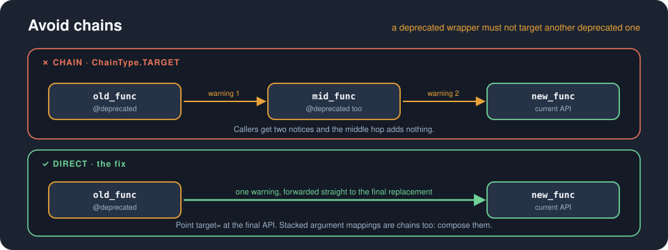

# Audit Tools

See [policy enforcement](policy.md), [CI integration](ci-integration.md), and [testing deprecated code](../integrations/testing.md) for the companion guides.

Audit tools catch four common problems before they reach users:

| Problem                 | Detection API                   | Example                                                                         |
| ----------------------- | ------------------------------- | ------------------------------------------------------------------------------- |
| Zombie code.            | `validate_deprecation_expiry()` | A `remove_in` deadline passes without code removal.                             |
| Chained deprecations.   | `validate_deprecation_chains()` | A wrapper targets another deprecated function and emits two notices.            |
| Misconfigured wrappers. | `find_deprecation_wrappers()`   | An `args_mapping` key has a typo and silently does nothing.                     |
| Policy violations.      | `validate_deprecation_policy()` | Removal follows announcement by one patch, or the warning names no replacement. |

??? info "Version changes: v0.6, v0.8, v0.13"

    **Renamed in v0.6.** `find_deprecated_callables` is now `find_deprecation_wrappers`, `validate_deprecated_callable` is now `validate_deprecation_wrapper`, and `DeprecatedCallableInfo` is now `DeprecationWrapperInfo`. The old names remain exported for backwards compatibility but will be removed in v1.0.

    **Breaking change in v0.8: `__deprecated__.target` type changed.** In v0.8, `DeprecationConfig.target` now always stores a `TargetMode` enum member or a `Callable` — never a raw boolean sentinel. Code inspecting this attribute must be updated:

    The direct metadata reads below apply only through v0.12; v0.13 code must use `get_deprecation_config(func)` as shown in the next section.

    | Before v0.8                           | v0.8-v0.12                                            |
    | ------------------------------------- | ----------------------------------------------------- |
    | `func.__deprecated__.target is None`  | `func.__deprecated__.target is TargetMode.NOTIFY`     |
    | `func.__deprecated__.target is True`  | `func.__deprecated__.target is TargetMode.ARGS_REMAP` |
    | `func.__deprecated__.target is False` | `func.__deprecated__.misconfigured`                   |

    **Breaking change in v0.13: `__deprecated__` is now a plain message string.** Since v0.13, `__deprecated__` holds a PEP 702-conformant message string instead of the `DeprecationConfig` object. PEP-702-aware tooling, including IDE hover, `pyright`, and `mypy`, can read this string correctly.

    The config object moved to `__deprecation_config__`. Read it through the public **`get_deprecation_config(obj)`** helper rather than either attribute directly:

    | Before v0.13                                         | v0.13+                                       |
    | ---------------------------------------------------- | -------------------------------------------- |
    | `func.__deprecated__.target`                         | `get_deprecation_config(func).target`        |
    | `func.__deprecated__.deprecated_in`                  | `get_deprecation_config(func).deprecated_in` |
    | `isinstance(func.__deprecated__, DeprecationConfig)` | `get_deprecation_config(func) is not None`   |

    Every wrapper kind is affected — functions, methods, class proxies, instance proxies, and modules. See the [v0.12-to-v0.13 migration guide](../migration/index.md) for the full list.

## Scanning from Python without importing

Use `deprecate.audit.find_deprecation_wrappers_static()` (since v0.16) for **source-only discovery** through `ast`, without importing or executing the scanned package.

This helps when:

- Dependencies are missing from the audit environment.
- A docs build must not execute package initialization.
- An isolated script needs source-only discovery.

Pass a package directory, a Python module file, a plain directory, or a top-level module name.

Dotted module names are **refused** because locating them would import their parents. Package submodules are read recursively by default. Plain directories include only top-level Python files.

Set `recursive`, `include_members`, and module-name `exclude` globs on the scan itself.

The frozen `StaticScanResult` stores the scan results:

| Field       | Value                                          |
| ----------- | ---------------------------------------------- |
| `.wrappers` | A tuple of rows.                               |
| `.gaps`     | Ordered `"<kind>: <detail>"` strings.          |
| `.version`  | A version resolved without imports, or `None`. |

Pass this result directly to expiry, policy, and table APIs to reuse rows without another scan.

This example runs from the repository root against the real static collection:

```python
from deprecate.audit import (
    find_deprecation_wrappers_static,
    generate_deprecation_table,
    validate_deprecation_expiry,
    validate_deprecation_policy,
)

scan = find_deprecation_wrappers_static("tests/collections/static_forms.py")
print("Wrappers:", len(scan.wrappers))
for gap in scan.gaps:
    print(gap)

expired = validate_deprecation_expiry(scan, current_version="2.0")
violations = validate_deprecation_policy(scan)
report = generate_deprecation_table(scan, current_version="2.0")
print("Expired:", len(expired))
print("Policy violations:", len(violations))
# Show the table header and one source-derived row.
print(report.splitlines()[1])
print(next(line for line in report.splitlines() if "static_forms.forward_sum`" in line))
```

<details>
  <summary>Output: <code>scan.gaps</code>, validator counts, and a table row</summary>

```text
Wrappers: 23
not statically resolvable: tests/collections/static_forms.py:237: unrecognized use of `deprecated`
not statically resolvable: tests/collections/static_forms.py:213: `remove_in` is `REMOVAL`, not a literal (Callable `static_forms.ambiguous_removal` not checked)
not statically resolvable: tests/collections/static_forms.py:225: arguments come from `**dict(deprecated_in='1.0', remove_in='2.0')` (Callable `static_forms.called_splat` not checked)
not statically resolvable: tests/collections/static_forms.py:219: `remove_in` is `f'{_MAJOR}.0'`, not a literal (Callable `static_forms.formatted_removal` not checked)
not statically resolvable: tests/collections/static_forms.py:231: `target` is `_REPLACEMENTS['double']`, not a literal or a name (Callable `static_forms.looked_up_target` not checked)
Expired: 17
Policy violations: 9
| Original API | API Type | New API | Deprecated | Remove | Current Status |
| `static_forms.forward_sum` | callable | `base_sum_kwargs` | v1.0 | v2.0 | 💥 Past Removal Date |
```

</details>

**Consuming a completed scan.** Install `pyDeprecate[audit]` for version comparisons. Expiry and table generation default to `scan.version`.

Supply `current_version` explicitly when that version is unavailable. Otherwise, expiry raises `ImportError`, while the table shows unknown status.

Policy checks only settings resolved for each rule. It *never* reads `pyproject.toml` policy settings.

Leave consumer `recursive` and `include_members` at their defaults. Passing `False` with a completed result raises `ValueError`.

!!! warning "Source rows are approximations"

    **Always** read `.gaps`, even when `.wrappers` or validator results are empty. A gap marks incomplete coverage. Some dynamic forms are invisible without a gap.

    Row targets are stand-ins. Calling `row.deprecated_info.target()` when it is a synthetic target raises `TypeError`.

    Use an import-mode audit with the package dependencies available for full runtime discovery.

The API shares the [CLI `--static` source reader](cli.md#static-mode) and its [blind spots](../limitations.md#audit-tooling).

The Python API also accepts module files and renders tables from results. CLI `status` has no `--static` mode.

## Validating Wrapper Configuration

Validate wrappers to check argument names, mapping effects, and targets:

- `args_mapping` keys must exist in the function signature.
- The mapping must have a real effect.
- The target must not point back to the same function.

`validate_deprecation_wrapper()` inspects one decorated callable, a proxy, or a module deprecated with `deprecated_module()`. `find_deprecation_wrappers()` scans an entire package.

Both functions return `DeprecationWrapperInfo` dataclasses.

| Field                          | Meaning                                                                                                                 |
| ------------------------------ | ----------------------------------------------------------------------------------------------------------------------- |
| `module`                       | The defining module name, empty for direct validation.                                                                  |
| `function`                     | The function name.                                                                                                      |
| `deprecated_info`              | The decorator's `__deprecation_config__` attribute, a `DeprecationConfig` dataclass.                                    |
| `invalid_args`                 | `args_mapping` keys absent from the function signature.                                                                 |
| `empty_args_mapping`           | `True` when `args_mapping` is `None` or empty.                                                                          |
| `identity_args_mapping`        | Arguments whose key equals their value, such as `{"arg": "arg"}`, with no effect.                                       |
| `self_reference`               | `True` when the target points to the same function.                                                                     |
| `no_effect`                    | `True` for zero-impact wrappers: self-reference, empty mapping, or all-identity mapping.                                |
| `misconfigured_target`         | `True` when the target contradicts its configuration; see the cases below.                                              |
| `all_identity`                 | `True` when every `args_mapping` entry maps a key to itself.                                                            |
| `chain_type`                   | The chain classification, such as `TARGET` or `STACKED`.                                                                |
| `empty_deprecated_in`          | `True` when `deprecated_in` is absent or empty; useful for CI version-annotation checks.                                |
| `api_type`                     | The inferred report kind: for example, `callable`, `args`, `class`, `dataclass attributes`, or `class method`.          |
| `pep702_message`               | `None` on pyDeprecate rows; the decorator's message string, possibly empty, on PEP 702-only rows.                       |
| `args_mapping_auto_expanded`   | `args_mapping` keys copied automatically from `attrs_mapping` by the dataclass dual-surface expansion; empty otherwise. |
| `args_mapping_positional_only` | `args_mapping` old keys whose target is a positional-only constructor parameter; empty otherwise.                       |
| `inner_order_property`         | `True` for the inner-order `@property @deprecated` shape, where only the getter warns; `check` fails on it.             |
| `source_file`, `source_line`   | Since v0.16, the absolute source file and definition line; see the exceptions below.                                    |

**Contradictory targets.** `misconfigured_target` covers these cases:

- `NOTIFY` has an `args_mapping`, `args_extra`, or `attrs_mapping`.
- `ARGS_REMAP` has an empty `args_mapping`, or an `attrs_mapping` next to its `args_mapping`.
- `deprecated_class(target=TargetMode.ATTRS_REMAP)` has no `attrs_mapping`, or has an `args_mapping` or `args_extra`.
- A served object is not callable but has an `args_mapping` or `args_extra`.
- The target is the invalid `target=False`.

Read this audit field in CI rather than `DeprecationConfig.misconfigured`. They are not identical: legacy `target=True` skips callable-mode validation, leaving `DeprecationConfig.misconfigured=False`. The audit still flags an `ARGS_REMAP` wrapper with an empty mapping.

**PEP 702 rows and representations.** `find_deprecation_wrappers(..., include_pep702=True)` also reports symbols deprecated only with `warnings.deprecated`. Their rows have no versions, so `empty_deprecated_in` is `True`. See [PEP 702-only deprecations](#pep-702-only-deprecations).

`api_type` is excluded from `repr()` to keep snapshot tests stable. `pep702_message` is also excluded from `repr()`.

**Source locations.** `source_line` points to the first, outermost decorator, including a `functools.lru_cache` above `@deprecated`. A class may point to its `class` line or its decorator. Functions point to their outermost `@` line.

Both source fields are `None` for these objects:

- A `deprecated_instance` data object.
- A runtime-built class, such as a functional `Enum` or a `type()` call.
- A function compiled from a string.

On Python 3.13+, an `exec`-built class may be attributed to a real module's file when its namespace names that module. A deprecated module has its file but no line. Neither field participates in equality or `repr()`, preserving existing comparisons.

??? info "Cache fields leave in v1.0"

    `deprecated_info` is a `DeprecationConfig`. These audit metadata fields are stable:

    | Fields                                                                             | Role                                                  |
    | ---------------------------------------------------------------------------------- | ----------------------------------------------------- |
    | `deprecated_in`, `remove_in`, `name`, `target`                                     | They describe the deprecation.                        |
    | `args_mapping`, `args_extra`, `attrs_mapping`                                      | They describe forwarding and renaming.                |
    | `misconfigured`, `docstring_style`, `message_template`, `as_exception`             | They describe configuration and messaging.            |
    | `args_mapping_auto_expanded`, `args_mapping_positional_only`, `call_options_inert` | They describe mapping and call-option audit metadata. |

    Eight internal call-time cache fields avoid repeated signature inspection:

    | Fields                                                                                   | Role                                          |
    | ---------------------------------------------------------------------------------------- | --------------------------------------------- |
    | `target_positional_only`, `target_positional_only_order`                                 | They cache target positional-only parameters. |
    | `source_positional_only`, `source_positional_only_order`, `source_var_positional_prefix` | They cache source positional information.     |
    | `target_all_param_names`, `target_accepts_var_positional`, `target_accepts_var_keyword`  | They cache accepted target parameters.        |

    These eight fields will leave `DeprecationConfig` in v1.0. Do **not** read them in audit or CI code.

### Validating a single function

`validate_deprecation_wrapper()` extracts the configuration from the function's `__deprecation_config__` attribute and returns a `DeprecationWrapperInfo` dataclass. Use it in development or in a targeted pytest assertion to confirm a specific wrapper is sound before shipping.

```python
from deprecate import TargetMode, validate_deprecation_wrapper, deprecated, DeprecationWrapperInfo


# Define your deprecated function
@deprecated(target=TargetMode.ARGS_REMAP, args_mapping={"old_arg": "new_arg"}, deprecated_in="1.0")
def my_func(old_arg: int = 0, new_arg: int = 0) -> int:
    return new_arg


# Validate the configuration - automatically extracts `args_mapping` and target from the decorator
result = validate_deprecation_wrapper(my_func)


# DeprecationWrapperInfo(
#   function='my_func',
#   invalid_args=[],
#   empty_args_mapping=False,
#   identity_args_mapping=[],
#   self_reference=False,
#   no_effect=False
# )


# Example: Function with invalid args_mapping
@deprecated(target=TargetMode.ARGS_REMAP, args_mapping={"nonexistent": "new_arg"}, deprecated_in="1.0")
def bad_func(real_arg: int = 0) -> int:
    return real_arg


result = validate_deprecation_wrapper(bad_func)
# result.invalid_args == ['nonexistent']
print(result)


# Example: Function with empty mapping (no effect)
@deprecated(target=TargetMode.ARGS_REMAP, args_mapping={}, deprecated_in="1.0")
def empty_func(arg: int = 0) -> int:
    return arg


result = validate_deprecation_wrapper(empty_func)
# result.empty_args_mapping == True, result.no_effect == True
print(result)

# Quick check if wrapper has any effect
if result.no_effect:
    print("Warning: This wrapper configuration has zero impact!")
```

<details>
  <summary>Output: <code>"Warning: This wrapper configuration has zero impact!"</code></summary>

```
DeprecationWrapperInfo(module='', function='bad_func', deprecated_info=DeprecationConfig(deprecated_in='1.0', remove_in='', name='bad_func', target=<TargetMode.ARGS_REMAP: 'args_remap'>, args_mapping={'nonexistent': 'new_arg'}, args_extra=None, misconfigured=False, docstring_style='rst', message_template=None, attrs_mapping=None, as_exception=None, args_mapping_auto_expanded=(), args_mapping_positional_only=(), target_positional_only=frozenset(), source_positional_only=frozenset(), source_var_positional_prefix=0, call_options_inert=False), invalid_args=['nonexistent'], empty_args_mapping=False, identity_args_mapping=[], self_reference=False, no_effect=False, misconfigured_target=False, all_identity=False, chain_type=None, empty_deprecated_in=False, args_mapping_auto_expanded=[], args_mapping_positional_only=[], inner_order_property=False)
DeprecationWrapperInfo(module='', function='empty_func', deprecated_info=DeprecationConfig(deprecated_in='1.0', remove_in='', name='empty_func', target=<TargetMode.ARGS_REMAP: 'args_remap'>, args_mapping={}, args_extra=None, misconfigured=True, docstring_style='rst', message_template=None, attrs_mapping=None, as_exception=None, args_mapping_auto_expanded=(), args_mapping_positional_only=(), target_positional_only=frozenset(), source_positional_only=frozenset(), source_var_positional_prefix=0, call_options_inert=False), invalid_args=[], empty_args_mapping=True, identity_args_mapping=[], self_reference=False, no_effect=True, misconfigured_target=True, all_identity=False, chain_type=None, empty_deprecated_in=False, args_mapping_auto_expanded=[], args_mapping_positional_only=[], inner_order_property=False)
Warning: This wrapper configuration has zero impact!
```

</details>

### Scanning a package for deprecated wrappers

`find_deprecation_wrappers()` walks an entire package or module and returns a list of `DeprecationWrapperInfo` entries, one per deprecated callable discovered. Pass either a module object or a dotted module path string. This is the foundation for all package-wide CI checks.

The following scanning functions accept the same scope options:

- `find_deprecation_wrappers()` discovers wrappers.
- `validate_deprecation_expiry()` checks removal deadlines.
- `validate_deprecation_policy()` checks governance rules.
- `validate_deprecation_chains()` detects deprecated targets.
- `validate_mapping_compatibility()` reports positional-only mappings.
- `generate_deprecation_table()` generates reports.

Their keyword-only `exclude` argument accepts glob patterns over full dotted module names, such as `exclude=["my_package.tests", "*._legacy*"]`.

The scan *never* imports a matching package or descends into it. Another module may still import it, but its wrappers are filtered either way. No wrapper reported under a matching module is returned.

Use exclusions to omit test fixtures or a frozen legacy tree from every audit. The CLI reads the same list from `--exclude` or `[tool.pydeprecate]` in `pyproject.toml`. See [project configuration](cli.md#project-configuration-in-pyprojecttoml).

These six functions also accept `include_members`, which defaults to `True`.

| Setting                 | Scope                                                                                                                                   |
| ----------------------- | --------------------------------------------------------------------------------------------------------------------------------------- |
| `include_members=True`  | Deprecated methods, constructors, properties, other descriptors, and `deprecated_class` proxies bound as class attributes are included. |
| `include_members=False` | Only module-level wrappers are checked.                                                                                                 |

Every CLI subcommand accepts the matching `--no-include-members` flag.

!!! warning "Recursive scans execute imports"

    Recursive scans import every submodule, so <u>module-level side effects run</u>. Any import exception, not just `ImportError`, skips the submodule. Module-level `sys.exit()` also skips it.

    The scan emits `UserWarning: audit: skipped <module>: <exception>` and continues. One broken submodule cannot abort the whole CI gate.

    The CLI also writes `pydeprecate gap: module not audited: <module>: <exception>` to stderr for each skipped submodule. This remains visible even when your package silences warnings.

```python
from deprecate import find_deprecation_wrappers

# For testing purposes, we use the test module; normally you would import your own package
from tests.collections.api_deprecated import core as my_package

# Scan an entire package for deprecated wrappers
results = find_deprecation_wrappers(my_package)

# Or scan using a string module path
results = find_deprecation_wrappers("tests.collections.api_deprecated.core")

# Filter to only ineffective wrappers
ineffective = [r for r in results if r.no_effect]
print(f"Found {len(ineffective)} deprecated wrappers with zero impact!")

# Check some results - each item is a DeprecationWrapperInfo dataclass
for r in results[:5]:
    print(f"{r.module}.{r.function}: no_effect={r.no_effect}")
    if r.no_effect:
        print(f"  Warning: This wrapper has zero impact!")
        print(f"  invalid_args: {r.invalid_args}, identity_args_mapping: {r.identity_args_mapping}")
```

<details>
  <summary>Output: <code>f"Found {len(ineffective)} deprecated wrappers with zero impact!"</code></summary>

```
Found 0 deprecated wrappers with zero impact!
tests.collections.api_deprecated.core.ChainedProxyColorEnum: no_effect=False
tests.collections.api_deprecated.core.CrossGuardModuleLevel.old_method: no_effect=False
tests.collections.api_deprecated.core.CrossGuardOldClass.__init__: no_effect=False
tests.collections.api_deprecated.core.CrossGuardSameClass.old_method: no_effect=False
tests.collections.api_deprecated.core.DecoratedDataClass: no_effect=False
```

</details>

### Scanning a misconfigured collection

`tests.collections.misconfigured` intentionally mixes invalid args, empty mappings, identity mappings, self-references, and target-mode misconfigurations. Use it as a regression fixture to see the audit buckets in one place.

```python
from deprecate import find_deprecation_wrappers

# For testing purposes, we use the misconfigured test module; normally you would import your own package
from tests.collections import misconfigured as my_package

results = find_deprecation_wrappers(my_package, recursive=False)

invalid_args = [r for r in results if r.invalid_args]
empty_mappings = [r for r in results if r.empty_args_mapping]
identity_mappings = [r for r in results if r.identity_args_mapping]
self_refs = [r for r in results if r.self_reference]
misconfigured_targets = [r for r in results if r.misconfigured_target]
no_effect = [r for r in results if r.no_effect]

print("=== Misconfiguration Report ===")
print(f"Wrappers scanned: {len(results)}")
print(f"Invalid arguments: {len(invalid_args)}")
print(f"Empty mappings: {len(empty_mappings)}")
print(f"Identity mappings: {len(identity_mappings)}")
print(f"Self-references: {len(self_refs)}")
print(f"Misconfigured targets: {len(misconfigured_targets)}")
print(f"No effect: {len(no_effect)}")
```

<details>
  <summary>Output: <code>f"No effect: {len(no_effect)}"</code></summary>

```
=== Misconfiguration Report ===
Wrappers scanned: 14
Invalid arguments: 3
Empty mappings: 7
Identity mappings: 3
Self-references: 1
Misconfigured targets: 6
No effect: 6
```

</details>

Group results by issue type for structured reports — separate hard errors (invalid argument names) from advisory notes (identity mappings):

```python
from deprecate import find_deprecation_wrappers

# For testing purposes, we use the test module; normally you would import your own package
from tests.collections.api_deprecated import core as my_package

results = find_deprecation_wrappers(my_package)

# Group by issue type (using dataclass attribute access)
wrong_args = [r for r in results if r.invalid_args]
identity_mappings = [r for r in results if r.identity_args_mapping]
self_refs = [r for r in results if r.self_reference]

print(f"=== Deprecation Validation Report ===")
print(f"Wrong arguments: {len(wrong_args)}")
print(f"Identity mappings: {len(identity_mappings)}")
print(f"Self-references: {len(self_refs)}")
```

<details>
  <summary>Output: <code>f"Self-references: {len(self_refs)}"</code></summary>

```
=== Deprecation Validation Report ===
Wrong arguments: 0
Identity mappings: 0
Self-references: 0
```

</details>

### PEP 702-only deprecations

The default scan **skips** symbols deprecated only with `warnings.deprecated` or `typing_extensions.deprecated`. They carry no pyDeprecate metadata. This preserves `check`, `expiry`, and `policy` results when projects mix both decorators.

Pass `include_pep702=True` to include these symbols:

| Field                 | PEP 702-only value                                                               |
| --------------------- | -------------------------------------------------------------------------------- |
| `api_type`            | The usual shape, such as `callable`, `class`, `class method`, or `staticmethod`. |
| `pep702_message`      | The decorator's message string, possibly empty.                                  |
| `deprecated_info`     | Metadata without versions, because PEP 702 records none.                         |
| `empty_deprecated_in` | Always `True`.                                                                   |

Use `row.pep702_message is not None` to identify these rows. Every pyDeprecate row has `pep702_message=None`.

**Applying schedule filters.** Drop PEP 702-only rows before applying your own `empty_deprecated_in`, expiry, or report filters to an opt-in scan.

A pyDeprecate wrapper with PEP 702 stacked on top remains a regular row with its full schedule. See the [static-checker pattern](../usage/functions.md#static-type-checkers-pep-702).

```python
from deprecate import find_deprecation_wrappers
from tests.collections import pep702

rows = find_deprecation_wrappers(pep702, include_pep702=True)
for row in rows:
    if row.pep702_message is not None:
        print(f"{row.function} [{row.api_type}]: {row.pep702_message or '<empty message>'}")
```

<details>
  <summary>Output: <code>row.function, row.api_type, row.pep702_message</code></summary>

```
Pep702CallableClass [class]: Use `pep702_target` instead.
Pep702DefaultCategoryClass [class]: Use `Pep702StaticTarget` instead.
Pep702ExplicitHooks [class]: Use `Pep702StaticTarget` instead.
Pep702ExplicitHooks.__init_subclass__ [classmethod]: Do not subclass; use `Pep702StaticTarget`.
Pep702ExplicitHooks.__new__ [staticmethod]: Build through `Pep702StaticTarget` instead.
Pep702ForeignMember.local_old [class method]: Use `pep702_target` instead.
Pep702MixedMembers.old_pep702 [class method]: Use `pep702_target` instead.
Pep702OnlyClass [class]: Use `Pep702StaticTarget` instead.
Pep702OnlyMembers._old_method [class method]: Use the public method instead.
Pep702OnlyMembers._old_value [class method]: Use the public value instead.
Pep702OnlyMembers.old_method [class method]: Use `pep702_target` instead.
Pep702OnlyMembers.old_static [staticmethod]: Use `pep702_target` instead.
Pep702OnlyMembers.old_total [class method]: Compute the total from `value` instead.
Pep702OnlyMembers.old_value [class method]: Read `value` instead.
pep702_empty_message [callable]: <empty message>
pep702_only_function [callable]: Use `pep702_target` instead.
```

</details>

??? note "Ownership and duplicate rows"

    A subclass of a PEP 702-deprecated class is not listed. Neither is a ready-made callable instance of one. Both inherit `__deprecated__` through the class and are not themselves deprecated.

    A class lists only its own PEP 702 markers. Methods inherited from a library base, such as pydantic's `BaseModel`, belong to that library. They are not repeated under every subclass.

    A class with the default warning category produces one row, not three. Its decorator also installs `__new__` and `__init_subclass__` with the same message. The class row already covers them.

    Symbols imported from another top-level package belong to that dependency. For example, `from pydantic.deprecated.tools import parse_obj_as` is omitted even with `recursive=False`. A symbol with unknown `__module__` stays listed under its exposing module.

    A second binding, such as `ShortName = LongName`, lists PEP 702 members once. They appear under the class's own name, `LongName`, even if the alias sorts first. Without such a binding, the first scanned name is used.

    pyDeprecate rows remain unchanged for aliased classes. They still appear under each name.

**Overloads are invisible at runtime.** The scan sees only runtime objects. An individual `@overload` decorated with PEP 702 is invisible because implementation functions replace overload stubs. Those stubs never become module or class members. Static checkers still flag calls matching that overload.

!!! tip "PEP 702 needs Python"

    The `pydeprecate` CLI has no `--include-pep702` flag. Its gates evaluate schedule metadata: `deprecated_in`, `remove_in`, and a replacement. PEP 702 rows lack this metadata, so list them with the Python API.

### CLI usage

All audit functions are also available through six CLI subcommands: `check`, `expiry`, `policy`, `chains`, `all`, and `status`.

See the [CLI Reference](cli.md) for flags and exit codes. See [Enforcing the policy in CI](ci-integration.md#enforcing-the-policy-in-ci) for workflow wiring.

## Detecting Deprecation Chains

A *chain* forms when a deprecated wrapper targets another deprecated function. Callers receive **two notices**, and the intermediate hop adds no value.

`validate_deprecation_chains()` scans a module or package for chains using metadata alone. It requires no source-code inspection.



Two chain types are reported:

| Type                                       | Meaning                                                                                                                                  | Remedy                                                   |
| ------------------------------------------ | ---------------------------------------------------------------------------------------------------------------------------------------- | -------------------------------------------------------- |
| `ChainType.TARGET`                         | The target is deprecated: a callable forwarding to another function, or a deprecated object passed as `deprecated_instance(target=...)`. | Point directly to the final, non-deprecated replacement. |
| `ChainType.STACKED`                        | Mappings chain through multiple hops.                                                                                                    | Compose the mappings.                                    |
| `ChainType.STACKED` covers these patterns: |                                                                                                                                          |                                                          |

- Callable argument mappings form chains.
- Multiple `@deprecated(TargetMode.ARGS_REMAP, args_mapping=...)` decorators are stacked.
- `deprecated_class(attrs_mapping=...)` maps a deprecated attribute to another key in the same mapping, such as `{"a": "b", "b": "c"}`.

The example below shows both bad patterns and the correct direct form:

```python
from deprecate import TargetMode, deprecated, validate_deprecation_wrapper, void


# NEW API — computes a power with the final exponent spelling
def new_power(base: float, exponent: float = 2) -> float:
    return base**exponent


# DEPRECATED API — `power_v2` replaced by `new_power`
@deprecated(target=new_power, deprecated_in="1.0", remove_in="2.0")
def power_v2(base: float, exponent: float = 2) -> float:
    void(base, exponent)


# DEPRECATED API — `legacy_power` renames "exp" to "exponent" in the same function
@deprecated(TargetMode.ARGS_REMAP, deprecated_in="1.0", remove_in="2.0", args_mapping={"exp": "exponent"})
def legacy_power(base: float, exp: float = 2, exponent: float = 2) -> float:
    return base**exponent


# DEPRECATED API — BAD: targets power_v2 (another deprecated forwarder) — ChainType.TARGET
# SOLUTION: point directly to new_power
@deprecated(target=power_v2, deprecated_in="1.5", remove_in="2.5")
def caller_target_chain(base: float, exponent: float = 2) -> float:  # ❌
    return void(base, exponent)


# DEPRECATED API — BAD: targets legacy_power (target=TargetMode.ARGS_REMAP with arg renaming) — ChainType.STACKED
# Mappings chain: "power" -> "exp" -> "exponent" — must be composed.
# SOLUTION: target=new_power, args_mapping={"power": "exponent"}
@deprecated(target=legacy_power, deprecated_in="1.5", remove_in="2.5", args_mapping={"power": "exp"})
def caller_stacked_chain(base: float, power: float = 2) -> float:  # ❌
    return void(base, power)


# DEPRECATED API — GOOD: `caller_direct` targets `new_power` with the composed mapping
@deprecated(target=new_power, deprecated_in="1.5", remove_in="2.5", args_mapping={"power": "exponent"})
def caller_direct(base: float, power: float = 2) -> float:  # ✅
    return void(base, power)


for func in (caller_target_chain, caller_stacked_chain, caller_direct):
    info = validate_deprecation_wrapper(func)
    print(f"{func.__name__}: {info.chain_type}")
```

<details>
  <summary>Output: <code>f"{func.__name__}: {info.chain_type}"</code></summary>

```
caller_target_chain: ChainType.TARGET
caller_stacked_chain: ChainType.STACKED
caller_direct: None
```

</details>

### pytest integration for chain detection

Add a test that fails whenever a deprecated function in your package targets another deprecated function. The session-scoped autouse fixture variant prevents the entire suite from running until chains are resolved.

```python
import pytest
from deprecate import validate_deprecation_chains

# normally you would import your own package
from tests.collections import chains as my_package


def test_no_deprecation_chains():
    """Ensure no deprecated function targets another deprecated function."""
    issues = validate_deprecation_chains(my_package)

    if issues:
        lines = [
            f"  - {i.function}: target '{getattr(i.deprecated_info.target, '__name__', repr(i.deprecated_info.target))}' is deprecated"
            for i in issues
        ]
        pytest.fail("Found deprecation chains:\n" + "\n".join(lines))


# Alternative: session-scoped auto-use fixture
@pytest.fixture(scope="session", autouse=True)
def enforce_no_deprecation_chains():
    from tests.collections import chains as my_package

    issues = validate_deprecation_chains(my_package)
    if issues:
        raise AssertionError(f"Found {len(issues)} deprecation chain(s). Fix before running tests.")
```

Use `recursive=False` to restrict scanning to the top-level module only, which can speed up large codebases when you know submodules are clean.

## Detecting Mapping Incompatibilities

`deprecated_class(args_mapping=...)` remaps deprecated argument names before forwarding to the target constructor.

!!! note "Positional-only target parameters"

    A replacement name declared before `/` is `POSITIONAL_ONLY`, so Python rejects it as a keyword argument. The proxy detects this at decoration time and emits a `UserWarning`. At call time, it forwards remapped values positionally.

    Construction uses the regular constructor. Required positional-only parameters, frozen dataclasses, and classes deriving state in `__post_init__` therefore work correctly.

`validate_mapping_compatibility()` reports wrappers with a non-empty `args_mapping_positional_only` field. This advisory finding makes configurations visible for deliberate review. It does **not** indicate a failure.

### The problem: POSITIONAL_ONLY remap target

This class uses the `/` positional-only separator in its constructor:

```python
from deprecate import deprecated_class


# NEW API — uses positional-only coordinates
class Point:
    def __init__(self, x: float = 0.0, y: float = 0.0, /) -> None:  # POSITIONAL_ONLY with defaults
        self.x = x
        self.y = y


# DEPRECATED API — `OldPoint` remaps "px" and "py" to "x" and "y"
OldPoint = deprecated_class(  # warns: UserWarning — px, py target POSITIONAL_ONLY params
    deprecated_in="2.0",
    remove_in="3.0",
    args_mapping={"px": "x", "py": "y"},
)(Point)

# Proxy forwards the remapped values positionally: Point(1.0, 2.0)
p = OldPoint(px=1.0, py=2.0)  # warns: FutureWarning
print(p.x, p.y)
```

<details>
  <summary>Output: <code>p.x, p.y</code></summary>

```
1.0 2.0
```

</details>

**Supported constructors.** Positional forwarding works with required parameters and parameters that have defaults. Immutable classes without a permissive `__setattr__` also construct correctly. Constructors can derive state from these values.

The decoration-time `UserWarning` most commonly appears through dataclass auto-expansion. An `attrs_mapping` generates `args_mapping` entries, and a target field name maps to a positional-only constructor parameter.

### Scanning for incompatible wrappers

```python
from deprecate import validate_mapping_compatibility

# For testing purposes, we use the test module; normally you would import your own package
from tests.collections.api_deprecated import core as my_package

issues = validate_mapping_compatibility(my_package)
print(f"Found {len(issues)} wrappers with POSITIONAL_ONLY mapping incompatibilities")

for info in issues:
    print(f"  {info.module}.{info.function}: incompatible keys = {list(info.args_mapping_positional_only)}")
```

<details>
  <summary>Output: <code>f"Found {len(issues)} wrappers with POSITIONAL_ONLY mapping incompatibilities"</code></summary>

```
Found 8 wrappers with POSITIONAL_ONLY mapping incompatibilities
  tests.collections.api_deprecated.core.DepPositionalOnly: incompatible keys = ['old_val']
  tests.collections.api_deprecated.core.DepPositionalOnlyDerived: incompatible keys = ['old_val']
  tests.collections.api_deprecated.core.DepPositionalOnlyImmutable: incompatible keys = ['old_val']
  tests.collections.api_deprecated.core.DepPositionalOnlyMixed: incompatible keys = ['old_x']
  tests.collections.api_deprecated.core.DepPositionalOnlyRequired: incompatible keys = ['old_val']
  tests.collections.api_deprecated.core.PositionalOnlyProxyHolder.LegacyTarget: incompatible keys = ['old_val']
  tests.collections.api_deprecated.core.depr_resize: incompatible keys = ['size_px']
  tests.collections.api_deprecated.core.depr_scaler: incompatible keys = ['quantity']
```

</details>

The function accepts the same `module`, `recursive`, and `include_members` arguments as `find_deprecation_wrappers()`.

| Argument                | Usage                                                                                           |
| ----------------------- | ----------------------------------------------------------------------------------------------- |
| `module`                | Pass an imported module object or a dotted string path.                                         |
| `recursive=False`       | Scan only the top-level module.                                                                 |
| `include_members=False` | Skip proxies bound as class attributes, such as `PositionalOnlyProxyHolder.LegacyTarget` above. |

!!! tip "CI reporting"

    A positional-only mapping is **not a defect**: the wrapper forwards remapped values positionally and works correctly. Expiry and chain findings can indicate defects.

    Prefer `pydeprecate check` for advisory CI reporting. Positional-only mappings produce advisory warnings with exit `0`. *Only* hard configuration errors, such as invalid argument mappings, cause exit `1`.

    See the [CLI Reference](cli.md) for flags and exit codes.

## Generating Deprecation Tables

`generate_deprecation_table()` renders discovered wrapper metadata as a Markdown table suitable for embedding in your project documentation. It supports two `style=` options:

| Style                 | Layout                                                                                                                                                                  |
| --------------------- | ----------------------------------------------------------------------------------------------------------------------------------------------------------------------- |
| `"compact"` (default) | One row per symbol, with a **Current Status** column: `📢 Deprecation Active`, `💥 Past Removal Date`, `ℹ️ No Removal Target`, and the other labels in the table below. |
| `"matrix"`            | One column per release, with `D` (deprecated), `R` (remove), and `D/R` (both in the same release) markers.                                                              |

**Equivalent release spellings.** Matrix columns combine spellings such as `1.0`, `v1.0`, and `1.0.0` under the shortest spelling when the `audit` extra is installed. Without `packaging`, only the `v` prefix is ignored.

**Compact style** — one row per symbol with a lifecycle status column:

```python
from tests.collections.api_deprecated import core as my_package
from deprecate import generate_deprecation_table

report = generate_deprecation_table(my_package, current_version="1.5", recursive=False)
print(report.splitlines()[1])
```

<details>
  <summary>Output: <code>report.splitlines()[1]</code></summary>

```text
| Original API | API Type | New API | Deprecated | Remove | Current Status |
```

</details>

The following selected rows illustrate the rendered table, using `my_package` as the module label.

**Current version: 1.5**

| Original API                                | API Type          | New API                               | Deprecated | Remove | Current Status           |
| :------------------------------------------ | :---------------- | :------------------------------------ | :--------: | :----: | :----------------------- |
| `my_package.CrossGuardOldClass.__init__`    | class constructor | `my_package.CrossGuardClassTargetNew` |    v1.0    |  v2.0  | 📢 Deprecation Active    |
| `my_package.DecoratedDataClass`             | dataclass         | `my_package.NewDataClass`             |    v0.5    |  v1.0  | 💥 Past Removal Date     |
| `my_package.ServiceCls.old_class_method`    | classmethod       | `—`                                   |    v1.0    |  v2.0  | 📢 Deprecation Active    |
| `my_package.ServiceCls.old_redirect_method` | class method      | `my_package.ServiceCls.compute`       |    v1.0    |  v2.0  | 📢 Deprecation Active    |
| `my_package.depr_func_no_remove_in`         | callable          | `—`                                   |    v1.0    |   —    | ℹ️ No Removal Target     |
| `my_package.depr_func_same_version`         | callable          | `—`                                   |    v2.0    |  v2.0  | 🕒 Scheduled Deprecation |
| `my_package.depr_pow_args`                  | callable          | `my_package.base_pow_args`            |    v1.0    |  v1.3  | 💥 Past Removal Date     |
| `my_package.decorated_sum`                  | callable          | `my_package.base_sum_kwargs`          |    v0.1    |  v0.5  | 💥 Past Removal Date     |

Compact-table status labels, matching `DeprecationStatus`, and what triggers each:

| Status                      | Trigger                                                                                  |
| :-------------------------- | :--------------------------------------------------------------------------------------- |
| `🕒 Scheduled Deprecation`  | The current version is below `deprecated_in`.                                            |
| `ℹ️ No Removal Target`      | `remove_in` is not set.                                                                  |
| `⚪ Status Unknown`         | `remove_in` is set but no current version is available.                                  |
| `⚪ Invalid Removal Target` | `remove_in` cannot be parsed as a version.                                               |
| `📢 Deprecation Active`     | The current version is below `remove_in`, in a different base release.                   |
| `⏰ Removal Imminent`       | The current version is a dev, alpha or beta pre-release of the `remove_in` base release. |
| `🔔 Remove Before Release`  | The current version is a release candidate (`rc`) of the `remove_in` base release.       |
| `💥 Past Removal Date`      | The current version is at or above `remove_in`.                                          |

**Matrix style** gives each release a column with `D`, `R`, or `D/R` lifecycle markers:

```python
from tests.collections.api_deprecated import core as my_package
from deprecate import generate_deprecation_table

matrix = generate_deprecation_table(my_package, current_version="1.5", recursive=False, style="matrix")
print(matrix.splitlines()[1])
```

<details>
  <summary>Output: <code>matrix.splitlines()[1]</code></summary>

```text
| Original API | API Type | New API | v0.1 | v0.2 | v0.3 | v0.5 | v0.8 | v1.0 | v1.3 | v1.8 | v2.0 |
```

</details>

The following selected rows illustrate the rendered table, using `my_package` as the module label.

**Current version: 1.5**

| Original API                                | API Type          | New API                               | v0.1 | v0.5 | v1.0 | v1.3 | v2.0 |
| :------------------------------------------ | :---------------- | :------------------------------------ | :--: | :--: | :--: | :--: | :--: |
| `my_package.CrossGuardOldClass.__init__`    | class constructor | `my_package.CrossGuardClassTargetNew` |      |      |  D   |      |  R   |
| `my_package.DecoratedDataClass`             | dataclass         | `my_package.NewDataClass`             |      |  D   |  R   |      |      |
| `my_package.ServiceCls.old_class_method`    | classmethod       | `—`                                   |      |      |  D   |      |  R   |
| `my_package.ServiceCls.old_redirect_method` | class method      | `my_package.ServiceCls.compute`       |      |      |  D   |      |  R   |
| `my_package.depr_func_no_remove_in`         | callable          | `—`                                   |      |      |  D   |      |      |
| `my_package.depr_func_same_version`         | callable          | `—`                                   |      |      |      |      | D/R  |
| `my_package.depr_pow_args`                  | callable          | `my_package.base_pow_args`            |      |      |  D   |  R   |      |
| `my_package.decorated_sum`                  | callable          | `my_package.base_sum_kwargs`          |  D   |  R   |      |      |      |

The table derives all data from `__deprecation_config__` decorator metadata so it stays in sync with the code automatically. Install the `audit` extra (`pip install pyDeprecate[audit]`) to enable lifecycle status evaluation.

## See also

- [Deprecation policy](policy.md)
- [CI integration](ci-integration.md)
- [Testing deprecated code](../integrations/testing.md)
- [Classes](../usage/classes.md)
- [Selective attribute deprecation](../usage/attributes.md)
- [Use Cases](../usage/index.md) — Deprecation patterns and scenarios.
- [Getting Started](../getting-started.md) — The decorator parameters.
- [Troubleshooting](../troubleshooting.md) — Common configuration errors and fixes.
