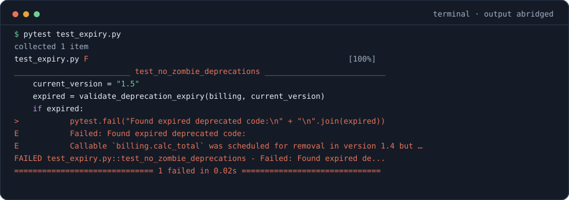

# Deprecation Policy

## Enforcing Removal Deadlines



`remove_in` commits you to **delete code** when that version ships. Forgotten deadlines leave *zombie code* behind.

`validate_deprecation_expiry()` scans a module or package for every deprecated callable whose removal version has been reached or passed. It returns error-message strings. An empty list means the scan found **no expired callables**.

Install the `audit` extra for `packaging`, which provides PEP 440 version comparison:

```bash
pip install 'pyDeprecate[audit]'
```

Scan a package and control recursion depth:

```python
from deprecate import validate_deprecation_expiry

# For testing purposes, we use the test module; normally you would import your own package
from tests.collections.api_deprecated import core as my_package

# Scan your package for expired deprecations - using early-version that won't have expirations
expired = validate_deprecation_expiry(my_package, "0.2")
print(f"Found {len(expired)} expired")  # Returns a list of error messages (empty list = no expired)

# Example with expired deprecations found (using later-version)
expired = validate_deprecation_expiry(my_package, "0.5")
print(f"Found {len(expired)} expired")

# Auto-detect version from package metadata (mocked for demo)
from unittest.mock import patch

with patch("importlib.metadata.version", return_value="0.3"):
    expired = validate_deprecation_expiry(my_package)  # Automatically detects version
    print(f"Found {len(expired)} expired")

# Control recursion
expired = validate_deprecation_expiry(my_package, "0.1", recursive=False)  # Only scan top-level module
print(f"Found {len(expired)} expired")
```

<details>
  <summary>Output: <code>f"Found {len(expired)} expired"</code></summary>

```
Found 14 expired
Found 31 expired
Found 17 expired
Found 0 expired
```

</details>

Expiry scope and comparison follow these rules:

| Setting or input                 | Behavior                                                                                                            |
| -------------------------------- | ------------------------------------------------------------------------------------------------------------------- |
| `include_members=True` (default) | Include class members decorated with `@deprecated`, such as an `__init__` wrapped by `deprecated_class` delegation. |
| `include_members=False`          | Restrict discovery to module-level callables.                                                                       |
| No `remove_in`                   | Skip the callable; notice-only deprecations are allowed.                                                            |
| PEP 440 versions                 | Compare versions normally, such as `"2.0.0" > "1.9.5"`.                                                             |
| Pre-release versions             | Order them correctly, such as `"1.5.0a1" < "1.5.0"`.                                                                |

!!! note "Unparsable versions leave gaps"

    An invalid `remove_in` is skipped with a `UserWarning` naming the callable and unparsable version. Its expiry is <u>not checked</u>. The CLI prints a `remove_in not PEP 440` gap instead.

    `pydeprecate policy` also prints gaps for versions its `min-grace` rule cannot parse. These are `remove_in not PEP 440` or `deprecated_in not PEP 440` gaps. A `--strict` run fails on them.

A downstream release may still need a symbol past its deadline. Accept that finding without excluding the whole module using the CLI ignore list or a baseline report. See [Accepting known findings](cli.md#accepting-known-findings). The Python API returns every finding and has no ignore or baseline filter, so your code decides which findings to keep.

### pytest integration for expiry enforcement

Wire expiry checks into your test suite so zombie code is caught *before* any tests run. The session-scoped autouse fixture pattern below prevents the suite from starting at all if expired deprecations are present.

```python
import pytest
from deprecate import validate_deprecation_expiry

# For testing purposes, we use the test module; normally you would import your own package
from tests.collections.api_deprecated import core as my_package


def test_no_zombie_deprecations():
    """Ensure all deprecated code is removed when it reaches its deadline."""
    # Use your package's actual version - for this example we use a test version
    current_version = "0.5"  # Replace with: from mypackage import __version__

    expired = validate_deprecation_expiry(my_package, current_version)

    if expired:
        error_msg = "Found deprecated code past its removal deadline:\n"
        for msg in expired:
            error_msg += f"  - {msg}\n"
        pytest.fail(error_msg)


# Alternative: Use a fixture to run on every test session
# For testing purposes, we use the test module; normally you would import your own package
@pytest.fixture(scope="session", autouse=True)
def enforce_deprecation_deadlines():
    """Automatically check for zombie code before running any tests."""
    from tests.collections.api_deprecated import core as my_package

    current_version = "0.5"  # Replace with: from mypackage import __version__
    expired = validate_deprecation_expiry(my_package, current_version)
    if expired:
        raise AssertionError(
            f"Cannot run tests: {len(expired)} deprecated callables past removal deadline. "
            f"Remove these functions first: {expired}"
        )
```

In this separate example, a standalone expiry test fails and names the expired billing wrapper:



## Enforcing a Deprecation Policy

`validate_deprecation_expiry()` asks whether code was removed *on time*. `validate_deprecation_policy()` checks whether the original schedule and migration guidance were *responsible*.

It detects short upgrade windows, removals off release boundaries, and missing migration guidance. These problems are cheap to fix during review. They become expensive once downstream projects pin against the release.


Like the expiry gate, the policy gate compares PEP 440 versions and therefore needs the `audit` extra:

```bash
pip install 'pyDeprecate[audit]'
```

Set up a policy in two steps:

1. Declare the rules once in `pyproject.toml`:

    ```toml
    [tool.pydeprecate.policy]
    min-grace = "1.0"
    message-required = true
    ```

2. Run the gate locally or in CI. See [Enforcing the policy in CI](ci-integration.md#enforcing-the-policy-in-ci):

    ```bash
    pydeprecate policy src/mypackage
    ```

`min-grace` is a version-shaped delta:

| Value                      | Required window                            |
| -------------------------- | ------------------------------------------ |
| `"1.0"`                    | Removal is allowed only at the next major. |
| `"0.3"` (built-in default) | Callers receive three minors.              |
| `"0.0.2"`                  | Callers receive two patches.               |
| `false`                    | The rule is disabled.                      |

Each run resolves each rule in *this order*: flag, project table, built-in default. A `Policy:` header identifies the source. See [project configuration](cli.md#project-configuration-in-pyprojecttoml).

The Python function takes rules as arguments. It never reads the configuration file.

### The two rules

| Rule slug          | What it checks                                                                     | Default                 | Disable with             |
| ------------------ | ---------------------------------------------------------------------------------- | ----------------------- | ------------------------ |
| `min-grace`        | `remove_in` is one clean version bump beyond `deprecated_in`, at least this far    | `min_grace="0.3"`       | `min_grace=None`         |
| `message-required` | The wrapper provides migration guidance (a target, a mapping, or a custom message) | `message_required=True` | `message_required=False` |

Every violation message starts with its *rule slug* in square brackets: `[min-grace]` or `[message-required]`. Group or filter CI logs by that stable prefix without parsing the prose.

Tune the defaults using these contracts.

#### Grace windows

`min_grace` accepts a version-shaped delta string with two or three components. **At most one** component may be non-zero.

| Input                              | Interpretation                            |
| ---------------------------------- | ----------------------------------------- |
| `"1.0"`                            | One major.                                |
| `"0.3"`                            | Three minors.                             |
| `"0.0.2"`                          | Two patches.                              |
| `"1"`                              | Reject as ambiguous: the unit is unknown. |
| `"1.2"`, or another mixed spelling | Reject before scanning with `ValueError`. |
| `"0.0"`                            | Accept a zero-count minor window.         |

!!! warning "Pass version deltas as strings"

    A float such as `0.10` loses its trailing zero and reads as one minor. Always pass the version-shaped form **as a string**.

**Zero-count windows still require clean bumps.** An all-zero window effectively disables the distance check. A clean bump of that unit or coarser remains required. Thus, `1.2` → `1.2.1` violates a zero-minor window.

Internally, every spelling becomes `deprecate.audit.GraceWindow(count, unit)`: one unit and one count. The scan consults only this parsed window.

You may also pass a `GraceWindow` instance (`from deprecate import GraceWindow, VersionBump`) or a one-key unit table such as `{"major": 1}`.

The removal must **cleanly bump a single component** and reset every lower component. For example, `1.2` → `1.5` or `2.0` is valid. `1.2` → `2.3` or `1.3.1` is not.

Mixed bumps miss the release boundaries on which projects promise removals.

| Relative unit                   | Result                                                                                                                    |
| ------------------------------- | ------------------------------------------------------------------------------------------------------------------------- |
| A coarser bump than the window. | It always clears the window. Deprecation in `1.2` and removal in `2.0` satisfies `"0.3"`, despite the lower minor number. |
| A finer bump than the window.   | It never clears the window. A patch cannot satisfy a minor-counted window.                                                |

!!! note "Projects before 1.0"

    A `0.x` project needs no special setting. A bump to `1.0` is a major step and clears any window. Removals within `0.x` are counted in minors as usual.

    `min_grace="1.0"` enforces the strict policy of removals only at a major.

#### Migration guidance

`message_required` accepts these forms of guidance:

- A callable or module `target` names a replacement.
- An `args_mapping` names argument replacements.
- An `attrs_mapping` names attribute replacements.
- A custom `message_template` supplies guidance.

!!! note "Guidance edge cases"

    An empty `args_mapping` or `attrs_mapping` (`{}`) carries no actual rename. The rule treats it like no mapping.

    A deprecated module passes with a custom `message_template`. The auto-rendered text stored by `deprecated_module()` does **not** count; otherwise, every module would pass trivially. A module using only `target` or `attrs_mapping` needs at least one non-empty value.

    A `deprecated_instance()` proxy over a dict or settings instance needs a custom `message_template` or an `attrs_mapping` for the default policy. The object is never called, so its `args_mapping` never applies. A `target=` replacement is served under the old name but is absent from the built-in warning.

### Scanning a package

```python
from deprecate import validate_deprecation_policy

# For testing purposes, we use the test module; normally you would import your own package
from tests.collections import policy as my_package

# Full default policy: a three-minor grace window on a clean release boundary, guidance required
violations = validate_deprecation_policy(my_package, recursive=False)
print(f"Found {len(violations)} violations")

# Every message is prefixed with the slug of the rule it broke
for msg in sorted(violations):
    print(msg.split("]")[0] + "]")

# Opt out of the grace-window rule, keep the guidance rule
violations = validate_deprecation_policy(my_package, recursive=False, min_grace=None)
print(f"Found {len(violations)} violations")
```

<details>
  <summary>Output: <code>f"Found {len(violations)} violations"</code></summary>

```
Found 7 violations
[message-required]
[message-required]
[message-required]
[message-required]
[min-grace]
[min-grace]
[min-grace]
Found 4 violations
```

</details>

Wrappers without `deprecated_in` or `remove_in` do not violate the grace-window rule. That rule skips them because unscheduled deprecations are valid and common.

An unparsable version emits a `UserWarning` naming the wrapper and offending field. The scan continues, so one typo *never* aborts the gate.

`recursive`, `include_members`, and `exclude` behave exactly as in `find_deprecation_wrappers()`.

!!! note "Result formats"

    Policy results are message strings, not structured records. Filter, group, or suppress them by the stable `[min-grace]` or `[message-required]` slug. The wording after that prefix **may change**.

    `validate_deprecation_expiry()` also returns plain strings, without a slug. Use `find_deprecation_wrappers()` for structured per-wrapper `DeprecationWrapperInfo` rows.

    The CLI's `--report-json` contains the rendered deprecation table, run gaps, and structured finding records with violation messages (since v0.16). See the [CLI Reference](cli.md).

The CLI exposes the same gate as `pydeprecate policy`. See the [CLI Reference](cli.md) for flags and exit codes. See [Enforcing the policy in CI](ci-integration.md#enforcing-the-policy-in-ci) for workflow wiring.

The CLI can read `[tool.pydeprecate.policy]` from `pyproject.toml`. See [project configuration](cli.md#project-configuration-in-pyprojecttoml).

The Python function accepts a module object or importable name, never a filesystem path. It does not read that file. Pass `min_grace` and `message_required` **explicitly**.

## See also

- [Python audit API](index.md)
- [CI integration](ci-integration.md)
- [Testing deprecated code](../integrations/testing.md)
- [Classes](../usage/classes.md)
- [Selective attribute deprecation](../usage/attributes.md)
- [Use Cases](../usage/index.md) — Deprecation patterns and scenarios.
- [Getting Started](../getting-started.md) — The decorator parameters.
- [Troubleshooting](../troubleshooting.md) — Common configuration errors and fixes.
