# Community

pyDeprecate is maintained in the open. Ask questions, share what worked, and see how other projects run their deprecation cycles.

## Ask, share and discuss

[GitHub Discussions](https://github.com/Borda/pyDeprecate/discussions) is the place for public usage questions, ideas, and migration stories.

| You want to                                   | Go to                                                                                      |
| --------------------------------------------- | ------------------------------------------------------------------------------------------ |
| Ask how to deprecate something                | [Q&A](https://github.com/Borda/pyDeprecate/discussions/categories/q-a)                     |
| Propose a feature or a use case we lack       | [Ideas](https://github.com/Borda/pyDeprecate/discussions/categories/ideas)                 |
| Share a migration story or your project's use | [Show and tell](https://github.com/Borda/pyDeprecate/discussions/categories/show-and-tell) |
| Report a bug or a documentation inaccuracy    | [Issues](https://github.com/Borda/pyDeprecate/issues)                                      |

Report vulnerabilities privately using the [security policy](https://github.com/Borda/pyDeprecate/blob/main/.github/SECURITY.md). For conduct concerns, use the confidential reporting channel in the [code of conduct](https://github.com/Borda/pyDeprecate/blob/main/.github/CODE_OF_CONDUCT.md).

Search the [troubleshooting guide](troubleshooting.md) and [limitations](limitations.md) first: most questions have an answer there. If a limitation blocks real work, **describe your practical use case**; we are happy to discuss it and integrate a fix when it fits.

## Who uses pyDeprecate

These projects declare pyDeprecate or call it in their source. The notes below come from their public repositories, read in November 2026.

| Project                                                                    | What they deprecate with it                                                                                                                                                                  |
| -------------------------------------------------------------------------- | -------------------------------------------------------------------------------------------------------------------------------------------------------------------------------------------- |
| [PyTorch Lightning](https://github.com/Lightning-AI/pytorch-lightning) 1.x | The 1.3 move of the metrics API to TorchMetrics: old functions and classes forward to their replacements and warn. The dependency was dropped in 1.8.0.                                      |
| [supervision](https://github.com/roboflow/supervision)                     | Deprecated helpers such as the COCO loader forward to their replacements with `@deprecated(target=…, deprecated_in="0.32.0", remove_in="0.35.0")`, warning through the project's own stream. |
| [RF-DETR](https://github.com/roboflow/rf-detr)                             | Legacy model classes such as `RFDETRBase` stay importable as `deprecated_class` proxies that warn until 2.0.0, with a migration guide.                                                       |

### What they show

- **PyTorch Lightning** wrapped `deprecated` once and reused it for every wrapper moved in the same release, with a custom warning stream. The [`deprecated_metrics` helper](https://github.com/Lightning-AI/pytorch-lightning/blob/1.3.0/pytorch_lightning/metrics/utils.py) fixed `deprecated_in="1.3.0"` and `remove_in="1.5.0"` for the whole module. Its [1.8.0 release notes](https://github.com/Lightning-AI/pytorch-lightning/releases/tag/1.8.0) list the final step: ["The `pyDeprecate` dependency is no longer installed"](https://github.com/Lightning-AI/pytorch-lightning/pull/14472), because nothing used it any more. A deprecation cycle that finished is the goal.
- **supervision** sends pyDeprecate warnings through the same `SupervisionWarnings` category as its other deprecation notices, so one project setting silences them all. See [Customization](usage/customization.md) for streams.
- **RF-DETR** keeps old class names importable as warn-only `target=None` proxies and points callers to a size-specific class. See [Classes](usage/classes.md).



The Lightning pattern is short enough to copy:

```python
from functools import partial

from deprecate import deprecated

# One schedule shared by every wrapper that moves in the same release.
deprecated_since_1_4 = partial(deprecated, deprecated_in="1.4", remove_in="1.6")


# NEW API — the maintained implementations
def to_onehot(labels: list, num_classes: int) -> list:
    return [[int(i == label) for i in range(num_classes)] for label in labels]


def top_k(scores: list, k: int) -> list:
    return sorted(scores, reverse=True)[:k]


# DEPRECATED API — both old names forward and share one version schedule
@deprecated_since_1_4(target=to_onehot)
def one_hot(labels: list, num_classes: int) -> list:
    pass  # never runs: calls are forwarded


@deprecated_since_1_4(target=top_k)
def select_top(scores: list, k: int) -> list:
    pass  # never runs: calls are forwarded


print(one_hot([0, 2], 3))  # warns: FutureWarning
print(select_top([3, 1, 2], 2))  # warns: FutureWarning
```

<details><summary>Output: <code>the two forwarded calls</code></summary>

```text
[[1, 0, 0], [0, 0, 1]]
[3, 2]
```

</details>

The same `deprecated_in` and `remove_in` values are what `pydeprecate expiry` and `pydeprecate policy` read in CI. See [Audit and CI](audit/index.md).

## Add your project

Using pyDeprecate? Tell us in [Show and tell](https://github.com/Borda/pyDeprecate/discussions/categories/show-and-tell), or open a pull request that adds a row to the table above with a link to your public code.

Show it in your own README with the badge:

[](https://github.com/Borda/pyDeprecate)

```markdown
[](https://github.com/Borda/pyDeprecate)
```

!!! note "Read the code, not this table"

    The table describes public code on the date above. A project may change how it deprecates, or drop pyDeprecate as Lightning did. Follow the links for the current state.
