# Classes

See [Attributes](attributes.md) for selective attribute deprecation and multi-version attribute migrations.

This page covers classes, Enums, dataclasses, and module-level constants. Patterns include forwarding old class names, transparent proxy wrappers, and stacked deprecation layers. For function deprecation, see [Functions](functions.md).

With `deprecated_class(update_docstring=True)`, existing class documentation receives the deprecation notice. A class with `__doc__ = None` keeps `None`, without inheriting internal proxy documentation. The original class docstring is unchanged.

## `@deprecated` on a class

`@deprecated` accepts classes directly and dispatches to `deprecated_class()`, producing an identical `_DeprecatedProxy`. Everything documented on this page applies to either form.

!!! note "Class dispatch notice"

    Dispatch is permanent and is not deprecated. It adds a one-time informational `UserWarning`, suppressed by `stream=None`. Only the notice is removed in v1.0.

    See [Troubleshooting](../troubleshooting.md#userwarning-when-decorating-a-class) for per-class keying and suppression options. The thread-safe notice cache retains at most 4096 class keys in insertion order. An evicted class may receive the notice again.

```python
from deprecate import deprecated


# NEW/FUTURE API — the replacement class callers should migrate to
class HttpService:
    def call(self) -> str:
        return "ok"


# DEPRECATED API — @deprecated on a class source dispatches to @deprecated_class
@deprecated(target=HttpService, deprecated_in="1.0", remove_in="2.0")  # warns: UserWarning (one-time dispatch notice)
class LegacyService:
    pass


svc = LegacyService()  # warns: FutureWarning
print(svc.call())
```

<details>
  <summary>Output: <code>svc.call()</code></summary>

```
ok
```

</details>

Prefer `@deprecated_class()` directly for classes, Enums, and dataclasses. It produces the same result without a dispatch notice and exposes proxy-only options such as `attrs_mapping`. The rest of this page uses that explicit form.

## Class deprecation



Choose one of two common patterns:

- Rename a method with `@deprecated(target=execute)` on the old name; calls forward to the replacement.
- Decorate `__init__` to warn at instantiation, optionally forwarding construction to a successor class.

Rename a method within a class:

```python
from deprecate import deprecated, void


class MyService:
    # NEW/FUTURE API — renamed from run() for clarity
    def execute(self, x: int) -> int:
        """Current method."""
        return x * 2

    # DEPRECATED API — `run` was the original name before the rename
    @deprecated(target=execute, deprecated_in="1.0", remove_in="2.0")
    def run(self, x: int) -> int:
        """Deprecated — renamed to execute()."""
        return void(x)


svc = MyService()
# calling this method will raise a deprecation warning:
#   The `run` was deprecated since v1.0 in favor of `your_module.execute`.
#   It will be removed in v2.0.
print(svc.run(5))
```

<details>
  <summary>Output: <code>svc.run(5)</code></summary>

```
10
```

</details>

Forward `__init__` to a successor class. The deprecated class inherits from its successor, preserving all methods and properties on instances:

```python
# NEW/FUTURE API — renamed to be more descriptive
class HttpClient:
    """My new class anywhere in the codebase or other package."""

    def __init__(self, c: float, d: str = "abc"):
        self.my_c = c
        self.my_d = d


# ---------------------------

from deprecate import deprecated, void


# DEPRECATED API — `Client` was the original name before it was renamed to HttpClient
class Client(HttpClient):
    """
    The deprecated class should be inherited from the successor class
     to hold all methods and properties.
    """

    @deprecated(target=HttpClient, deprecated_in="0.2", remove_in="0.4")
    def __init__(self, c: int, d: str = "efg"):
        """
        You place the decorator around __init__ as you want
         to warn user just at the time of creating object.

        Decorating __init__ warns at instantiation time and optionally
        forwards to another class. For deprecating the class itself
        (name change, Enum, dataclass), use @deprecated_class() instead.
        """
        void(c, d)


# calling this function will raise a deprecation warning:
#   The `Client` was deprecated since v0.2 in favor of `your_module.HttpClient`.
#   It will be removed in v0.4.
inst = Client(7)
print(inst.my_c)  # returns: 7
print(inst.my_d)  # returns: "efg"
```

<details>
  <summary>Output: <code>inst.my_d</code></summary>

```
7
efg
```

</details>

## Constants and instances

`deprecated_instance` wraps module-level dicts, lists, and custom objects in a transparent proxy. Attribute, item, and call access emit a deprecation notice. Use `read_only=True` to prevent mutation through the deprecated alias.

The proxy carries only protocols supported by the wrapped object:

- A deprecated settings `dict` is neither `callable()`, an `Iterator`, nor `os.PathLike`.
- A deprecated file handle retains context-manager support and iteration.
- A deprecated Enum class retains `len()` and iteration.

Arithmetic, unary, and conversion operators forward to the wrapped object. Data-use operations emit deprecation warnings; ordering comparisons, `format()`, and context exit remain silent structural probes.

!!! note "When operations consume warnings"

    Synchronous operations warn only after success. A subscript miss (`KeyError`) or another failed operation emits nothing and preserves the `num_warns` budget.

    `next()` warns before advancing the wrapped iterator. An exhausted `next()` (`StopIteration`) still warns and spends the budget. A warning raised as an error consumes no item.

    `__await__` and `__anext__` warn when obtaining the underlying awaitable, before it runs. Later rejection or async exhaustion still consumes the warning budget. Calls also warn before execution, like `@deprecated`.

!!! warning "Fatal operations"

    With `as_exception=True`, these operations raise `DeprecatedError` before touching the wrapped object:

    - Subscripts, iteration, `next()`, context entry, async iteration, and `await` raise first.

    - Unary and conversion operators, `round()`, and in-place operators raise first.

    A missing key therefore raises `DeprecatedError` rather than `KeyError`, and a `defaultdict` gains no entry. Binary operators compute first and raise after a successful result.

In-place operators (`+=`, `-=`, etc.) return the active object's result rather than a re-wrapped proxy.

!!! warning "Right-hand operands"

    Python cannot fall back to the proxy when the left-operand type raises `TypeError` directly, as with `"prefix" + proxy_str` for `str`. Put the proxy on the left or wrap the value in a container. See [Troubleshooting](../troubleshooting.md#do-arithmetic-and-operator-protocol-methods-emit-deprecation-notices-on-deprecated_instance-proxies) for details.

!!! note "Context-entry cleanup"

    A warning filter or custom stream can raise after synchronous or asynchronous context entry acquires a resource. The proxy invokes that context's exit method before propagating the error. Failed underlying entry does not invoke exit.

`isinstance(DEFAULTS, dict)` returns `True`: the proxy reports the wrapped object's type through `__class__`.

!!! note "Introspection limits"

    `type(DEFAULTS)` still returns the wrapper class. Only `isinstance`, which honours `__class__`, is transparent; strict `type()` equality still sees the wrapper.

    Detect proxies with `isinstance(DEFAULTS, DeprecationProxy)` after `from deprecate import DeprecationProxy`. Never use `type(DEFAULTS) is _DeprecatedProxy`, which names a private class.

    `isinstance` checks, dunder reads, and failed `hasattr` probes stay silent. They do not consume the `num_warns` budget.

!!! note "Writes and read-only aliases"

    Writes never warn. Item writes and deletes (`DEFAULTS["lr"] = 0.01`, `del DEFAULTS["lr"]`) follow the attribute-write rule.

    With `read_only=True`, writes raise `AttributeError` unless `skip_if` evaluates `True`. During a skip, every write goes directly to the wrapped object.

A `deprecated_instance` over a plain function can act as a method in a class body: `class Model: scale = deprecated_instance(legacy_scale, ...)`.

- Through an instance, the proxy binds like the wrapped function. `Model().scale(2)` calls `legacy_scale(model, 2)` and warns against one `num_warns` budget shared across instances.
- `Model().scale` is a bound method whose `__func__` is the proxy. Consequently, `inspect.signature` drops `self`.
- Through the class, `Model.scale` is the proxy itself, so `Model.scale(model, 2)` also works. Use `staticmethod(...)` around the proxy to keep the function unbound.
- Proxies over data, classes, and non-function descriptors (`property`, `classmethod`, and `staticmethod` objects) remain as stored and never bind.
- Only proxies over functions or `@deprecated` wrappers are descriptors. `inspect.isroutine(proxy)` is `True` for these and `False` for data and class proxies.

Deprecated proxies survive `copy.copy()` and `copy.deepcopy()` round-trips. Copies retain the warning behavior and receive independent counters snapshotted from the original.

!!! note "Copying replacement data"

    A shallow proxy copy also tries to copy its [replacement data object](#serving-a-replacement-object). After success, top-level writes such as `copy["key"] = value` do not affect the original replacement. If copying raises, the copy retains the shared replacement, so writes can reach it.

    Nested mutable values remain shared after a shallow copy. `copy.deepcopy` can provide independence when the objects support it.

Plain-object `deprecated_instance` proxies, including dicts, lists, and custom objects, are fully picklable.

!!! warning "Pickling class aliases"

    A `deprecated_class` alias raises `PicklingError` in the common pattern where the proxy replaces the decorated class name. Pickle cannot find the original class by reference. Use `copy.deepcopy` for class alias proxies instead.

    Instances of classes deprecated in place pickle and load as original-class instances without warnings, including exception and `OrderedDict` subclasses. Classes defining their own `__reduce_ex__`, such as Enums, are exceptions.

```python
from deprecate import deprecated_instance

# NEW/FUTURE API — renamed to be more explicit about its scope
TRAINING_CONFIG = {"lr": 0.001, "batch_size": 32, "epochs": 10}

# What it looked like before the rename:
# DEFAULTS = {"lr": 0.001, "batch_size": 32, "epochs": 10}

# DEPRECATED API — `DEFAULTS` was the original name; read-only so
# callers cannot mutate shared state through the deprecated alias
DEFAULTS = deprecated_instance(
    TRAINING_CONFIG,
    deprecated_in="1.2",
    remove_in="2.0",
    read_only=True,
)

# Reading still works but emits a FutureWarning once:
#   The `dict` was deprecated since v1.2. It will be removed in v2.0.
print(DEFAULTS["lr"])  # 0.001
```

<details>
  <summary>Output: <code>DEFAULTS["lr"]</code></summary>

```
0.001
```

</details>

### Serving a replacement object

Pass the replacement as `target=` when the old name should already return new values. Attribute, item, operator, and call access use the replacement. The old name keeps warning until removal.

When `skip_if` evaluates true, operations use the wrapped source without warning or forwarding. Use `name=` so warnings name the alias callers use.

!!! note "Naming data replacements"

    Built-in warnings name callable replacements only. For a dict or settings object, provide a `message_template` naming the replacement. See [Customization](customization.md).

    In generic warnings, `%(target_name)s` and `%(target_path)s` render empty for data replacements. Mapped-attribute warnings do fill them.

```python
from deprecate import deprecated_instance

# NEW/FUTURE API — the retry settings that replaced `RETRY_DEFAULTS`
RETRY_POLICY = {"timeout": 30, "retries": 5}

# DEPRECATED API — the old name now serves the new settings and still warns
RETRY_DEFAULTS = deprecated_instance(
    {"timeout": 10, "retries": 3},
    name="RETRY_DEFAULTS",
    target=RETRY_POLICY,
    deprecated_in="1.3",
    remove_in="2.0",
    message_template="`%(source_name)s` is deprecated since v%(deprecated_in)s; use `RETRY_POLICY` instead.",
)

print(RETRY_DEFAULTS["timeout"])  # warns: FutureWarning
```

<details>
  <summary>Output: <code>RETRY_DEFAULTS["timeout"]</code></summary>

```
30
```

</details>

Operations through the old name follow the replacement. `isinstance` and hashing use it, and writes land on it.

!!! warning "Replacement type compatibility"

    Proxy protocols combine those of the source and replacement, because `skip_if` can serve the source. A function replaced by a dict still reports `callable(proxy)` as `True`, although calling it raises `TypeError`.

    Keep the replacement's type unchanged or use a subclass unless the type change is intended. A tuple constant replaced by a list becomes unhashable immediately when the deprecation ships.

    `target=True`, `target=False`, `TargetMode.AUTO`, and modules raise `TypeError`. Redirect modules with [`deprecated_module`](modules.md).

`attrs_mapping` deprecates only the listed attribute spellings of an object, the same way it does on a class proxy. Every other attribute stays silent. The mapping covers attributes, not the keys of a mapping object:

```python
from deprecate import deprecated_instance


# NEW/FUTURE API — the display settings spell the attribute `colour`
class DisplaySettings:
    colour = "teal"


# DEPRECATED API — the `color` spelling still works but warns
THEME = deprecated_instance(
    DisplaySettings(), name="THEME", attrs_mapping={"color": "colour"}, deprecated_in="1.3", remove_in="2.0"
)

print(THEME.color)  # warns: FutureWarning
print(THEME.colour)
```

<details>
  <summary>Output: <code>THEME.color</code>, <code>THEME.colour</code></summary>

```
teal
teal
```

</details>

On callable objects, `args_mapping` renames keyword arguments. Values renamed onto positional-only parameters are passed positionally.

- Without `target`, calls warn only when an old name is used.
- With a callable `target`, every call warns because calling the old name is itself deprecated.

!!! warning "Unused call options"

    On objects that are never called, `args_mapping` and `args_extra` cannot apply. They emit `UserWarning`, becoming `TypeError` in v1.0.

## Enums and dataclasses

`deprecated_class()` wraps an Enum or dataclass in a transparent proxy. It emits deprecation notices and forwards attribute, item, and call operations to the replacement.

- Use `args_mapping` to rename or drop kwargs when calling the deprecated class.
- Without an explicit `target`, supplying `args_mapping` auto-resolves to `TargetMode.ARGS_REMAP`. Warnings occur **only when an old argument name is used**, matching `@deprecated(target=TargetMode.ARGS_REMAP, args_mapping=...)`.
- For a no-target `ARGS_REMAP` proxy, calls using new argument names are silent. A callable replacement target still emits the class-level warning. Structural checks with `isinstance` and `issubclass` remain silent.
- Use `args_extra` to inject fixed kwargs into every forwarded call. Use `message_template` to override the warning; both options behave as their `@deprecated` counterparts do.

```python
from enum import Enum
from dataclasses import dataclass
from deprecate import deprecated_class

# mypackage/theme.py — what it looked like before the rename:
#
# class Color(Enum):
#     RED = 1
#     BLUE = 2


# NEW/FUTURE API — renamed to be more descriptive
class ThemeColor(Enum):
    RED = 1
    BLUE = 2


# DEPRECATED API — `Color` was the original name; no class body needed,
# the proxy forwards all access to ThemeColor
Color = deprecated_class(target=ThemeColor, deprecated_in="1.0", remove_in="2.0")(ThemeColor)

# All access is forwarded to ThemeColor — a FutureWarning is emitted once:
#   The `ThemeColor` was deprecated since v1.0 in favor of `<module>.ThemeColor`. It will be removed in v2.0.
print(Color.RED is ThemeColor.RED)  # True
print(Color(1) is ThemeColor.RED)  # True
print(Color["RED"] is ThemeColor.RED)  # True


# Precision migration story:
# - PointV1 used integer pixel coordinates.
# - PointV2 supports float coordinates for sub-pixel precision and smoother transforms.


# NEW/FUTURE API — extended to float precision
@dataclass
class PointV2:
    x: float
    y: float


# DEPRECATED API — PointV1 was the original integer-coordinate implementation
@deprecated_class(target=PointV2, deprecated_in="1.8", remove_in="2.0")
@dataclass
class PointV1:
    x: int
    y: int


# Existing callers using integer coordinates still work and are forwarded to PointV2:
p_old = PointV1(3, 4)
print(isinstance(p_old, PointV2))
print((p_old.x, p_old.y))

# New callers can use higher precision directly:
p_new = PointV2(3.25, 4.75)
print((p_new.x, p_new.y))
```

<details>
  <summary>Output: <code>(p_new.x, p_new.y)</code></summary>

```
True
True
True
True
(3, 4)
(3.25, 4.75)
```

</details>

## Conditional skip

`deprecated_class()` and `deprecated_instance()` accept `skip_if`: a `bool` or zero-argument callable returning `bool`, evaluated at access time.

While the condition evaluates `True`, the proxy serves the wrapped source unchanged:

- Warnings and `attrs_mapping` redirects are disabled.
- `args_mapping`, `args_extra`, `target` forwarding, and `read_only` enforcement are disabled.
- `isinstance(proxy, ...)`, class statements subclassing the alias, and arithmetic operands follow the wrapped source.

Audits never evaluate the condition. Conditions needing a running application therefore do not break `find_deprecation_wrappers` or the CLI. Callable decorators behave similarly: skipped calls execute the source body unchanged.

!!! warning "Keep skip conditions safe for introspection"

    A proxy operation may consult the condition more than once. Keep the callable cheap and stable; non-`bool` results raise `TypeError` at access time.

    Return rather than raise when context is missing. Tools such as `help()` and `pytest --doctest-modules` run `isinstance` on module members, evaluating every proxy's condition.

```python
from deprecate import deprecated_class

MIGRATION_ROLLOUT_DONE = False


def rollout_pending() -> bool:
    return not MIGRATION_ROLLOUT_DONE


# NEW/FUTURE API — the replacement backend callers should migrate to
class StorageBackend:
    def save(self) -> str:
        return "stored"


# DEPRECATED API — deprecation stays dormant until the rollout flag flips
@deprecated_class(target=StorageBackend, deprecated_in="1.0", remove_in="2.0", skip_if=rollout_pending)
class LegacyStorage:
    def save(self) -> str:
        return "legacy-stored"


store = LegacyStorage()  # silent — skip active, source class served, no target forwarding
print(store.save())
```

<details>
  <summary>Output: <code>store.save()</code></summary>

```
legacy-stored
```

</details>

Once the condition flips to `False`, the very next access warns and forwards to the target as usual — no re-decoration required.

## Type annotations and static analysis

At runtime, `deprecated_class()` returns a proxy. Type checkers model the class it forwards to.

The call form `deprecated_class(target=BrandColor, ...)(WidgetColor)` has type `type[BrandColor]` regardless of the wrapped class. The alias therefore checks against the replacement.

!!! note "Class decorator differences"

    Mypy ignores a class decorator's return type, leaving the name typed as the decorated class. Pyright applies it, so `@deprecated_class(target=BrandColor, ...)` produces `type[BrandColor]`:

```python
from enum import Enum
from deprecate import DeprecationProxy, deprecated_class


# NEW/FUTURE API — renamed to describe the palette rather than the widget
class BrandColor(Enum):
    RED = 1
    BLUE = 2


# DEPRECATED API — `WidgetColor` was the original name; `target=BrandColor` types the alias as `type[BrandColor]`
WidgetColor = deprecated_class(target=BrandColor, deprecated_in="1.0", remove_in="2.0")(BrandColor)

print(WidgetColor(1) is BrandColor.RED)  # warns: FutureWarning
print(isinstance(BrandColor.BLUE, WidgetColor))
print(isinstance(WidgetColor, DeprecationProxy))
```

<details>
  <summary>Output: <code>WidgetColor(1) is BrandColor.RED; isinstance(BrandColor.BLUE, WidgetColor); isinstance(WidgetColor, DeprecationProxy)</code></summary>

```
True
True
True
```

</details>

Type-checking behavior depends on how the alias is used:

- **Class checks succeed.** `isinstance(x, WidgetColor)` and `issubclass(...)` narrow to `BrandColor`. `WidgetColor(1)`, member and attribute access, and passing the alias as `type[BrandColor]` also type-check. Each forwards to the class at runtime.
- **The alias is a variable, not a type.** Every checker rejects `def paint(color: WidgetColor)`, and mypy also rejects `class Child(WidgetColor)`. Annotate with the replacement class, or use the decorator form in mypy to retain a class statement.
- **Missing old names are flagged.** Renamed kwargs and attributes absent from the wrapped class trigger `call-arg` and `attr-defined` errors, as in the decorator form. Retain old names in a legacy class body to keep calls type-checking during migration.
- **An explicit proxy cast permits old names.** Use `cast(DeprecationProxy[Config], deprecated_class(...)(Config))` for permissive calls and attributes. The trade-off is that `isinstance` against this alias no longer type-checks.
- **A class target determines the type.** With `target=BrandColor`, the alias is `type[BrandColor]` even when wrapping a separate legacy class. `WidgetColor(...)` has the `BrandColor` instance type returned at runtime.
- **Without a class target, the wrapped type remains.** This includes `args_mapping`-only and `attrs_mapping`-only wrappers. With `skip_if`, the type models the steady state; keep the wrapped class compatible with `target` while serving it during skips.
- **The `@deprecated` front door cannot see `target` statically.** A class decorated with `@deprecated(target=BrandColor, ...)` keeps its wrapped-class type despite runtime forwarding. Use `deprecated_class(target=BrandColor, ...)` for `type[BrandColor]`.
- **Proxy-only attributes are invisible on `type[BrandColor]`.** Read `__deprecation_config__` with `get_deprecation_config(WidgetColor)` and unwrap with `inspect.unwrap(WidgetColor)`. Alternatively, use `cast(DeprecationProxy[Any], WidgetColor)` at the site needing these attributes.

`DeprecationProxy[T]` remains the annotation for `deprecated_instance()` proxies, where `T` is the type calling the proxy produces.

!!! warning "Functional aliases keep the source name"

    Warnings name the wrapped class, not the assigned variable. The example reports `` `BrandColor` ``. Wrap a source class with the name callers know, or provide `message_template`.

!!! warning "`isinstance` only"

    `DeprecationProxy` declares attributes as well as methods, making it a data protocol. `isinstance(obj, DeprecationProxy)` works. `issubclass(SomeType, DeprecationProxy)` raises `TypeError`, like every runtime-checkable protocol with non-method members.

### Breadcrumbs for documentation and IDE tools

Every proxy carries two attributes that let static tooling see through it to the original object:

| Attribute       | Points to                  | Used by                                                           |
| --------------- | -------------------------- | ----------------------------------------------------------------- |
| `__wrapped__`   | the source class or object | `inspect.unwrap`, Sphinx autodoc, griffe/mkdocstrings, IDEs       |
| `__signature__` | the source's signature     | `inspect.signature` and anything that does not walk `__wrapped__` |

Reading either attribute has no side effects or deprecation notices. Documentation builds and IDE hovers stay quiet:

```python
import inspect
from dataclasses import dataclass
from deprecate import deprecated_class


# NEW/FUTURE API — renamed for clarity
@dataclass
class RetryPolicy:
    attempts: int
    backoff: float = 1.0


# DEPRECATED API — `RetryConfig` was the original name
@deprecated_class(target=RetryPolicy, deprecated_in="1.4", remove_in="2.0")
@dataclass
class RetryConfig:
    attempts: int
    backoff: float = 1.0


# No warning — the breadcrumbs are read straight off the proxy
print(inspect.unwrap(RetryConfig).__name__)
print(str(inspect.signature(RetryConfig)))
```

<details>
  <summary>Output: <code>inspect.unwrap(RetryConfig).__name__; str(inspect.signature(RetryConfig))</code></summary>

```
RetryConfig
(attempts: int, backoff: float = 1.0) -> None
```

</details>

!!! note "Missing signatures"

    Objects without introspectable signatures receive `__signature__ = None`, rather than raising. A plain `dict` wrapped by `deprecated_instance()` is one example. Failed source introspection never prevents wrapping.

### PEP 702 static checkers

Stack `typing_extensions.deprecated` or `warnings.deprecated` directly above `@deprecated_class(...)` to flag every old-class use in mypy and pyright. Supply `category=None` and a string-literal message. See [Functions → Static type checkers](functions.md#static-type-checkers-pep-702).

With a class `target`, the checkers infer different types:

- Mypy ignores the class decorator's return type, retaining the old class statement. Mirror the replacement's constructor and methods in the old class body for accurate checking.
- Pyright applies the return type, producing `type[ReportWriter]` in the example below. It already checks calls against the replacement.

The PEP 702 message lives on the proxy, leaving the replacement class unmarked. It survives `copy.copy`, `copy.deepcopy`, and `pickle` round-trips of the alias.

!!! note "Deleting PEP 702 metadata"

    After `del alias.__deprecated__`, the attribute reads as missing. It does not fall through to the wrapped class.

```python
import typing_extensions

from deprecate import deprecated_class


# NEW API — the renamed writer
class ReportWriter:
    def __init__(self, path: str = "") -> None:
        self.path = path


# DEPRECATED API — flagged by mypy, forwarded with a warning at runtime
@typing_extensions.deprecated("Use `ReportWriter` instead.", category=None)
@deprecated_class(target=ReportWriter, deprecated_in="1.2", remove_in="2.0")
class CsvReportWriter:
    def __init__(self, path: str = "") -> None:
        self.path = path


print(CsvReportWriter("out.csv").path)  # warns: FutureWarning
print("__deprecated__" in vars(ReportWriter))
```

<details>
  <summary>Output: <code>CsvReportWriter("out.csv").path; "__deprecated__" in vars(ReportWriter)</code></summary>

```
out.csv
False
```

</details>

## Fatal deprecations

`as_exception=True` works on `deprecated_class()` and `deprecated_instance()` as on callable forms. See [Fatal deprecations](functions.md#fatal-deprecations) for the full contract.

Operations that would warn raise `DeprecatedError` instead:

- Instantiation, warning-producing attribute reads, item access, and calls become fatal.
- Data-use arithmetic and conversion dunders become fatal.
- Writes to names listed in `attrs_mapping` raise before the mapped write.

Ordinary attribute writes and access outside an active `attrs_mapping` stay silent. Constructor-only `TargetMode.ARGS_REMAP` does not make attribute access fatal.

Structural probes remain silent: `isinstance`, `issubclass`, `repr`, `str`, equality, ordering, and `len` never warned.

!!! note "Fatal attribute probes"

    Without `attrs_mapping`, a missing attribute makes `hasattr` return `False` silently. Successful non-dunder lookups on warning-producing paths raise `DeprecatedError`, which `hasattr` does not swallow.

    With `attrs_mapping`, listed names raise before lookup even when missing. Unlisted names stay silent whether present or missing.

!!! warning "Fatal deprecation is not an authorization boundary"

    Without `attrs_mapping`, attribute lookup resolves the value before reaching the fatal warning path. A property getter or descriptor can therefore produce side effects before `DeprecatedError`.

    If the getter raises its own exception, that exception propagates first. Mapped attribute reads reach the fatal path before resolving the mapped descriptor.

Next: [Properties](properties.md) — learn how to deprecate `@property` and `@cached_property` accessors.

## See also

- [Attributes](attributes.md) covers selective attribute deprecation and multi-version stacking.
- [Use Cases overview](use-cases.md) provides a guided tour of deprecation patterns.
- [Functions](functions.md) covers function and method deprecation.
- [Properties](properties.md) covers `@property` and `@cached_property` deprecation.
- [Async](async.md) covers async functions and generators.
- [Advanced](advanced.md) covers docstring updates, `args_extra`, testing helpers, and class/static methods.
- [Audit Tools](audit.md) covers Python scanning, validation, and chain detection.
- [Audit Policy](audit-policy.md) covers removal deadlines and policy enforcement.
- [CI Integration](ci-integration.md) covers CI gates, pre-commit, and GitHub Actions.
- [Testing](testing.md) covers testing deprecated code and warning behavior.
- [Troubleshooting](../troubleshooting.md) explains common `deprecated_class` configuration errors and fixes.
