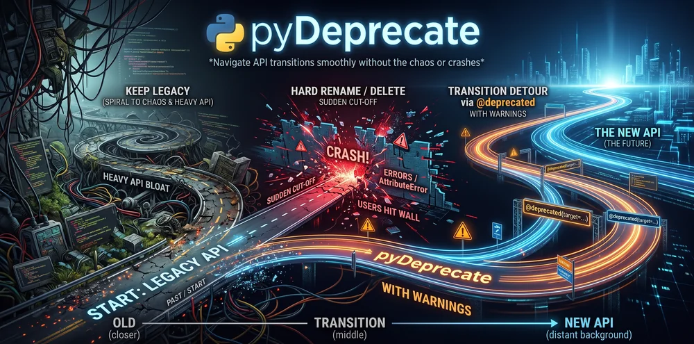

 

# pyDeprecate

**Author:** [Jiri Borovec](https://github.com/Borda) · **License:** Apache 2.0 · **Python:** 3.9+ · **Install:** `pip install pyDeprecate` · **Import:** `from deprecate import deprecated` · **PyPI:** https://pypi.org/project/pyDeprecate/

Renaming a function or retiring an argument often means writing a wrapper and manual forwarding. You must also configure the warning category and `stacklevel`, then enforce the removal deadline. **pyDeprecate** replaces that boilerplate with a decorator and CI checks for overdue removals.

!!! note "Usage and background"

    **pyDeprecate has broad PyPI usage**. For current download statistics, see [pepy.tech](https://pepy.tech/project/pyDeprecate).

    Read [Mastering API Deprecation in Python — the pain points and how pyDeprecate can help](https://medium.com/codex/mastering-api-deprecation-in-python-the-pain-points-and-how-pydeprecate-can-help-1dbfd90e2b62) on CodeX / Medium.



```python
from deprecate import deprecated


# NEW API — compute a sum with the current implementation.
def compute_sum(a: int, b: int) -> int:
    return a + b


# DEPRECATED API — addition forwards to compute_sum.
@deprecated(target=compute_sum, deprecated_in="1.0", remove_in="2.0")
def addition(a: int, b: int) -> int:
    return a + b


print(addition(1, 2))  # warns: FutureWarning
```

<details>
  <summary>Output: <code>addition(1, 2)</code></summary>

```
3
```

</details>

Calling `addition(1, 2)` now emits a `FutureWarning` and transparently forwards to `compute_sum`.



## Features

- **Automatic call forwarding:** The decorator routes positional and keyword arguments to the replacement. You need no manual `*args/**kwargs` plumbing.

- **Generator and async support:** Wrappers support generator functions (`def fn(): yield`), `async def` coroutines, and async generators (`async def fn(): yield`). They preserve the source's `iscoroutinefunction`, `isgeneratorfunction`, or `isasyncgenfunction` introspection. Functions warn at call time, coroutines on `await`, and generators on their first `next()` or `async for` step.

- **Argument mapping:** `args_mapping={"old": "new"}` handles renames across the API boundary. Map to `None` to drop an argument entirely.

- **Argument deprecation:** `TargetMode.ARGS_REMAP` warns only when callers pass the old argument name. Migrated callers see no noise.

- **Class and Enum support:** `@deprecated_class` wraps classes, Enums, and dataclasses in a transparent proxy. It supports `isinstance` and `issubclass`.

- **Instance / constant proxy:** `deprecated_instance(obj, ...)` wraps module-level dicts, lists, and custom objects. It provides transparent attribute/item access and optional `read_only` enforcement.

- **Module deprecation:** [`deprecated_module(__name__, ...)`](guide/modules.md) retires a module, warning on every public attribute access. This includes names already in `__dict__` and star-imports, which PEP 562's `__getattr__` cannot reach. Warn in place, redirect to a replacement, or alias from the parent package.

- **Strict callable-only form:** `@deprecated_callable()` shares every `@deprecated` parameter. It raises `TypeError` at decoration time on a class source when implicit class dispatch should be an error.

- **Mode inference:** `@deprecated` defaults to `TargetMode.AUTO`. Configuration resolves the mode at decoration time. Audit tools see the concrete mode, never `AUTO`.

- **Public proxy protocol:** Annotate against [`DeprecationProxy`](api-reference.md) instead of private `_DeprecatedProxy`. Proxies carry `__wrapped__` / `__signature__` breadcrumbs. These let `inspect`, Sphinx, griffe, and IDEs resolve the source.

- **Configurable frequency:** `num_warns=1` defaults to one warning per function. Set `-1` for always or `N` for exactly N times.

- **Docstring injection:** `update_docstring=True` automatically appends a Sphinx `.. deprecated::` or MkDocs admonition notice. This keeps rendered API docs accurate.

- **Sphinx Plugin:** `deprecate.docstring.sphinx_ext` renders `_DeprecatedProxy` objects with their injected deprecation notices in Sphinx autodoc.

- **MkDocs Plugin:** `deprecate.docstring.griffe_ext` exposes runtime-injected `!!! warning` admonitions in mkdocstrings-generated API docs.

- **Decorator stacking:** Stack `@deprecated` decorators for multi-version migrations. Rename arguments across releases (`ARGS_REMAP + ARGS_REMAP`), then deprecate the function when a replacement arrives (`ARGS_REMAP + NOTIFY`). Unsupported combinations warn at decoration time.

- **Custom streams:** The `stream` parameter routes warnings to `logging`, standard `warnings`, or any callable. `stream=None` silences output while forwarding continues.

- **Custom message templates:** `message_template` overrides the default message with `%`-style placeholders. Available placeholders include `source_name`, `target_path`, `deprecated_in`, `remove_in`, and `argument_map`.

- **Conditional skip:** `skip_if=callable` suppresses deprecation machinery when a runtime condition holds, such as callers adopting a newer dependency. It works on decorators and proxies.

- **CI audit tools:** [`validate_deprecation_expiry()`](guide/audit-policy.md#enforcing-removal-deadlines) catches overdue removals. [`validate_deprecation_policy()`](guide/audit-policy.md#enforcing-a-deprecation-policy) checks your release policy. [`validate_deprecation_chains()`](guide/audit.md#detecting-deprecation-chains) detects double-deprecation chains.

- **Wrapper validation:** [`find_deprecation_wrappers()`](guide/audit.md#validating-wrapper-configuration) surfaces misconfigured `args_mapping` keys before they silently do nothing.

- **Static type-checker signals:** Native PEP 702 diagnostics come from `warnings.deprecated`, which type checkers recognise by name. For static hints with runtime forwarding, stack `@warnings.deprecated("literal message", category=None)` directly above `@deprecated(...)`. See [Static type checkers](guide/functions.md#static-type-checkers-pep-702).

- **CLI:** `pydeprecate check src/` scans for misconfigured wrappers and chains. `pydeprecate all src/` also checks expiry and policy, then appends a deprecation table. See [CLI Reference](guide/cli.md).

- **CI integration:** Ready-made [pre-commit hooks](guide/ci-integration.md#pre-commit-integration) and a [GitHub Action](guide/ci-integration.md#github-action) run the checks in CI.

- **Fatal mode:** `as_exception=True` or `deprecate.as_exceptions()` raises `DeprecatedError` instead of warning. Test runs can refuse deprecated calls. See [Fatal deprecations](guide/functions.md#fatal-deprecations).

- **Testing helpers:** The `assert_no_warnings()` context manager checks that no warnings of a given type escape a block. `no_warning_call` remains a legacy alias.

- **Zero runtime dependencies:** Nothing is added to `install_requires`.

- **Python compatibility:** Python 3.9+ is supported.

## Installation

<!-- keep this install table in sync with docs/getting-started.md -->

Choose the install that matches your workflow.

| Workflow                     | Command                                | Includes                                                                                                                                                                                    |
| ---------------------------- | -------------------------------------- | ------------------------------------------------------------------------------------------------------------------------------------------------------------------------------------------- |
| Runtime deprecation wrappers | `pip install pyDeprecate`              | `@deprecated`, `@deprecated_class`, `deprecated_instance`, docstring helpers, and most audit metadata helpers                                                                               |
| CI deadline checks           | `pip install 'pyDeprecate[audit]'`     | Adds `packaging` for PEP 440 version comparison in `validate_deprecation_expiry()` and `validate_deprecation_policy()`                                                                      |
| Command-line audit workflows | `pip install 'pyDeprecate[audit,cli]'` | Adds `packaging` version support for `pydeprecate expiry`, `pydeprecate policy`, and `pydeprecate all`; the CLI itself needs no dependency (`cli` is an empty extra kept for compatibility) |

```bash
pip install pyDeprecate
```

Install the audit extra for CI checks that compare version strings.

```bash
pip install 'pyDeprecate[audit]'
```

!!! tip "The `[audit]` extra is only needed for `validate_deprecation_expiry` and `validate_deprecation_policy`"

    The base install gives you `@deprecated`, `@deprecated_class`, `deprecated_instance`, and all other audit functions. Only `validate_deprecation_expiry()` and `validate_deprecation_policy()` need the extra. They use `packaging` for PEP 440 version comparison.

!!! tip "Use `[audit,cli]` for command-line audit workflows"

    The `pydeprecate` command itself needs no extra. The empty `[cli]` extra preserves existing install commands. `pydeprecate expiry`, `pydeprecate policy`, and the expiry/policy phases of `pydeprecate all` need `[audit]`.

    Start with `pip install 'pyDeprecate[audit,cli]'` unless you only need Python API calls.

## Comparison with other tools

Choose pyDeprecate for call forwarding, argument mapping, proxies, and CI audits. Use PEP 702 with `category=None` for static checker visibility without per-call wrapper overhead. See the [canonical tool comparison](guide/compare-python-deprecation-tools.md) for alternatives, migration examples, and testing guidance.

## Where to go next

- [Getting Started](getting-started.md) — install, write your first deprecation, see the full API at a glance.

- [Use Cases](guide/use-cases.md) — overview of all deprecation patterns with links to each topic page.

- [Customization](guide/customization.md) — custom message templates and output redirection to loggers.

- [void() Helper](guide/void-helper.md) — sentinel function for self-documenting deprecated stubs.

- [Audit Tools](guide/audit.md) — enforce removal deadlines and catch deprecation chains in CI.

- [Compare Python Deprecation Tools](guide/compare-python-deprecation-tools.md) — compare `warnings.warn`, `deprecation`, `Deprecated`, and `warnings.deprecated`.

- [Agent Recipes](guide/agent-recipes.md) — copy-paste patterns for AI coding assistants.

- [Troubleshooting](troubleshooting.md) — common errors and how to fix them.

- [Brand](brand.md) — logos, colors, banners, and the "API migration by pyDeprecate" badge.

- [Sphinx demo](demo-sphinx/index.html) · [MkDocs demo](demo-mkdocs/index.html) — live rendered output.

## Show that you use pyDeprecate

Show callers your project's deprecation path with a README badge. They receive a warning, a forwarded call, and a removal deadline instead of a sudden break.

[](https://github.com/Borda/pyDeprecate)

```markdown
[](https://github.com/Borda/pyDeprecate)
```

## Compatibility and fit

Recent PyPI download statistics show broad production use; see pepy.tech for current numbers.

| Topic                        | Status                                                                                                                                                            |
| ---------------------------- | ----------------------------------------------------------------------------------------------------------------------------------------------------------------- |
| Python versions              | Project metadata currently supports Python 3.9+; Borda-maintained development policy targets Python 3.10+ because Python 3.9 reached end of life in October 2025. |
| Runtime dependencies         | None.                                                                                                                                                             |
| Optional audit extra         | `packaging` (plus `tomli` on Python < 3.11 for `pyproject.toml` version detection).                                                                               |
| Optional CLI extra           | None — the CLI uses only the standard library; `cli` is an empty extra kept so `pip install 'pyDeprecate[cli]'` keeps working.                                    |
| Docs engines                 | Sphinx and MkDocs compatible.                                                                                                                                     |
| Type checker static warnings | Prefer `warnings.deprecated` for Python 3.13+ static-checker-only cases.                                                                                          |

### When not to use pyDeprecate

- Use `warnings.warn` for one-off internal warnings that do not need compatibility behavior.

- Use `warnings.deprecated` for static-checker-only visibility on Python 3.13+.

- Use pyDeprecate when callers need forwarding, argument mapping, class or object aliases, warning frequency control, or CI audit checks.
