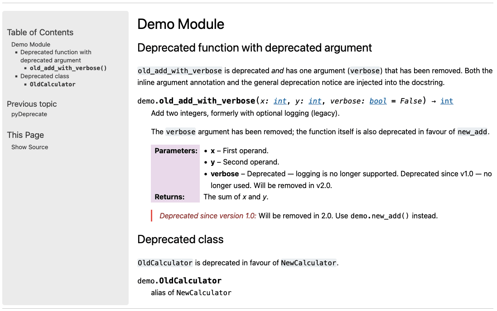
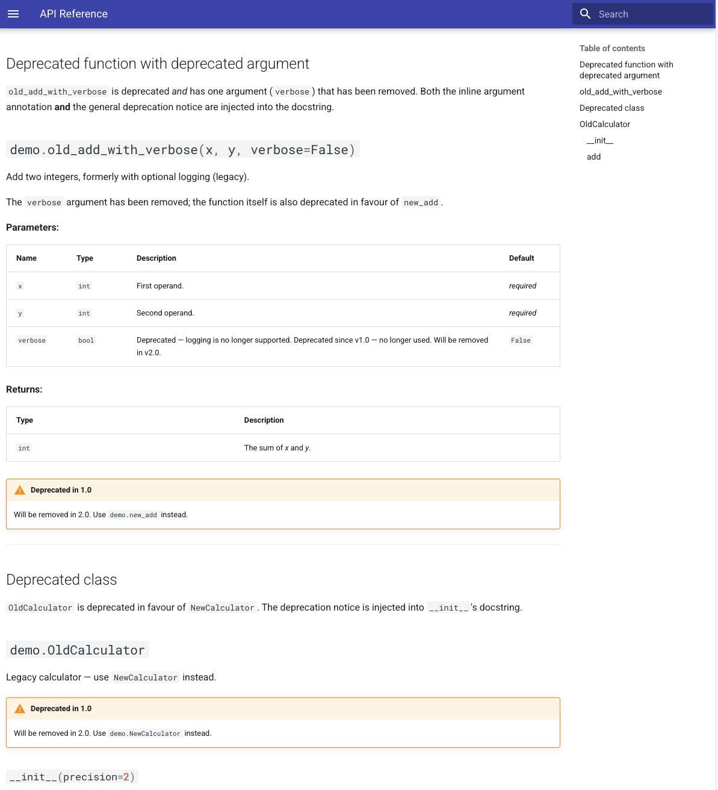

# API documentation integration

Enable `update_docstring=True` to include migration notices in API documentation. Then **configure the documentation engine** to read those *runtime* docstrings.

## What it looks like

The same deprecated API rendered by each engine. Each demo is built from `demo-docs/` in this repository.

=== "Sphinx"

    

    The `.. deprecated::` directive renders as a red-bar notice below the function docstring. Open the [live Sphinx function-notice demo](../demo-sphinx/api.html), or read its [`conf.py`](https://github.com/Borda/pyDeprecate/blob/main/demo-docs/sphinx/source/conf.py) and [`api.rst`](https://github.com/Borda/pyDeprecate/blob/main/demo-docs/sphinx/source/api.rst).

=== "MkDocs"

    

    The `!!! warning "Deprecated in …"` admonition renders as an orange card below the docstring. Open the [live MkDocs demo](../demo-mkdocs/api.html), or read its [`mkdocs.yml`](https://github.com/Borda/pyDeprecate/blob/main/demo-docs/mkdocs/mkdocs.yml).

## Update docstrings

The decorator updates an existing docstring at *decoration time*; it does **not** wait for a deprecated call.

```python
from deprecate import deprecated, void

# NEW API — adds quantities using the replacement implementation
from tests.collections.api_current.core import base_sum_kwargs


# DEPRECATED API — `calculate_total` replaced by `base_sum_kwargs`
@deprecated(
    target=base_sum_kwargs,
    deprecated_in="0.1",
    remove_in="0.5",
    update_docstring=True,
    docstring_style="rst",
)
def calculate_total(a: int, b: int = 5) -> int:
    """Add invoice line quantities."""
    return void(a, b)


print(calculate_total.__doc__)
```

<details><summary>Output: <code>calculate_total.__doc__</code></summary>

```text
Add invoice line quantities.

.. deprecated:: 0.1
   Will be removed in 0.5.
   Use :func:`tests.collections.api_current.core.base_sum_kwargs` instead.
```

</details>

The option is named `update_docstring` and **defaults to `False`** on `deprecated`, `deprecated_callable` and `deprecated_class`; `deprecated_instance` and `deprecated_module` have no such option, so they inject no docstring notice. The notice includes the removal version when supplied, and a replacement reference when `target` is callable.

| `docstring_style`  | Injected format                                        |
| ------------------ | ------------------------------------------------------ |
| `"rst"`            | A Sphinx `.. deprecated::` directive.                  |
| `"mkdocs"`         | A Markdown `!!! warning "Deprecated in …"` admonition. |
| `"markdown"`       | An alias for `"mkdocs"`.                               |
| `"auto"` (default) | Select the format from the build environment.          |

Automatic selection checks these signals in order:

1. A recognized `DEPRECATE_DOCSTRING_STYLE` value: `rst`, `mkdocs`, or `markdown`.
2. The presence of `mkdocs` in `sys.modules`.
3. The text `mkdocs` in the executable path, `sys.argv[0]`.
4. The fallback format, `"rst"`.

!!! note "Choose explicitly when needed"

    An explicit `docstring_style` **bypasses automatic detection**. Unsupported values raise `ValueError` at decoration time, even with `update_docstring=False`.

## Sphinx

Add `deprecate.docstring.sphinx_ext` to `extensions` in `conf.py` alongside autodoc.

```python
# phmdoctest:skip — Sphinx conf.py configuration snippet
extensions = [
    "sphinx.ext.autodoc",
    "sphinx.ext.napoleon",  # Parse Google-style or NumPy-style docstrings.
    "deprecate.docstring.sphinx_ext",
]

autoclass_content = "both"
autodoc_default_options = {
    "members": True,
    "undoc-members": True,
    "show-inheritance": True,
}
```

- Use `docstring_style="rst"` on wrappers intended for Sphinx.
- Document functions with `autofunction` and classes with `autoclass`.
- Install Sphinx and make pyDeprecate and the documented package importable in the build environment.

Autodoc reads function docstrings *at runtime*. The bundled extension handles the proxies returned by `deprecated_class`, which otherwise appear as aliases without their injected notices.

It uses the wrapped class for signature and member inspection, while retaining the proxy's updated docstring. The rendered class entry therefore includes the deprecation notice instead of only an “alias of” description.

!!! note "Configuration scope"

    The extension defines no additional Sphinx configuration keys. `autoclass_content` and `autodoc_default_options` are autodoc settings. Both bundled documentation extensions are beta; their public interfaces may change in a minor release.

The [live Sphinx demo](../demo-sphinx/api.html) shows the function notice. The current demo renders `OldCalculator` as an alias. See the repository's [Sphinx configuration](https://github.com/Borda/pyDeprecate/blob/main/demo-docs/sphinx/source/conf.py) and [API directives](https://github.com/Borda/pyDeprecate/blob/main/demo-docs/sphinx/source/api.rst) for the setup.

## MkDocs and mkdocstrings

Configure `deprecate.docstring.griffe_ext:RuntimeDocstrings` under the Python handler's `options.extensions`.

```yaml
markdown_extensions:
  - admonition

plugins:
  - mkdocstrings:
      handlers:
        python:
          paths: ["src"]
          options:
            docstring_style: google
            extensions:
              - deprecate.docstring.griffe_ext:RuntimeDocstrings
```

Use `update_docstring=True` and `docstring_style="mkdocs"` on decorated APIs to produce Markdown notices. This repository uses the same Griffe extension in its own `mkdocs.yml`.

!!! note "Two different style options"

    The decorator's `docstring_style="mkdocs"` selects the injected notice format. The handler's `docstring_style: google` selects how mkdocstrings parses the surrounding docstring.

Griffe normally reads docstrings from the *source syntax tree*, which does not contain decoration-time changes. `RuntimeDocstrings` imports the documented module and replaces matching function, class, and method docstrings with their runtime values.

1. Install `mkdocstrings[python]` and pyDeprecate in the documentation environment.
2. Set `paths` to the documented source location and make its runtime dependencies available.
3. Add the extension and enable `admonition` as shown above.
4. Render the API with a mkdocstrings directive such as `::: deprecate.deprecated`.

!!! note "Runtime imports"

    The Griffe extension <u>executes module imports</u> during the build. It leaves docstrings unchanged when its import attempts fail with `ImportError`. Other import-time exceptions can fail the build.

See the [live MkDocs demo](../demo-mkdocs/api.html) and the repository's [MkDocs configuration](https://github.com/Borda/pyDeprecate/blob/main/demo-docs/mkdocs/mkdocs.yml) for a complete example.

## Placement and limits

- Without `args_mapping`, general notices precede the first recognized Google-style or NumPy-style section, or follow the docstring when no section exists.
- With `args_mapping`, Google-style `Args:` / `Arguments:` and Sphinx `:param` entries receive inline notes for deprecated arguments.
- With `TargetMode.ARGS_REMAP`, finding every deprecated argument suppresses the general notice because only arguments are deprecated.
- MkDocs shows the notice only for the decorator form: Griffe reads a call-form alias such as `Old = deprecated_class(...)(New)` as an attribute with no docstring, so it gets no notice.
- Callable targets still receive a general notice after inline argument annotations. Missing argument entries also cause a general notice.

**Existing text is required:** `update_docstring=True` leaves a missing or empty docstring **unchanged**. The Griffe extension also requires an existing static docstring and deprecation metadata. It does not create documentation for undocumented objects.

See [Functions](../usage/functions.md) for argument migrations, [Classes](../usage/classes.md) for proxy behavior, and [Advanced](../usage/advanced.md#automatic-docstring-updates) for more docstring examples.
