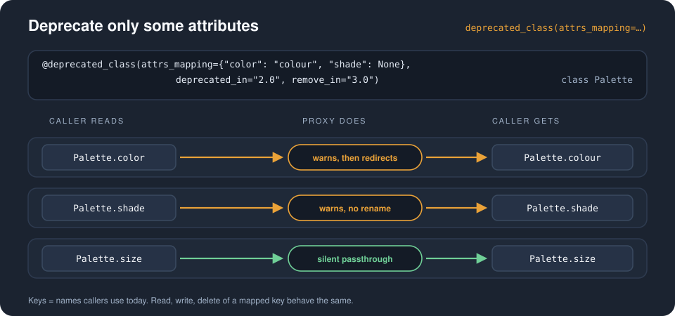

# Attributes

Use selective attribute deprecation when only particular names need migration; see [Classes](classes.md) for whole-class deprecation.

## Selective attribute deprecation

Use `attrs_mapping` on `deprecated_class()` to deprecate **selected attribute names** while leaving all others silent. It covers renames, spelling corrections such as `color` → `colour`, and individual warn-only notices.

Mapping keys are deprecated attribute names:

| Value                   | Behavior                                                               |
| ----------------------- | ---------------------------------------------------------------------- |
| A canonical name string | Reads, writes, and deletes warn and redirect against the active class. |
| `None`                  | Access warns without renaming the attribute.                           |

Unlisted attributes **stay silent**.



!!! note "Mapping validation"

    Non-`None` values must exist on the `target` class when supplied, or otherwise on the wrapped source class. Redirect chains such as `{"a": "b", "b": "c"}` are accepted and audited as `ChainType.STACKED`. Cycles such as `{"a": "b", "b": "a"}` raise immediately.

### Decorator syntax — attribute rename

Apply `@deprecated_class(attrs_mapping=...)` at class definition time. *Only* the attribute names listed as keys emit a `FutureWarning`; all others pass through silently:

```python
from deprecate import deprecated_class


# NEW API — Palette.colour is the canonical spelling
# DEPRECATED API — Palette.color redirects to Palette.colour
@deprecated_class(
    attrs_mapping={"color": "colour"},  # "color" is the deprecated spelling
    deprecated_in="2.0",
    remove_in="3.0",
)
# NEW API — the canonical colour attribute
class Palette:
    colour: str = "red"  # canonical name
    size: int = 10  # unlisted — silent passthrough, no warning


# Deprecated alias — warns: "The `color` was deprecated since v2.0 in favor of `Palette.colour`."
print(Palette.color)  # red

# Canonical names — silent passthrough, no warning
print(Palette.colour)  # red
print(Palette.size)  # 10
```

<details>
  <summary>Output: <code>Palette.color; Palette.colour; Palette.size</code></summary>

```
red
red
10
```

</details>

The *wrapper form* is equivalent to decorator syntax. Use it for existing classes or to apply deprecation outside the class definition:

```python
from deprecate import deprecated_class


# NEW API — canonical configuration attributes
class Config:
    colour: str = "red"
    size: int = 42
    timeout: int = 30


# DEPRECATED API — "color" redirects to "colour"; "size" warns without renaming
DeprecatedConfig = deprecated_class(
    attrs_mapping={"color": "colour", "size": None},
    deprecated_in="1.0",
    remove_in="2.0",
)(Config)

print(DeprecatedConfig.color)  # warns → returns Config.colour ("red")
print(DeprecatedConfig.colour)  # silent passthrough ("red")
print(DeprecatedConfig.size)  # warns (warn-only, size=42 unchanged)
```

<details>
  <summary>Output: <code>DeprecatedConfig.color; DeprecatedConfig.colour; DeprecatedConfig.size</code></summary>

```
red
red
42
```

</details>

### Reads, writes, and deletes all redirect

The `attrs_mapping` interception applies to **all three** access modes. Writing to a deprecated attribute alias warns and sets the canonical attribute instead:

```python
from deprecate import deprecated_class


# NEW API — the canonical colour attribute
class Palette:
    colour: str = "red"


# DEPRECATED API — the color spelling redirects to colour
DeprecatedPalette = deprecated_class(
    attrs_mapping={"color": "colour"},  # "color" is the deprecated spelling
    deprecated_in="1.0",
    remove_in="2.0",
)(Palette)

# Write — warns: FutureWarning and redirects to Palette.colour
DeprecatedPalette.color = "blue"  # warns: FutureWarning

# Canonical attribute now holds the new value (no warning on canonical reads)
print(Palette.colour)  # blue
```

<details>
  <summary>Output: <code>Palette.colour</code></summary>

```
blue
```

</details>

### Warn-only with `None` redirect

Map a deprecated attribute to `None` to emit a warning on access *without renaming* anything. The attribute is fetched by its original name on the active class after the warning fires. Use this when an attribute is **going away with no replacement**:

```python
from deprecate import deprecated_class


# NEW API — callers should stop using the size attribute
class Widget:
    size: int = 42  # scheduled for removal — callers should stop reading it


# DEPRECATED API — size warns without a replacement
DeprecatedWidget = deprecated_class(
    attrs_mapping={"size": None},  # warn-only, no rename
    deprecated_in="1.0",
    remove_in="2.0",
)(Widget)

# Warns: "The `size` was deprecated since v1.0. It will be removed in v2.0."
print(DeprecatedWidget.size)  # 42 — value still returned, just warned

# Second access is silent — num_warns=1 budget exhausted
print(DeprecatedWidget.size)  # 42 — no second warning
```

<details>
  <summary>Output: <code>DeprecatedWidget.size; DeprecatedWidget.size (second call)</code></summary>

```
42
42
```

</details>

### Per-attribute independent warning budgets

Each deprecated attribute name has an **independent warning counter**. With `num_warns=1`, the default, two different deprecated aliases each warn once. This produces two warnings rather than sharing one budget:

```python
from deprecate import deprecated_class


# NEW API — canonical configuration attributes
class Config:
    colour: str = "red"
    text: str = "hello"


# DEPRECATED API — color and txt keep independent warning budgets
proxy = deprecated_class(
    attrs_mapping={"color": "colour", "txt": "text"},
    deprecated_in="1.0",
    remove_in="2.0",
)(Config)

print(proxy.color)  # warns: FutureWarning — "color" budget consumed
print(proxy.txt)  # warns: FutureWarning — "txt" budget consumed (independent counter)

# Both budgets now exhausted — subsequent accesses are silent
print(proxy.color)  # silent
print(proxy.txt)  # silent
```

<details>
  <summary>Output: <code>proxy.color; proxy.txt; proxy.color (silent); proxy.txt (silent)</code></summary>

```
red
hello
red
hello
```

</details>

### Enum — deprecated member aliases

`attrs_mapping` also works on Enum proxies. Use it when member names change, such as a casing migration. Wrap the canonical Enum and register deprecated names as aliases:

```python
from enum import Enum
from deprecate import deprecated_class


# NEW API — canonical uppercase direction names
class Direction(Enum):
    NORTH = "N"
    SOUTH = "S"
    EAST = "E"
    WEST = "W"


# DEPRECATED API — lowercase aliases redirect to canonical uppercase members
LegacyDirection = deprecated_class(
    attrs_mapping={"north": "NORTH", "south": "SOUTH"},
    deprecated_in="1.0",
    remove_in="2.0",
)(Direction)

# Deprecated lowercase alias — warns and returns the canonical Direction.NORTH member
print(LegacyDirection.north is Direction.NORTH)  # True

# Canonical uppercase name — silent passthrough, no warning
print(LegacyDirection.NORTH is Direction.NORTH)  # True
```

<details>
  <summary>Output: <code>LegacyDirection.north is Direction.NORTH; LegacyDirection.NORTH is Direction.NORTH</code></summary>

```
True
True
```

</details>

`attrs_mapping` can be combined with `target=NewClass`; listed attribute aliases redirect to their canonical counterparts on the target class. Unlisted attributes and calls continue to use the normal target-forwarding behaviour.

!!! note "Audit visibility"

    `find_deprecation_wrappers` discovers the proxy via its class-level `__deprecation_config__`. Individual `attrs_mapping` entries are data inside the single proxy config and are not emitted as separate `DeprecationWrapperInfo` records. All entries share the same `deprecated_in`/`remove_in` lifecycle.

### Explicit `TargetMode.ATTRS_REMAP` form

Passing `attrs_mapping` alone auto-resolves to `TargetMode.ATTRS_REMAP`. Explicitly passing `target=TargetMode.ATTRS_REMAP` with `attrs_mapping` has *identical* behavior. The explicit form makes intent visible at the call site:

```python
from deprecate import TargetMode, deprecated_class


# NEW API — the canonical colour attribute
class Palette:
    colour: str = "red"  # canonical name


# Explicit form — equivalent to passing `attrs_mapping` alone
# DEPRECATED API — the color spelling redirects to colour
DeprecatedPalette = deprecated_class(
    target=TargetMode.ATTRS_REMAP,
    attrs_mapping={"color": "colour"},
    deprecated_in="1.0",
    remove_in="2.0",
)(Palette)

print(DeprecatedPalette.color)  # warns → returns "red"
```

<details>
  <summary>Output: <code>DeprecatedPalette.color</code></summary>

```
red
```

</details>

!!! note "Decoration-time validation"

    These misconfigurations emit `UserWarning` at decoration time, planned to become `TypeError` in `v1.0`:

    | Misconfiguration                                        | Why it is wrong                                                                                                                                                                                                |
    | ------------------------------------------------------- | -------------------------------------------------------------------------------------------------------------------------------------------------------------------------------------------------------------- |
    | `target=TargetMode.ATTRS_REMAP` without `attrs_mapping` | `ATTRS_REMAP` requires deprecated attribute names in `attrs_mapping`. Without them, the proxy has no selective effect.                                                                                         |
    | `attrs_mapping={}`                                      | An empty mapping has no effect. Remove it or add deprecated attribute names.                                                                                                                                   |
    | `target=TargetMode.NOTIFY` with `attrs_mapping`         | `NOTIFY` means warn-only without redirection. The proxy keeps `NOTIFY`; the mapping remains inert but preserved in audit metadata and flagged `misconfigured`. Omit `target` to auto-resolve to `ATTRS_REMAP`. |

**Explicit modes stay explicit.** Explicit configuration is *never* silently rewritten; auto-resolution fills in only an omitted `target`. For blanket per-access warnings plus selective attribute renaming, stack two `deprecated_class()` layers. See [Nested proxy wrappers](#nested-proxy-wrappers).

**Proxy-only mode.** `TargetMode.ATTRS_REMAP` works **only with proxies**. `@deprecated(target=TargetMode.ATTRS_REMAP)` raises `TypeError` at decoration time for every source: functions, methods, properties, and classes. The front door cannot expose `attrs_mapping`, so this mode could never redirect anything there. The error points to `deprecated_class(attrs_mapping=...)`, or `deprecated_instance(obj, attrs_mapping=...)` for objects.

### Callable target with attribute redirection

Combine `target=NewClass` and `attrs_mapping` for full class replacement with renamed attributes:

- Listed deprecated aliases resolve against `NewClass`.
- Unlisted attributes and instantiation calls also forward to `NewClass`.
- `None` entries keep their original names. For example, `attrs_mapping={"size": None}` warns before reading, writing, or deleting `NewClass.size`.

```python
from deprecate import deprecated_class


# NEW API — Config uses the shorter lr name
class Config:
    lr: float = 0.01  # canonical name in the new class
    batch_size: int = 32  # unchanged attribute


# DEPRECATED API — learning_rate redirects to Config.lr
@deprecated_class(
    target=Config,
    attrs_mapping={"learning_rate": "lr"},  # "learning_rate" was renamed to "lr"
    deprecated_in="2.0",
    remove_in="3.0",
    num_warns=-1,
)
class LegacyConfig:
    learning_rate: float = 0.01  # old name — will warn
    lr: float = 0.01  # canonical alias also present


print(LegacyConfig.learning_rate)  # warns: FutureWarning — value from Config.lr

print(LegacyConfig.lr)  # silent — canonical name

print(LegacyConfig.batch_size)  # silent — unlisted attribute
```

<details>
  <summary>Output: <code>LegacyConfig.learning_rate; LegacyConfig.lr; LegacyConfig.batch_size</code></summary>

```
0.01
0.01
32
```

</details>

Instantiation also forwards to `Config`: `LegacyConfig()` returns a `Config` instance.

!!! warning "Returned instances"

    Here, `attrs_mapping` applies only to class-level attribute access on the proxy. It does not apply to <u>the returned instance</u>.

### Dataclass field renames

For dataclasses, `deprecated_class(attrs_mapping=...)` automatically covers two surfaces. Accessing mapped class attributes through the proxy and passing constructor kwargs (`DC(old_field=5)`) can emit `FutureWarning` using separate budgets for attribute access and each old constructor keyword. A call with a canonical keyword uses the call-level budget. Returned instances are **not wrapped**, so their attribute reads are not remapped.

The auto-expansion copies entries targeting dataclass fields from `attrs_mapping` into `args_mapping`. Pure field renames therefore need no separate `args_mapping`.

Auto-expansion *never* overwrites entries already supplied in an explicit `args_mapping`.

```python
from dataclasses import dataclass
from deprecate import deprecated_class


# NEW API — x and y name the point coordinates
@dataclass
class NewPoint:
    x: float = 0.0
    y: float = 0.0


# DEPRECATED API — px and py redirect to x and y
OldPoint = deprecated_class(
    attrs_mapping={"px": "x", "py": "y"},
    deprecated_in="2.0",
    remove_in="3.0",
    num_warns=-1,
)(NewPoint)

# Constructor kwarg warns: FutureWarning — "px" remapped to "x"
pt = OldPoint(px=1.0)  # warns: FutureWarning
print(pt.x)
```

<details>
  <summary>Output: <code>pt.x</code></summary>

```
1.0
```

</details>

### Class-type compatibility

Remapping a deprecated kwarg to a `POSITIONAL_ONLY` constructor parameter emits `UserWarning` at decoration time. For example, this applies to `def __init__(self, val, /): ...`. At call time, the proxy forwards remapped values positionally through the regular constructor.

This supports required positional-only parameters, frozen or immutable classes, and constructors whose `__post_init__` derives state from those values. Run `validate_mapping_compatibility(module)` in CI to keep these patterns visible.

### Combining attribute and argument deprecation

The mappings operate on *separate* surfaces:

| Mapping         | Intercepted surface                                                                   |
| --------------- | ------------------------------------------------------------------------------------- |
| `attrs_mapping` | Class-level attributes through proxy `__getattr__`, `__setattr__`, and `__delattr__`. |
| `args_mapping`  | Call arguments through `__call__`.                                                    |

Combine them when a callable target class has renamed class attributes and constructor parameters.

```python
from deprecate import deprecated_class


# NEW API — lr and epochs configure training
class NewTrainer:
    epochs: int = 10  # class-level default, required for attrs_mapping validation
    lr: float = 0.01  # class-level default, required for attrs_mapping validation

    def __init__(self, lr: float = 0.01, epochs: int = 10) -> None:
        self.lr = lr
        self.epochs = epochs


# DEPRECATED API — learning_rate and n_epochs redirect to the new names
@deprecated_class(
    target=NewTrainer,
    attrs_mapping={"n_epochs": "epochs"},  # class-level attribute rename
    args_mapping={"learning_rate": "lr"},  # constructor argument rename
    deprecated_in="2.0",
    remove_in="3.0",
    num_warns=-1,
)
class LegacyTrainer:
    pass


# The replacement call warns and remaps the keyword to lr.
trainer = LegacyTrainer(learning_rate=0.05)  # warns: FutureWarning
print(trainer.lr)  # NewTrainer instance has lr=0.05

# Warning path 2 — attrs_mapping fires: class-level "n_epochs" redirects to "epochs"
default_epochs = LegacyTrainer.n_epochs  # warns: FutureWarning
print(default_epochs)  # value from NewTrainer.epochs
```

<details>
  <summary>Output: <code>trainer.lr; default_epochs</code></summary>

```
0.05
10
```

</details>

Each deprecated class attribute has its own warning budget. Calls forwarding to a replacement share a **call-level budget**, even when they use different deprecated keywords. With the default `num_warns=1`, the proxy emits one warning for calls and one for each deprecated attribute.

#### Mixed redirect and warn-only entries

`attrs_mapping` accepts string redirects and `None` for warnings without renaming. Both can coexist alongside `args_mapping`. One proxy then records every deprecated surface on the class.

The example below deprecates a `Model` class that renamed its `gpu` attribute to `device` and retired the `cuda` flag entirely. The constructor kwarg `n_layers` was also renamed to `num_layers`:

```python
from deprecate import deprecated_class


# NEW API — device and num_layers configure the model
class Model:
    device: str = "cpu"
    num_layers: int = 4

    def __init__(self, num_layers: int = 4, device: str = "cpu") -> None:
        self.num_layers = num_layers
        self.device = device


# DEPRECATED API — gpu and n_layers redirect; cuda warns without a replacement
@deprecated_class(
    target=Model,
    attrs_mapping={
        "cuda": None,  # warn-only — flag is being removed, still served from LegacyModel
        "gpu": "device",  # redirect — old name "gpu" resolves to Model.device
    },
    args_mapping={"n_layers": "num_layers"},  # constructor kwarg rename
    deprecated_in="3.0",
    remove_in="4.0",
    num_warns=-1,
)
class LegacyModel:
    cuda: bool = False  # being-removed attribute; must live on LegacyModel for warn-only validation


# 1. Constructor — args_mapping fires: "n_layers" remapped to "num_layers"
m = LegacyModel(n_layers=8)  # warns: FutureWarning
print(m.num_layers)

# 2. Attribute redirect — attrs_mapping "gpu" -> "device" fires
print(LegacyModel.gpu)  # warns: FutureWarning

# 3. Warn-only — "cuda" warns but is still served from LegacyModel.cuda
print(LegacyModel.cuda)  # warns: FutureWarning
```

<details>
  <summary>Output: <code>m.num_layers; LegacyModel.gpu; LegacyModel.cuda</code></summary>

```
8
cpu
False
```

</details>

`"cuda": None` emits `FutureWarning` on every access in this example. It serves `LegacyModel.cuda` because `Model` does not define `cuda`. `"gpu": "device"` warns and redirects to `Model.device`.

At decoration time, every `None`-value key **must exist** on at least one class. Define `cuda` on `LegacyModel`, or on `Model` if retaining it in the new API.

!!! tip "Mapping compatibility audit"

    After combining mappings, run `validate_mapping_compatibility(module)` from the audit module in CI. It surfaces deprecated kwargs remapped to `POSITIONAL_ONLY` constructor parameters.

    The proxy forwards remapped values positionally. Findings are advisory visibility signals, not failures. Results are `DeprecationWrapperInfo` objects with non-empty `args_mapping_positional_only` fields.

    See [Mapping compatibility](../audit/index.md#detecting-mapping-incompatibilities) for the full pattern.

#### Stacking `deprecated_class()` for multi-version deprecations

**Use one** `deprecated_class()` call when all attributes and arguments share a `deprecated_in`/`remove_in` pair. This simplest form keeps both mappings together.

**Stack two** `@deprecated_class()` decorators when attributes deprecated in *different* releases need separate version pairs. For example, `steps` renamed in v0.8 and `lr` renamed in v1.0 each need their own removal deadline.

```python
from deprecate import deprecated_class


# NEW API — learning_rate and max_steps are the canonical configuration names
# DEPRECATED API — each old name keeps its own version pair
# outer layer: v1.0 rename (lr → learning_rate, remove in v2.0)
@deprecated_class(
    attrs_mapping={"lr": "learning_rate"},
    deprecated_in="1.0",
    remove_in="2.0",
)
# inner layer: v0.8 rename (steps → max_steps, remove in v1.0)
@deprecated_class(
    attrs_mapping={"steps": "max_steps"},
    deprecated_in="0.8",
    remove_in="1.0",
)
class LegacyConfig:
    lr: float = 1e-3  # deprecated since 1.0
    learning_rate: float = 1e-3  # canonical
    steps: int = 1000  # deprecated since 0.8
    max_steps: int = 1000  # canonical


cfg = LegacyConfig()
print(LegacyConfig.lr)  # warns: FutureWarning (deprecated in 1.0, remove in 2.0)
print(LegacyConfig.steps)  # warns: FutureWarning (deprecated in 0.8, remove in 1.0)
print(isinstance(cfg, LegacyConfig))
```

<details>
  <summary>Output: <code>LegacyConfig.lr; LegacyConfig.steps; isinstance(cfg, LegacyConfig)</code></summary>

```
0.001
1000
True
```

</details>

Each proxy layer carries its own `deprecated_in`/`remove_in` pair. `LegacyConfig.lr` uses the v1.0 deprecation, while `LegacyConfig.steps` uses the earlier v0.8 deprecation. Instance reads are **not intercepted**.

Stacking supports `isinstance()` and `issubclass()` through the proxy chain. Instantiation fires at most one global warning.

`ATTRS_REMAP` layers **never warn on instantiation**. Two stacked layers warn only on attribute access, using each layer's version pair for its keys.

### Chained redirect

`attrs_mapping` accepts multi-hop rename chains such as `{"num_iters": "num_steps", "num_steps": "max_steps"}`:

- `proxy.num_iters` warns once for `num_iters` and reads the active class's `num_steps` value directly.
- `proxy.num_steps` warns once for `num_steps` and resolves to `max_steps`.
- Audit reports the mapping structure as `ChainType.STACKED`.

Cycles such as `{"a": "b", "b": "a"}` raise `ValueError` at decoration time. Every non-`None` redirect target in a chain must be a <u>static class attribute</u>. Below, `num_steps` must exist on the class because `num_iters` redirects to it:

```python
from deprecate import deprecated_class


# NEW API — max_steps is the canonical training limit
class TrainLoop:
    max_steps: int = 200
    num_steps: int = max_steps  # redirect target — must exist as a static class attribute


# DEPRECATED API — earlier iteration names resolve through one lookup hop
proxy = deprecated_class(
    attrs_mapping={"num_iters": "num_steps", "num_steps": "max_steps"},
    deprecated_in="2.0",
    remove_in="3.0",
    num_warns=-1,
)(TrainLoop)


val1 = proxy.num_iters  # warns: FutureWarning — num_iters deprecated in v2.0 (→ num_steps)
print(val1)

val2 = proxy.num_steps  # warns: FutureWarning — num_steps deprecated in v2.0 (→ max_steps)
print(val2)

val3 = proxy.max_steps  # silent — canonical name
print(val3)
```

<details>
  <summary>Output: <code>val1; val2; val3</code></summary>

```
200
200
200
```

</details>

Each deprecated name in the chain fires **exactly one** warning per access (not two). The resolution is a single lookup hop: `proxy.num_iters` warns for `num_iters` and then reads `TrainLoop.num_steps` directly, which at the class level holds the same value as `max_steps`.

### Nested proxy wrappers

A `deprecated_class` proxy can wrap another `deprecated_class` proxy. The inner proxy handles selective attribute deprecation; the outer proxy adds a *blanket* class-level deprecation warning on every access regardless of attribute name. The two warning budgets are independent.

```python
from deprecate import deprecated_class


# NEW API — the canonical colour attribute
class Palette:
    colour: str = "red"
    color: str = colour  # deprecated alias kept for backwards compatibility


# DEPRECATED API — the inner proxy redirects color; the outer proxy deprecates the class
# Inner proxy: warns only when the deprecated alias "color" is accessed
selective_proxy = deprecated_class(
    attrs_mapping={"color": "colour"},
    deprecated_in="1.0",
    remove_in="2.0",
    num_warns=-1,
)(Palette)

# Outer proxy: warns on every attribute access regardless of name
blanket_proxy = deprecated_class(
    deprecated_in="1.0",
    remove_in="2.0",
    num_warns=-1,
)(selective_proxy)


# Accessing the deprecated alias through the outer proxy: two warnings fire —
# first from the inner selective proxy ("color" is deprecated in favor of "colour"),
# then from the outer blanket proxy ("Palette" is deprecated).
print(blanket_proxy.color)  # warns: FutureWarning × 2 — inner selective, then outer blanket

# Accessing the canonical name through the outer proxy: one warning fires —
# only the outer blanket proxy warns; the inner proxy forwards silently.
print(blanket_proxy.colour)  # warns: FutureWarning × 1 — outer blanket only
```

<details>
  <summary>Output: <code>blanket_proxy.color; blanket_proxy.colour</code></summary>

```
red
red
```

</details>

The inner proxy handles the attribute redirect first; the outer proxy then issues its blanket class-deprecation warning. Two warnings fire for `blanket_proxy.color` — one per proxy layer, the inner `color` warning before the outer one. Accessing `blanket_proxy.colour` fires only the outer proxy warning because `colour` is not listed in the inner proxy's `attrs_mapping`.

### Real-world migration: ML training config

This end-to-end example migrates a `TrainingConfig` dataclass with fields renamed across versions. Existing attribute names keep working while warnings guide users toward the canonical API.

The migration makes these changes:

| Surface                | Change                                                                      |
| ---------------------- | --------------------------------------------------------------------------- |
| v2.0 → v3.0 attributes | `lr` becomes `learning_rate`, and `n_epochs` becomes `max_epochs`.          |
| v3.0 removal           | `size` is removed without a replacement, using a warn-only `None` redirect. |
| Constructor            | `hidden_dim` becomes `hidden_size`.                                         |

```python
from dataclasses import dataclass
from deprecate import deprecated_class, find_deprecation_wrappers


# NEW API — descriptive training configuration names
@dataclass
class TrainingConfig:
    learning_rate: float = 0.001
    max_epochs: int = 100
    hidden_size: int = 256


# DEPRECATED API — old training names redirect or warn until removal
@deprecated_class(
    target=TrainingConfig,
    attrs_mapping={
        "lr": "learning_rate",  # v2.0 rename
        "n_epochs": "max_epochs",  # v2.0 rename
        "size": None,  # removed in v3.0 — warn-only, no replacement
    },
    args_mapping={"hidden_dim": "hidden_size"},  # constructor rename
    deprecated_in="2.0",
    remove_in="3.0",
)
class LegacyTrainingConfig:
    lr: float = 0.001
    learning_rate: float = 0.001
    n_epochs: int = 100
    max_epochs: int = 100
    size: int = 128  # removed in v3.0
    hidden_size: int = 256


# Old attribute names still work — each emits one FutureWarning
print(LegacyTrainingConfig.lr)  # warns: FutureWarning — "lr" → "learning_rate"
print(LegacyTrainingConfig.n_epochs)  # warns: FutureWarning — "n_epochs" → "max_epochs"
print(LegacyTrainingConfig.size)  # warns: FutureWarning — "size" removed (no replacement)
```

<details>
  <summary>Output: <code>LegacyTrainingConfig.lr; LegacyTrainingConfig.n_epochs; LegacyTrainingConfig.size</code></summary>

```
0.001
100
128
```

</details>

```python
# phmdoctest:skip
# Old constructor argument still works — emits one FutureWarning
cfg = LegacyTrainingConfig(hidden_dim=512)  # warns: FutureWarning
print(cfg.hidden_size)
```

<details>
  <summary>Output: <code>cfg.hidden_size</code></summary>

```
512
```

</details>

```python
# phmdoctest:skip
# Audit tools discover the proxy — useful for CI expiry checks
import sys
import types

mod = types.ModuleType("my_ml_lib")
mod.LegacyTrainingConfig = LegacyTrainingConfig
sys.modules["my_ml_lib"] = mod

results = find_deprecation_wrappers(mod)
print(results[0].function, results[0].deprecated_info.deprecated_in)
```

<details>
  <summary>Output: <code>results[0].function; results[0].deprecated_info.deprecated_in</code></summary>

```
LegacyTrainingConfig 2.0
```

</details>

## See also

- [Classes](classes.md) covers classes, constants, Enums, dataclasses, and fatal deprecations.
- [Audit Tools](../audit/index.md) covers scanning and mapping compatibility.
- [Audit Policy](../audit/policy.md) covers removal deadlines and policy enforcement.
- [CI Integration](../audit/ci-integration.md) covers CI gates, pre-commit, and GitHub Actions.
- [Testing](../integrations/testing.md) covers testing deprecated code and warning behavior.
